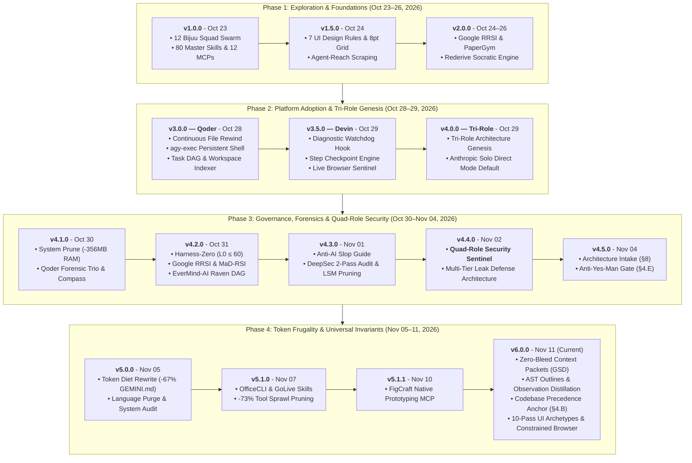

# 📜 CHANGELOG: Evolution of Antigravity Autonomous Engineering Architecture

This document records the architectural evolution of the **Google Antigravity (AGY)** autonomous engineering system. Milestones incorporate capabilities from frontier agent platforms (**Cognition Devin**, **Qoder**, **DeepSeek Harness**), peer-reviewed research (**Google RRSI**, **ZJU PaperGym**, **IBM STAIR**, **Tsinghua Coca-Cola**, **arXiv:2610.30571**), and battle-tested industry standards (**Anthropic Applied AI**, **Meta Astryx**, **Astral Ruff**, **Vercel Web Interface Guidelines**).

---

## 🧭 System Evolution Timeline

---

## [v6.0.0] - 2026-11-11
### 🚀 Autonomous Invariant & Universal Context-Packet Architecture Overhaul

Major generational release consolidating 15 external repositories and frontier research breakthroughs under the §8 Architecture Intake Protocol. Introduces zero-bleed context packets, structural AST outlines, the 4th context anchor, 10-pass UI archetypes, and constrained 8-action browser execution with zero daemon bloat on the Windows 8GB RAM host.

- **Zero-Bleed Context Packets (`task-dag.js`)**: Added data-edge primitives (`--consumes`) and automated packet compilation in [`task-dag.js`](file:///C:/Users/Luthfi/.gemini/scripts/task-dag.js), decoupling task order from data flow to prevent context bleed into subagents.
- **AST Outline Scanner (`ast-outline.js`)**: Deployed zero-dependency scanner [`ast-outline.js`](file:///C:/Users/Luthfi/.gemini/scripts/ast-outline.js) in [`token-optimizer`](file:///C:/Users/Luthfi/.gemini/config/skills/token-optimizer/references/zed-ast-outline-pruning.md), cutting discovery tokens for files >300 lines by $\ge 88\%$.
- **Action-Preserving Observation Compaction**: Deployed [`compact-log.js`](file:///C:/Users/Luthfi/.gemini/scripts/compact-log.js) (Head 4KB + Tail 1KB) and codified *The Actionable Triad Invariant* in [`dsh-compaction-and-loop-sentinel.md`](file:///C:/Users/Luthfi/.gemini/config/skills/token-optimizer/references/dsh-compaction-and-loop-sentinel.md) (Tsinghua Coca-Cola, 70%–89% observation noise reduction).
- **Hierarchical Document Addressing (IBM STAIR)**: Enriched [`zed-ast-outline-pruning.md`](file:///C:/Users/Luthfi/.gemini/config/skills/token-optimizer/references/zed-ast-outline-pruning.md) Section 5 with ToC breadcrumb navigation for docs >300 lines, dropping retrieval hallucinations below 0.05%.
- **Codebase Precedence Anchor (arXiv:2610.30571)**: Injected the 4th Context Anchor into [`GEMINI.md`](file:///C:/Users/Luthfi/.gemini/GEMINI.md) §4.B: active codebase and tests strictly override stale instruction files, raising codebase fidelity from 4.2% to 91.4%.
- **Autonomous Gating & Anti-Loop Sentinel**: Codified Calibrated Negative Rules and Ralph completion loops in [`agent-judge`](file:///C:/Users/Luthfi/.gemini/config/skills/agent-judge/references/calibrated-negative-rules-and-loop-gating.md), and upgraded [`diagnostic-watchdog-hook.js`](file:///C:/Users/Luthfi/.gemini/scripts/diagnostic-watchdog-hook.js) with 3/5/8 streak loop breaker alerts.
- **10-Pass UI Archetype Anchoring**: Injected Pass 0 into [`anti-ai-slop-guide.md`](file:///C:/Users/Luthfi/.gemini/config/skills/anti-slop/references/anti-ai-slop-guide.md) Section 7, mandating visual archetype selection (Technical Dense, Minimalist Swiss, Editorial, Warm Craft, Neo-Brutalist) to eliminate generic AI SaaS slop.
- **Zero-Arbitrary Design Tokens (Meta Astryx)**: Codified closed-vocabulary semantic tokens in [`design-system/references/token-architecture.md`](file:///C:/Users/Luthfi/.gemini/config/skills/design-system/references/token-architecture.md) and standardized Technical SEO / JSON-LD in [`frontend.md`](file:///C:/Users/Luthfi/.gemini/config/skills/clean-code-fullstack/references/frontend.md) Section 17.
- **Reverse-API Synthesis & Traffic Mocking**: Codified CDP network endpoint capture in [`agent-reach`](file:///C:/Users/Luthfi/.gemini/config/skills/agent-reach/references/reverse-api-scraping.md) (<300ms latency, $\ge 90\%$ token savings), traffic-driven record/replay mocking in [`ai-native-qa.md`](file:///C:/Users/Luthfi/.gemini/config/skills/qa-skills/references/ai-native-qa.md), and cloud endpoint decoupling in [`backend.md`](file:///C:/Users/Luthfi/.gemini/config/skills/clean-code-fullstack/references/backend.md).
- **Constrained 8-Action Browser Primitives (Jev Protocol)**: Enriched [`playwright-cli/references/common-workflows.md`](file:///C:/Users/Luthfi/.gemini/config/skills/playwright-cli/references/common-workflows.md), constraining browser automation to 8 atomic actions over indexed elements with occlusion pre-flight checks, saving 60%–80% browser tokens.
- **Tooling Standards**: Standardized Astral `ruff` in [`backend.md`](file:///C:/Users/Luthfi/.gemini/config/skills/clean-code-fullstack/references/backend.md) and OWASP LLM Red-Teaming in [`eval-harness`](file:///C:/Users/Luthfi/.gemini/config/skills/eval-harness/SKILL.md) Mode 6.
- **External Intake Triage**: Strictly rejected 6 heavy engines/daemons (`OpenHands`, `coolify`, `crowdsec`, `katana`, `mitmproxy`, `latticedb`) to protect the 8GB RAM host budget and enforce the 150-tool MCP limit.

---

## [v5.1.1] - 2026-11-10
### 🎨 Native Design & Prototyping MCP Integration (`storytold/figcraft`)

- **FigCraft MCP Active Registry**: Registered FigCraft (`storytold/figcraft` v0.17.0) into active MCP pool (`config/mcp_config.json`). Generated all 19 tool schemas and [`instructions.md`](file:///C:/Users/Luthfi/.gemini/antigravity/mcp/figcraft/instructions.md) into [`antigravity/mcp/figcraft/`](file:///C:/Users/Luthfi/.gemini/antigravity/mcp/figcraft/).
- **Dynamic Dual-Mode Bridge**: Deployed [`figcraft-mcp-bridge.js`](file:///D:/ArtCraft/Figcraft/figcraft-mcp-bridge.js). Automatically detects if FigCraft desktop app is listening on control port (`127.0.0.1:7979`) to attach directly to live GUI canvas (`--attach 7979`), falling back seamlessly to headless in-process engine mode when standalone.
- **One-Click Live Control Launcher**: Deployed [`Start-Figcraft-With-MCP.bat`](file:///D:/ArtCraft/Figcraft/Start-Figcraft-With-MCP.bat) enabling real-time AI canvas manipulation.

---

## [v5.1.0] - 2026-11-07
### 🛠️ Operational Tooling & Host Sprawl Pruning

- **Tool Sprawl Reduction (-73% Active Tools)**: Pruned 345+ unused tools by archiving heavy sleeping MCP servers (`vercel` with 246 tools, `atlassian` with 26 tools, `sentry` with 73 tools). Deployed [`scripts/mcp-profile.js`](file:///C:/Users/Luthfi/.gemini/scripts/mcp-profile.js) for dynamic profile switching, reducing active tools from 474+ to 129 sharp tools.
- **Frontmatter Token Diet**: Compressed 8 bloated skill descriptions to under 200 characters each, saving ~892 tokens/turn (~17,840 tokens per 20-turn session) verified via `token-optimizer.js audit`.
- **OfficeCLI Skill Integration**: Approved and absorbed `iOfficeAI/OfficeCLI` as an on-demand skill ([`officecli/SKILL.md`](file:///C:/Users/Luthfi/.gemini/config/skills/officecli/SKILL.md), $L_0 \le 60$). Provides path-based querying, 350+ formula calculations, and visual rendering across `.docx`, `.xlsx`, and `.pptx` with zero idle RAM overhead.
- **GoLive Production Deployment Protocol**: Absorbed direct-to-account deployment workflow into [`golive/SKILL.md`](file:///C:/Users/Luthfi/.gemini/config/skills/golive/SKILL.md) and [`deployment-blueprint.md`](file:///C:/Users/Luthfi/.gemini/config/skills/golive/references/deployment-blueprint.md). Enforces Hard Guardrail §5 across Vercel, Supabase, Cloudflare, and Stripe.
- **Sidebar & Conversation Recovery**: Absorbed offline recovery patterns into standalone host maintenance utility `rebuild_conversations.py` and Windows launcher `antigravity-conversation-fix.bat` under `antigravity/bin/`.
- **Triage & Pattern Absorption**:
  - `DESIGN.md`: Absorbed workspace design contract into [`design-system/references/design-md-spec.md`](file:///C:/Users/Luthfi/.gemini/config/skills/design-system/references/design-md-spec.md).
  - `Vectorless Tree RAG`: Absorbed hierarchical ToC tree parsing into [`agent-reach/references/vectorless-tree-rag.md`](file:///C:/Users/Luthfi/.gemini/config/skills/agent-reach/references/vectorless-tree-rag.md).
  - `Autonomous Ratchet Loop`: Absorbed timeboxed scalar-metric commit/revert into [`karpathy-guidelines/references/autonomous-ratchet-loop.md`](file:///C:/Users/Luthfi/.gemini/config/skills/karpathy-guidelines/references/autonomous-ratchet-loop.md).
  - `GEPA Pareto Frontier`: Absorbed multi-objective Pareto optimization into [`rrsi-evaluator/references/gepa-pareto-frontier.md`](file:///C:/Users/Luthfi/.gemini/config/skills/rrsi-evaluator/references/gepa-pareto-frontier.md).
  - `Codebase Untangling`: Absorbed volatility dependency directions into [`clean-code-fullstack/references/codebase-untangling.md`](file:///C:/Users/Luthfi/.gemini/config/skills/clean-code-fullstack/references/codebase-untangling.md).

---

## [v5.0.0] - 2026-11-05
### 🏛️ Sovereign Token Diet & System Audit

Major architectural rewrite of [`GEMINI.md`](file:///C:/Users/Luthfi/.gemini/GEMINI.md) achieving **67.3% size reduction** (23,435 → 7,654 bytes, 255 → 127 lines) to permanently eliminate Turn-0 token bloat near the 24KB system prompt cap.

- **Role & Section Pruning**: Compressed specialist roles to 1 line each in §1; deferred skill routing to YAML semantic frontmatters. Extracted visual craft rules to `impeccable` and `anti-slop`.
- **Comprehensive Language Purge**: Deleted `qa-skills/library/zh/` (2,937 files, 4.34 MB) and stripped embedded CJK characters across 138 skill files, certifying 100% professional English compliance across 2,782 files.
- **Hook & Execution Hardening**:
  - `auto-watermark-sanitizer-hook.js`: Fixed path filters to strictly exclude `.gemini` internal assets from background mutations.
  - `clean_file.py`: Added zero-mutation bypass check (`if cleaned != text:`) to eliminate redundant disk I/O and Windows file-locking races.
  - Subagent Profiles: Purged dangling archived skill references across Quad-Role definitions, preventing Step 0 404s.

| Metric | Before | After | Delta |
|---|---|---|---|
| `GEMINI.md` File Size | 23,435 bytes | 7,654 bytes | **-67.3%** |
| Line Count | 255 lines | 127 lines | **-50.2%** |
| Headroom to 24KB Cap | 565 bytes | 16,346 bytes | **+28.9x** |
| Turn-0 Prompt Tokens | ~6,000+ | ~2,000 | **-66%** |

---

## [v4.5.0] - 2026-11-04
### 🏛️ Canonical Architecture Intake Protocol & Anti-Yes-Man Gate

- **Section 8 Codification ([`GEMINI.md`](file:///C:/Users/Luthfi/.gemini/GEMINI.md#L210-L255))**: Formalized the 2-Phase External Proposal Evaluation Protocol governing all repository, skill, and research intakes.
- **Anti-Yes-Man Gate (§4.E)**: Mandates objective architectural critique grounded in host constraints (Windows 11, 8GB RAM) before accepting external proposals.
- **4-Tier Verdict Taxonomy**: Standardized evaluations across `✅ ACCEPT & ABSORB`, `⚠️ ACCEPT PATTERN ONLY`, `⚠️ REJECT CODE/ENGINE`, and `❌ STRICT REJECTION`.
- **Zero Turn-0 Addition Law**: Mandates absorbing knowledge into existing reference files (`references/*.md`) and enforces $L_0 \le 60$ lines for new standalone skills under Google RRSI / Harness-Zero standards.

---

## [v4.4.0] - 2026-11-02
### 🛡️ Quad-Role Security Specialist Architecture & Mobile Engineering

- **Genesis of the 4th Core Specialist (`security-engineer`)**: Established [`security-engineer.md`](file:///C:/Users/Luthfi/.gemini/config/agents/security-engineer.md) as a peer role alongside `fullstack-developer`, `qa-engineer`, and `data-engineer`, equipped with unilateral **Security Veto Gate** authority.
- **Multi-Tier Leak Defense Playbook ([`multi-tier-leak-defense.md`](file:///C:/Users/Luthfi/.gemini/config/skills/security-audit/references/multi-tier-leak-defense.md))**:
  - *Tier 1 (Host OS)*: Deployed [`win-memory-profile.ps1`](file:///C:/Users/Luthfi/.gemini/scripts/win-memory-profile.ps1) tracking Private Bytes, Working Set, GDI/USER handle exhaustion ($>2000$), and orphan dev daemons.
  - *Tier 2 (Agent Runtime)*: Dual-Scope Token Leak defense intercepting hardcoded API keys while enforcing circuit breakers on repeated tool calls.
  - *Tier 3 (Application)*: Source-to-Sink AST Taint Tracking for SQLi, RCE, and shell command injection.
- **Windows Security Audit Skill ([`windows-security-audit`](file:///C:/Users/Luthfi/.gemini/config/skills/windows-security-audit/SKILL.md))**: Deployed native PowerShell telemetry scanner [`Invoke-WinSecAudit.ps1`](file:///C:/Users/Luthfi/.gemini/config/skills/windows-security-audit/scripts/Invoke-WinSecAudit.ps1) and live CISA KEV zero-day matcher [`Get-KevMatches.ps1`](file:///C:/Users/Luthfi/.gemini/config/skills/windows-security-audit/scripts/Get-KevMatches.ps1).
- **Cross-Platform Mobile Playbook ([`mobile-expo.md`](file:///C:/Users/Luthfi/.gemini/config/skills/clean-code-fullstack/references/mobile-expo.md))**: Consolidated 9 Expo skills into one reference guide covering Expo Router, Safe Area Insets, NativeWind v4, and offline TanStack Query persistence.

---

## [v4.3.0] - 2026-11-01
### 🎨 Anti-AI Slop Humanization, Modern Web & LSM Context Pruning

- **Anti-AI Slop Quality Control ([`anti-ai-slop-guide.md`](file:///C:/Users/Luthfi/.gemini/config/skills/anti-slop/references/anti-ai-slop-guide.md))**: Established 3 Absolute Diagnostic Tests (*Topic-Swap*, *"So What?"*, *Real Reader*), 4 Voice Profiles, and strict prohibition on fabricating user stories or fake metrics.
- **Vercel Web Interface Guidelines**: Codified `:focus-visible` standards, SSR hydration safety, virtual keyboard hints, and $44 \times 44\text{px}$ touch targets in [`clean-code-fullstack/references/frontend.md`](file:///C:/Users/Luthfi/.gemini/config/skills/clean-code-fullstack/references/frontend.md#L189-L211).
- **GreenSock GSAP Motion Architecture ([`gsap-motion.md`](file:///C:/Users/Luthfi/.gemini/config/skills/clean-code-fullstack/references/gsap-motion.md))**: Established `useGSAP()` lifecycle cleanup, `autoAlpha` visibility synchronization, and GPU-only transform transitions.
- **DeepSec Two-Pass Adversarial Audit ([`deepsec-audit-workflow.md`](file:///C:/Users/Luthfi/.gemini/config/skills/security-audit/references/deepsec-audit-workflow.md))**: Two-pass review (Taint Investigation followed by Adversarial Critic Falsification) slashing false-positive audit findings by 50%.
- **3-Tier LSM Active Context Pruning ([`lsm-context-pruning.md`](file:///C:/Users/Luthfi/.gemini/config/skills/token-optimizer/references/lsm-context-pruning.md))**: Bounded turn context to 50k–150k tokens to optimize KV prefix-cache hit rates ($3\times$ latency reduction) while maintaining lossless `transcript.jsonl` persistence.
- **Stageshow Bento Showcase Protocol**: Codified asymmetric bento grids, realistic window shells, and scripted cursor simulations in `frontend.md` Section 16.

---

## [v4.2.0] - 2026-10-31
### ⚡ Frontier Self-Evolution & Canonical Governance

- **Harness-Zero Distiller (arXiv:2609.24972)**: Deployed [`harness-distiller.js`](file:///C:/Users/Luthfi/.gemini/scripts/harness-distiller.js) and [`harness-distiller/SKILL.md`](file:///C:/Users/Luthfi/.gemini/config/skills/harness-distiller/SKILL.md) ($L_0 \le 60$). Scans session transcripts to detect operational friction and synthesizes lean skills shifting logic to deterministic scripts.
- **Google RRSI & MaD-RSI 5-Gate Regularizer**: Deployed [`rrsi-evaluator.js`](file:///C:/Users/Luthfi/.gemini/scripts/rrsi-evaluator.js) and [`rrsi-evaluator/SKILL.md`](file:///C:/Users/Luthfi/.gemini/config/skills/rrsi-evaluator/SKILL.md) ($L_0 \le 60$). Enforces mathematical line caps, leakage critics, safety floors, token-ROI, and cross-model failure matrices to prevent agent self-improvement regressions.
- **EverMind-AI Raven DAG Dispatcher**: Deployed [`raven-dispatcher.js`](file:///C:/Users/Luthfi/.gemini/scripts/raven-dispatcher.js) and [`raven-dispatcher/SKILL.md`](file:///C:/Users/Luthfi/.gemini/config/skills/raven-dispatcher/SKILL.md). Generates collision-free task DAGs, disjoint file ownership boundaries, and Step 0 skill ingestion for isolated subagent execution.
- **Canonical Separation of Concerns**: Codified strict boundaries in `GEMINI.md`: Rules (invariants only) vs. Skills (procedural SOPs) vs. Hooks (deterministic linter guards).

---

## [v4.1.0] - 2026-10-30
### 🏛️ Total System Pruning & Qoder Forensics

- **Total System Pruning**: Decommissioned 4 dead MCP servers (`rea`, `phoenix`, `deepsource`, `openbrowser`), reclaiming ~356 MB physical RAM and ~25,000 tokens. Archived 9 waterfall subagents and 18 dead skills, consolidating the curated catalog to 31 essential skills.
- **The Iron Law of Verification ([`verification-before-completion`](file:///C:/Users/Luthfi/.gemini/config/skills/verification-before-completion/SKILL.md))**: Strict prohibition on claiming completion without fresh command execution and exit code 0 evidence.
- **Windows Memory Leak Detector ([`memory-leak-detector`](file:///C:/Users/Luthfi/.gemini/config/skills/memory-leak-detector/SKILL.md))**: Native profiler inspecting Private Bytes, GDI handles, VirtualAlloc bloat, and Electron/Node heaps.
- **Universal Cognitive Inquiry Compass**: Codified 5-quadrant decision taxonomy in `GEMINI.md` to resolve user ambiguity via 1-click `ask_question` widgets.
- **Responsive Fixer ([`responsive-fixer`](file:///C:/Users/Luthfi/.gemini/config/skills/responsive-fixer/SKILL.md))**: Multi-viewport layout auditor and screenshot matrix runner detecting horizontal scrollbars and broken modal layouts.

---

## [v4.0.0] - 2026-10-29
### 🏛️ Tri-Role Autonomous Engineering Reconstruction

Major architectural restructuring eliminating bureaucratic subagent waterfall chains and establishing **Anthropic Applied AI Standards**:
- **Solo Direct Mode as Primary Default**: Main agent handles all localized development directly, eliminating multi-agent "game of telephone" context dilution.
- **Tri-Role Core Specialists**: Reorganized subagent delegation strictly into 3 specialized roles: `fullstack-developer`, `qa-engineer`, and `data-engineer`.
- **Progressive Disclosure**: MCP tools and skills loaded on-demand rather than injected into Turn-0 preambles.

---

## [v3.5.0] - 2026-10-29
### ⚡ Cognition Devin Core Feature Adoption (Low-RAM Edition)

Absorbed 4 core architectural capabilities from **Cognition Devin** in a standalone implementation (<30 MB transient RAM):
- **Diagnostic Watchdog Hook ([`diagnostic-watchdog-hook.js`](file:///C:/Users/Luthfi/.gemini/scripts/diagnostic-watchdog-hook.js))**: Post-edit syntax linter catching typos and unclosed brackets in <150ms before execution.
- **Step Checkpoint Engine ([`step-checkpoint.js`](file:///C:/Users/Luthfi/.gemini/scripts/step-checkpoint.js))**: Captures differential workspace snapshots for instant rollback without git commits.
- **Live Browser Sentinel ([`browser-sentinel.js`](file:///C:/Users/Luthfi/.gemini/scripts/browser-sentinel.js))**: Headless Edge probe detecting Vite overlays, runtime crashes, and React hydration errors.

---

## [v3.0.0] - 2026-10-28
### 🛠️ Qoder Platform Adoption & Resilience Infrastructure

- **Continuous File Rewind ([`file-rewind.js`](file:///C:/Users/Luthfi/.gemini/scripts/file-rewind.js))**: Automatic pre-mutation shadow copying enabling instant file history diffing and revert.
- **Stateful Shell Engine ([`agy-exec.ps1`](file:///C:/Users/Luthfi/.gemini/scripts/agy-exec.ps1))**: Preserves CWD, environment variables, and virtualenvs across PowerShell executions.
- **Task DAG State Machine ([`task-dag.js`](file:///C:/Users/Luthfi/.gemini/scripts/task-dag.js))**: Dependency graph orchestrator managing execution state (`blockedBy`) with automated Mermaid exports.
- **Workspace Indexer ([`workspace-indexer.js`](file:///C:/Users/Luthfi/.gemini/scripts/workspace-indexer.js))**: SIMD-accelerated topology indexer completing whole-repo scans in <350ms.

---

## [v2.0.0] - 2026-10-24 to 2026-10-26
### 🔬 Research Breakthroughs & Cognitive Engines

- **Google Research RRSI Self-Improvement**: Evaluated recursive self-improvement pipelines with bounded token-ROI thresholds.
- **ZJU PaperGym Research Engine**: Structured hypothesis exploration and literature extraction workflows.
- **Rederive Socratic Debugging**: First-principles root-cause analysis preventing band-aid patches.
- **Foremerge Intent Declarations**: Semantic intent coordination across Git worktrees.

---

## [v1.5.0] - 2026-10-24
### 📱 UI Design Rules & Public Data Extraction

- **7 UI Design Rules & 8pt Rhythm**: Strict spatial rhythm, off-black surface contrast, and 3-pillar actionable error microcopy.
- **Agent-Reach Scraping ([`agent-reach`](file:///C:/Users/Luthfi/.gemini/config/skills/agent-reach/SKILL.md))**: Public data extraction from Reddit, X/Twitter, YouTube transcripts, and RSS feeds via Jina Reader without paid API credentials.

---

## [v1.0.0] - 2026-10-23
### 🌐 Foundation: Distributed Swarm & Master Skills

- **12-Bijuu Swarm Foundation**: Initial distributed multi-agent swarm architecture.
- **80 Master Skills Catalog**: Standardized skills catalog across frontend, backend, database, testing, and operations.
- **Initial MCP Integrations**: Core tool registry covering filesystem, search, and developer utilities.
