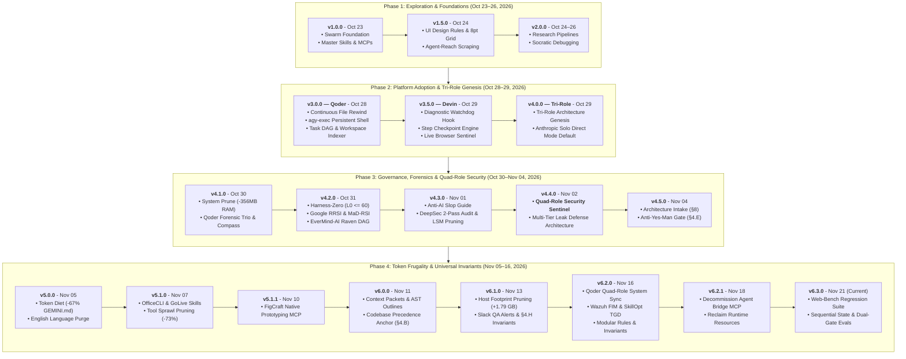

# CHANGELOG: Antigravity Autonomous Engineering System

All notable changes to the system are documented in this file.

### Changelog Conventions
- **Daily Version Escalation**: Exactly one version entry per calendar day (`YYYY-MM-DD`). The version tier reflects the day's highest-magnitude change:
  - `Patch (x.y.Z)`: Bug fixes, minor documentation updates, or internal refactors.
  - `Minor (x.Y.0)`: New features, scripts, skills, CLI wrappers, or rules.
  - `Major (X.0.0)`: Breaking architectural changes or complete structural rewrites.
  *(If changes begin as a patch at 01:00 but a minor/major update follows at 10:00, the day's release is escalated to `x.1.0` or `1.0.0` to reflect the highest impact).*
- **Anti-Slop Writing Standard**: Keep entries concise, direct, and factual. No marketing fluff, academic hype, or nested bullet sprawl. Flat bullet points using standard categories: `Added`, `Changed`, `Fixed`, `Removed`, `Optimized`.
- **Pattern**: `- **Target**: [Verb] [exact change] [direct impact / file link].`

---

## 🧭 System Evolution Timeline

---

## [v6.3.0] - 2026-11-21
### Web-Bench & Agent Skill Evaluation Ecosystem Absorption

### Added
- **Web-Bench Regression Suite (`bench-runner.js`)**: Built standalone zero-dependency evaluation runner in [`~/.gemini/scripts/bench-runner.js`](file:///C:/Users/Luthfi/.gemini/scripts/bench-runner.js) supporting multi-trial evaluation (`k >= 1`), historical regression tracking, and static token hygiene audit.
- **Benchmark Task Suites**: Authored 3 structured benchmark datasets in [`~/.gemini/benchmarks/`](file:///C:/Users/Luthfi/.gemini/benchmarks/):
  - `core-rules.jsonl`: Automated audit of GEMINI.md line/size ceilings, Quad-Role definitions, Universal Operational Invariants (§4.H), and Node.js script syntax integrity.
  - `code-sequential.jsonl`: ByteDance Web-Bench pattern enforcing multi-step sequential state dependency ($N \to N+1$) across TypeScript API contracts, optimistic UI rollbacks, and 4 UI states.
  - `browser-resilience.jsonl`: Halluminate & TIGER-AI-Lab patterns enforcing browser action taxonomy (`READ`, `CRUD`), interstitial modal dismissal, dual-gate visual SSIM / semantic DOM, and anti-bot challenge boundaries.
- **Eval Harness Architecture Framework**: Authored reference document [`web-bench-absorption-framework.md`](file:///C:/Users/Luthfi/.gemini/config/skills/eval-harness/references/web-bench-absorption-framework.md) formalizing the absorption of ByteDance, TIGER-AI-Lab, and Halluminate research into Mode 2 deterministic test pipelines.
- **Skill Judge 6-Dimension & Empirical Lift Framework**: Upgraded [`skill-judge-rubric.md`](file:///C:/Users/Luthfi/.gemini/config/skills/eval-harness/references/skill-judge-rubric.md) absorbing Evol-ai (`SkillCompass`) Weakest-Link Diagnosis ($\min(D_1 \dots D_6) \ge 4$), NVIDIA (`SkillEvaluator`) empirical Skill Lift and semantic overlap analysis, MrBinnacle (`skill-harness`) invocation attributability checks, and Qiaomu/ALEX-nlp negative trigger distractor suites.
- **Static Skill Structure Linter**: Enhanced [`token-optimizer.js`](file:///C:/Users/Luthfi/.gemini/scripts/token-optimizer.js) with Krusty84 (`SKILL.md-Inspector`) relative link verification and frontmatter structural auditing.
- **Mandatory Benchmark SOP Codification**: Codified mandatory pre-commit verification gate in [`GEMINI.md`](file:///C:/Users/Luthfi/.gemini/GEMINI.md) (§7 & §8) and [`verification-before-completion`](file:///C:/Users/Luthfi/.gemini/config/skills/verification-before-completion/SKILL.md), enforcing `bench-runner.js audit` + `bench-runner.js run` before any system commit.
- **PRD-to-Engineering Spec Decomposition Matrix**: Absorbed from `phuryn/pm-skills` into [`review-checklist.md`](file:///C:/Users/Luthfi/.gemini/config/skills/clean-code-fullstack/references/review-checklist.md), establishing a 3-layer decomposition flow (User Story $\to$ Deterministic Schema/Status Contract $\to$ Automated Assertion) and non-functional invariant gates.
- **Self-Authored Partitioning & Provenance Invariants**: Absorbed from `tigerless-labs/autoharness` into [`harness-engineering-pillars.md`](file:///C:/Users/Luthfi/.gemini/config/skills/harness-distiller/references/harness-engineering-pillars.md), locking automated skill learning to ephemeral sandboxes (`learned_skills/`), strictly barring machine mutation of human-authored root rules, and requiring immutable session provenance headers.
- **Anti-First-Choice & Moves Ledger Invariants**: Absorbed from `mankidev/antialgorithm` into [`anti-ai-slop-guide.md`](file:///C:/Users/Luthfi/.gemini/config/skills/anti-slop/references/anti-ai-slop-guide.md), establishing conscious rejection of top-1 statistically average AI tropes and non-repetition tracking.
- **Context SNR & Anti-Dump Gate**: Absorbed from `VolkanSah/Anti-Dump-Index` into [`GEMINI.md`](file:///C:/Users/Luthfi/.gemini/GEMINI.md) (§3), enforcing an empirical $\text{SNR} \ge 20\%$ threshold on raw terminal and log dumps to eliminate context saturation.
- **Agent-to-UI Event Lifecycle Schema**: Absorbed from `ag-ui-protocol/ag-ui` into [`frontend-api-integration/SKILL.md`](file:///C:/Users/Luthfi/.gemini/config/skills/frontend-api-integration/SKILL.md), codifying a 4-state event streaming contract between autonomous backends and frontend views.
- **Deterministic Rework Routing Gate**: Absorbed from `Tencent/LoopForge` into [`context-packet-spec-driven.md`](file:///C:/Users/Luthfi/.gemini/config/skills/task-dag/references/context-packet-spec-driven.md), isolating verification test failures to structured Rework Ticket Packets routed directly to target authoring nodes while preserving clean upstream states.
- **Think-in-Code & Script-First Extraction**: Absorbed from `mksglu/context-mode` and `Domush/antigravity-plugin-context-mode` into [`workspace-indexer/SKILL.md`](file:///C:/Users/Luthfi/.gemini/config/skills/workspace-indexer/SKILL.md), enforcing execution-first local filtering via scratch scripts to achieve ~98% context reduction on raw datasets.
- **Two-Level Automated Harness Evolution Framework**: Absorbed from Sylph.AI (`arXiv:2604.21003`) into [`harness-engineering-pillars.md`](file:///C:/Users/Luthfi/.gemini/config/skills/harness-distiller/references/harness-engineering-pillars.md), formalizing the Level 1 Worker-Evaluator-Evolution triad ($W_{\mathcal{H}}, V, E$) and Level 2 Meta-Evolution Blueprint ($\Lambda = [W_{\mathcal{H}}, \mathcal{H}^{(0)}, V, E]$) for rapid zero-human harness convergence on novel domains.
- **Log-to-Spec Ingestion & Peer-Review Refinement**: Absorbed from Google Cloud AI Research's PaperOrchestra (`arXiv:2604.05018`) into [`readme-craft/SKILL.md`](file:///C:/Users/Luthfi/.gemini/config/skills/readme-craft/SKILL.md), requiring all performance figures and benchmark claims in documentation to be parser-bound to physical execution logs with adversarial critique verification.
- **Lexical-First Retrieval & Grep-Over-Embeddings Hierarchy**: Absorbed from PwC Labs (`arXiv:2605.15184`) into [`rag-and-agent-eval-metrics.md`](file:///C:/Users/Luthfi/.gemini/config/skills/eval-harness/references/rag-and-agent-eval-metrics.md) and [`workspace-indexer/SKILL.md`](file:///C:/Users/Luthfi/.gemini/config/skills/workspace-indexer/SKILL.md), codifying empirical evidence that deterministic regex search outperforms dense vector embeddings by eliminating semantic drift, false friends, and vector DB RAM overhead.
- **MaxIM Dual-Gate Compaction & Incremental Summarization Invariant**: Absorbed from Google Research / Google DeepMind (`arXiv:2611.12825`) into [`rag-and-agent-eval-metrics.md`](file:///C:/Users/Luthfi/.gemini/config/skills/eval-harness/references/rag-and-agent-eval-metrics.md), [`context-packet-spec-driven.md`](file:///C:/Users/Luthfi/.gemini/config/skills/task-dag/references/context-packet-spec-driven.md), and [`memory-trimmer/SKILL.md`](file:///C:/Users/Luthfi/.gemini/config/skills/memory-trimmer/SKILL.md), establishing information-theoretic dual bounds (Predictive Sufficiency forward-utility and Recursive Consistency backward-grounding) to eliminate context hallucination and token waste.
- **Seven Canonical Subsystems of Production Harnesses**: Absorbed from Barbaste et al. (`arXiv:2609.00006`) into [`harness-engineering-pillars.md`](file:///C:/Users/Luthfi/.gemini/config/skills/harness-distiller/references/harness-engineering-pillars.md), codifying empirical source-code analysis of 11 production coding agents ($\text{Agent} = \text{Model} + \text{Harness}$) across the Agent Loop, LLM Provider Layer, Tools Sandbox, Memory Management, Safety Controls, Orchestration, and Extension Surfaces.
- **Offline Sleep & Synthetic Rehearsal Paradigm**: Absorbed from Behrouz et al. (Google Research, `arXiv:2606.03979`) into [`harness-engineering-pillars.md`](file:///C:/Users/Luthfi/.gemini/config/skills/harness-distiller/references/harness-engineering-pillars.md) and [`memory-trimmer/SKILL.md`](file:///C:/Users/Luthfi/.gemini/config/skills/memory-trimmer/SKILL.md), establishing a post-session memory consolidation protocol paired with synthetic regression rehearsal (`bench-runner.js run`) to prevent catastrophic forgetting.
- **Unified IT Soft Skills & Incident Orchestrator (`it-soft-skills`)**: Consolidated and translated 11 raw community skills from `it-soft-skills-agent.zip` into a single, high-efficiency English meta-skill [`it-soft-skills`](file:///C:/Users/Luthfi/.gemini/config/skills/it-soft-skills/SKILL.md) ($L_0 \le 60$ lines) and 4 modular reference guides ([`incident-protocol.md`](file:///C:/Users/Luthfi/.gemini/config/skills/it-soft-skills/references/incident-protocol.md), [`stakeholder-translation.md`](file:///C:/Users/Luthfi/.gemini/config/skills/it-soft-skills/references/stakeholder-translation.md), [`blameless-postmortem.md`](file:///C:/Users/Luthfi/.gemini/config/skills/it-soft-skills/references/blameless-postmortem.md), [`priority-matrix.md`](file:///C:/Users/Luthfi/.gemini/config/skills/it-soft-skills/references/priority-matrix.md)), establishing a 4-tier audience translation matrix, blameless post-mortem RCA with confidence calibration, and SEV 1-4 incident triage while saving ~85% Turn-0 prompt tokens.
- **Skill Activation & Trigger Calibration Benchmark Suite**: Added dedicated benchmark dataset [`skill-activation.jsonl`](file:///C:/Users/Luthfi/.gemini/benchmarks/skill-activation.jsonl) (4 test cases) integrating Evol-ai SkillCompass ($D_1 \ge 4$ anti-trigger validation), NVIDIA SkillEvaluator (telemetry attributability), Step 0 mandatory ingestion, and MrBinnacle negative distractor isolation to mathematically benchmark and enforce skill invocation reliability.

### Fixed
- **QA Skills Reference Broken Links**: Repaired dead links in [`qa-skills/SKILL.md`](file:///C:/Users/Luthfi/.gemini/config/skills/qa-skills/SKILL.md) pointing to nonexistent `_EN.md` reference variants detected by the upgraded static linter.

---

## [v6.2.1] - 2026-11-18
### Agent Bridge Decommissioning & MCP Runtime Cleanup

### Removed
- **Inter-Agent Bridge MCP Server**: Decommissioned `agent-bridge` service, terminated background Node.js daemon, unhooked configuration from `~/.gemini/config/mcp_config.json` and `~/.qoder/settings.json`, purged cached tool descriptors in Antigravity MCP cache, and archived repository assets to [`~/.agents-bridge-backup.zip`](file:///C:/Users/Luthfi/.agents-bridge-backup.zip).

---

## [v6.2.0] - 2026-11-16
### Qoder Quad-Role Architecture Synchronization & Frontier Engineering Standards

### Added
- **Zero-Dependency Inter-Agent Bridge & War Room Webview**: Built and deployed `agent-bridge` MCP server and real-time dashboard at `http://localhost:4444` using native Node.js v22 (`node:sqlite` in WAL mode + `node:http`), connecting Google Antigravity and Qoder Desktop over 9 MCP tools (`agent_join_room`, `agent_send_message`, `agent_read_room`, `agent_publish_state`, `agent_query_peer_state`, `agent_submit_proposal`, `agent_review_proposal`, `agent_sync_memory`, `agent_leave_room`) with 100% automated test coverage ([walkthrough.md](file:///C:/Users/Luthfi/.gemini/antigravity/brain/81557ba3-a41f-4dc1-998d-d1bb3f2f7b5a/walkthrough.md)).
- **Qoder Ecosystem Pruning & Disk Reclamation**: Executed deep pruning prompt ([`qoder-cleanup-audit-prompt.md`](file:///C:/Users/Luthfi/.qoder/qoder-cleanup-audit-prompt.md)) resulting in 12 non-compliant/dead plugins uninstalled, 24 redundant loose skills deduplicated, registry consolidated to 8 clean plugins, and 19.77 MB disk recovered with verified backup ([`ecosystem-prune-report-20261116.md`](file:///c:/Users/Luthfi/Documents/Qoder/2026-11-16/e836734d/ecosystem-prune-report-20261116.md)).
- **Qoder Live Operational Validation**: Confirmed full operational success of quad-role-engineering@local v1.0.0 via native Qoder runtime audit ([quad-role-engineering-root-cause-report.md](file:///c:/Users/Luthfi/Documents/Qoder/2026-11-16/e836734d/quad-role-engineering-root-cause-report.md)) with 24 skills, 4 specialist agents, 6 slash commands, and 16 MCP connectors live in session inventory.
- **PowerShell UTF-8 No-BOM & ZIP Forward-Slash Invariants**: Codified strict No-BOM UTF-8 writing ([System.Text.UTF8Encoding]::new($false)) and forward-slash ZIP entry pathing in [powershell-windows-patterns](file:///C:/Users/Luthfi/.gemini/config/skills/powershell-windows-patterns/SKILL.md) to eliminate silent parser corruption and manifest resolution failures in Electron/Node agent runtimes.
- **Qoder Local Plugin Packaging & Registration**: Packaged the Quad-Role Autonomous Engineering System as a formal local Qoder plugin ([`quad-role-engineering@local`](file:///C:/Users/Luthfi/.qoder/plugins/cache/local/quad-role-engineering/1.0.0/)), registering it in `installed_plugins_v2.json` and `settings.json` so all 24 skills, 4 agents, 4 rules, and 6 slash commands populate Qoder Desktop's **Extension Management** UI directly.
- **Qoder Quad-Role Specialist Architecture**: Exported, mapped, and verified 3 new custom agents ([`Full Stack Developer.md`](file:///C:/Users/Luthfi/.qoder/agents/Full%20Stack%20Developer.md), [`Data Engineer.md`](file:///C:/Users/Luthfi/.qoder/agents/Data%20Engineer.md), [`Security Sentinel.md`](file:///C:/Users/Luthfi/.qoder/agents/Security%20Sentinel.md)) and synchronized [`QA Engineer.md`](file:///C:/Users/Luthfi/.qoder/agents/QA%20Engineer.md) in `~/.qoder/agents/` matching Qoder schema (`name`, `description`, `permissionMode: auto`, `skills`, `mcpServers`).
- **Qoder Skill Porting & Sanitization**: Migrated 24 production-grade engineering skills into [`~/.qoder/skills/`](file:///C:/Users/Luthfi/.qoder/skills/), stripping non-standard tool tags, eliminating host-specific `.gemini` paths, purging `__pycache__`, and verifying 100% Agent Skills standard compliance across 34 active skills.
- **Qoder Modular Trigger-Based Rules**: Authored 4 progressive-disclosure rule files in [`~/.qoder/rules/`](file:///C:/Users/Luthfi/.qoder/rules/) (`core-invariants.md` [`always_on`], `typescript-frontend.md` [`glob`], `database-query-standards.md` [`glob`], `security-audit.md` [`model_decision`]), consuming only 12.7 KB (12.7%) of Qoder's 100 KB rule limit.
- **Qoder Master Architecture Invariants**: Upgraded [`~/.qoder/AGENTS.md`](file:///C:/Users/Luthfi/.qoder/AGENTS.md) with Quad-Role router assignments, Minimal Verifiable Blast Radius (MVBR), 4 UI States, Anti-Yes-Man double confirmation, and The Iron Law of Verification while preserving all owner-approved tie-breakers.
- **SkillOpt Optimization Principles**: Absorbed Microsoft Research `SkillOpt` methodology into [`harness-engineering-pillars.md`](file:///C:/Users/Luthfi/.gemini/config/skills/harness-distiller/references/harness-engineering-pillars.md), formalizing Trajectory-Driven Credit Assignment, surgical delta mutations, and validation-gated skill updates.
- **Wazuh FIM & LOLBin Correlation**: Absorbed Wazuh endpoint security heuristics into [`threat-matrix.md`](file:///C:/Users/Luthfi/.gemini/config/skills/windows-security-audit/references/threat-matrix.md), specifying File Integrity Monitoring (FIM) for agent/developer assets (`%USERPROFILE%\.gemini`, `%APPDATA%\antigravity\mcp`, `.ssh`) and Sysmon Event ID 1/3 correlation.
- **Rad Spacing Hierarchy (~40% Rule)**: Absorbed `nolanperk/rad-spacing` into [`token-architecture.md`](file:///C:/Users/Luthfi/.gemini/config/skills/design-system/references/token-architecture.md), codifying hierarchy nesting depth, the $1.4\times$ spacing progression, and standard semantic spacing scales (`spacing/xs` to `spacing/3xl`).
- **Design System Drift Audit**: Absorbed `edenspiekermann/Skills` audit protocols into [`token-architecture.md`](file:///C:/Users/Luthfi/.gemini/config/skills/design-system/references/token-architecture.md), establishing detection rules and remediation gates for unbound colors, arbitrary spacing, local overrides, and unlinked typography.
- **STRIDE Threat Modeling & Trust Boundaries**: Absorbed `inbharatai/claude-skills` (`threat-modeler`) into [`deepsec-audit-workflow.md`](file:///C:/Users/Luthfi/.gemini/config/skills/security-audit/references/deepsec-audit-workflow.md), codifying pre-implementation architectural threat analysis across 4 trust boundaries and DFDs.
- **Container Hardening Invariants**: Absorbed `inbharatai/claude-skills` (`dockerfile-builder` & `compose-creator`) into [`backend.md`](file:///C:/Users/Luthfi/.gemini/config/skills/clean-code-fullstack/references/backend.md), formalizing multi-stage build isolation, deterministic layer caching, non-root user execution (`UID > 0`), and healthchecks.
- **Enterprise RAG & Hybrid Search Pipeline**: Absorbed `inbharatai/claude-skills` (`rag-architect`) into [`backend.md`](file:///C:/Users/Luthfi/.gemini/config/skills/clean-code-fullstack/references/backend.md), establishing recursive chunking with 10–15% overlap, dense/sparse Reciprocal Rank Fusion (RRF), cross-encoder reranking, and Recall@K validation gates.
- **Tech Debt Churn Heuristic**: Absorbed `ksimback/tech-debt-skill` into [`codebase-untangling.md`](file:///C:/Users/Luthfi/.gemini/config/skills/clean-code-fullstack/references/codebase-untangling.md), establishing Git Churn $\cap$ High LOC 4-quadrant prioritization.
- **TLS Browser Impersonation**: Absorbed `lwthiker/curl-impersonate` into [`backend.md`](file:///C:/Users/Luthfi/.gemini/config/skills/clean-code-fullstack/references/backend.md), documenting JA3/JA4 anti-fingerprint extraction via `curl_cffi`.
- **HackerOne VRT & 7-Question Validation Gate**: Absorbed `elementalsouls/Claude-BugHunter` calibration patterns into [`deepsec-audit-workflow.md`](file:///C:/Users/Luthfi/.gemini/config/skills/security-audit/references/deepsec-audit-workflow.md), preventing severity inflation with 7-point falsification checks.
- **Thinker-Executor Plan Protocol**: Absorbed `shadcn/improve` methodology into [`review-checklist.md`](file:///C:/Users/Luthfi/.gemini/config/skills/clean-code-fullstack/references/review-checklist.md), establishing read-only planning audits and deterministic verification command mapping (`build`, `test`, `lint`, `type-check`).
- **Agent-Prescriptive Design Diagnostics**: Absorbed `@shadcn/lint` pattern into [`token-architecture.md`](file:///C:/Users/Luthfi/.gemini/config/skills/design-system/references/token-architecture.md), codifying prescriptive quick-fix recipes for arbitrary Tailwind brackets, component padding overrides, and raw hex colors.
- **Shannon Entropy Secret Detection**: Absorbed `Shigosag/GitShield` mathematical secret heuristics ($H \ge 4.5$) and lockfile masking into [`multi-tier-leak-defense.md`](file:///C:/Users/Luthfi/.gemini/config/skills/security-audit/references/multi-tier-leak-defense.md).
- **On-Demand Meta-Catalog Index**: Registered `VoltAgent/awesome-agent-skills` into [`ON_DEMAND_REGISTRY.md`](file:///C:/Users/Luthfi/.gemini/config/ON_DEMAND_REGISTRY.md) as the upstream reference catalog for 1,000+ official third-party SDK skills.
- **Production AI Agent Framework Rubric**: Documented canonical agent SDK selection standards in [`backend.md`](file:///C:/Users/Luthfi/.gemini/config/skills/clean-code-fullstack/references/backend.md), formalizing PydanticAI (type-safe Python), Google ADK (Gemini enterprise), LangGraph (cyclical graphs), and OpenAI Agents (handoffs).
- **Advanced RAG Retrieval Invariants**: Absorbed `run-llama/llama_index` patterns into [`backend.md`](file:///C:/Users/Luthfi/.gemini/config/skills/clean-code-fullstack/references/backend.md), establishing Sentence Window Retrieval (focal-context decoupling) and Auto-Merging Hierarchical Retriever (child-to-parent quorum thresholding).
- **Agentic Knowledge Graph & Temporal Memory Invariants**: Absorbed `getzep/graphiti` and `topoteretes/cognee` into [`backend.md`](file:///C:/Users/Luthfi/.gemini/config/skills/clean-code-fullstack/references/backend.md), formalizing Deterministic Ontology Blueprinting via Pydantic schemas, Bi-Temporal state modeling (`valid_time` vs `transaction_time`), causal edge invalidation, and zero-daemon embedded storage profiles (NetworkX/SQLite/LanceDB) to conserve host RAM.
- **Multimodal RAG & Cross-Modal Grounding**: Absorbed `HKUDS/RAG-Anything` patterns into [`backend.md`](file:///C:/Users/Luthfi/.gemini/config/skills/clean-code-fullstack/references/backend.md), establishing 4-stream Modality Decomposition (Text AST, Table HTML/Markdown, LaTeX equations, VLM image captions) and bidirectional co-reference binding to prevent data hallucination.
- **Structured Plan Annotation & State Gating**: Absorbed `backnotprop/plannotator` invariants into [`review-checklist.md`](file:///C:/Users/Luthfi/.gemini/config/skills/clean-code-fullstack/references/review-checklist.md), establishing the 4-phase Plan State Machine (`PROPOSED` $\rightarrow$ `CRITIQUED` $\rightarrow$ `REVISED` $\rightarrow$ `LOCKED`), structured review directives (`[REJECT]`, `[MODIFY]`, `[REPLACE]`), and execution write lock invariants.
- **Passive Exposure Recon Pipeline**: Absorbed `elementalsouls/Claude-OSINT` methodology into [`multi-tier-leak-defense.md`](file:///C:/Users/Luthfi/.gemini/config/skills/security-audit/references/multi-tier-leak-defense.md), codifying passive repository exposure audits (`.env*`, VCS artifacts, cloud stashes) and client bundle reachability triage (`dist/` vs internal server assets).
- **Deterministic Technical SEO Checklist**: Absorbed `AgriciDaniel/jev-seo` standards into [`frontend.md`](file:///C:/Users/Luthfi/.gemini/config/skills/clean-code-fullstack/references/frontend.md), establishing Google Search Central rules for single H1, strict heading hierarchy, zero internal redirects, descriptive image alt tags, and self-referencing canonicals.
- **RAG Triad & G-Eval Mathematical Formulations**: Absorbed `confident-ai/deepeval` metrics into [`rag-and-agent-eval-metrics.md`](file:///C:/Users/Luthfi/.gemini/config/skills/eval-harness/references/rag-and-agent-eval-metrics.md), formalizing mathematical formulations for Faithfulness, Answer Relevancy, Contextual Precision/Recall, and G-Eval probability-weighted scoring.
- **Production LLM Observability & OpenTelemetry Invariants**: Absorbed `langfuse/langfuse` and `comet-ml/opik` patterns into [`backend.md`](file:///C:/Users/Luthfi/.gemini/config/skills/clean-code-fullstack/references/backend.md), codifying 4-tier hierarchical span trees (Root $\rightarrow$ Turn $\rightarrow$ LLM $\rightarrow$ Tool), token & financial cost attribution, and non-blocking asynchronous export.
- **Confidence-Graded Dead Code Pruning Protocol**: Absorbed `vulture` static AST principles into [`codebase-untangling.md`](file:///C:/Users/Luthfi/.gemini/config/skills/clean-code-fullstack/references/codebase-untangling.md), establishing the 2-tier confidence filter (Tier 1: 100% confidence unreachable branches, private symbols, orphaned imports; Tier 2: dynamic framework callbacks with whitelist gates) and LOC-descending debt paydown (`--sort-by-size`).

### Optimized
- **Backend Reference Modularization**: Decoupled monolithic `backend.md` (26.5 KB $\rightarrow$ 17.1 KB) by extracting RAG and agentic systems into dedicated references [`rag-architecture.md`](file:///C:/Users/Luthfi/.gemini/config/skills/clean-code-fullstack/references/rag-architecture.md) and [`agentic-systems.md`](file:///C:/Users/Luthfi/.gemini/config/skills/clean-code-fullstack/references/agentic-systems.md), synchronizing Table of Contents and resolving the 24 KB ceiling violation.
- **Test Anti-Patterns L0 Refactoring**: Restructured `test-antipatterns` root from 844 lines down to 31 lines ($L_0 \le 60$), offloading the 29 KB catalog into [`antipattern-catalog.md`](file:///C:/Users/Luthfi/.gemini/config/skills/test-antipatterns/references/antipattern-catalog.md).

### Removed
- **Qoder Ecosystem Bloat & Duplicate Pruning**: Uninstalled 12 non-compliant/toy/duplicate Qoder marketplace plugins and purged 24 redundant loose skills ([ecosystem-prune-report-20261116.md](file:///c:/Users/Luthfi/Documents/Qoder/2026-11-16/e836734d/ecosystem-prune-report-20261116.md)), recovering 19.77 MB cache disk, eliminating dual-loading, and consolidating Qoder registry to 8 clean whitelisted plugins.
- **Chinese Duplicate References**: Purged redundant Chinese translation files in `qa-skills` (`skills-index.md`, `skills-graph.md`, `skills-composition.md`), promoting validated English versions to enforce the 100% English asset invariant (`GEMINI.md §4.G`).
- **Sprawled & Redundant Skills**: Archived 5 redundant skills (`api-contract-design`, `harness2`, `twg-jira`, `twg-confluence`, `twg-setup`) into `config/archive/skills/` to reduce active skill count.

### Changed
- **Evolution Graph**: Extended Phase 4 timeline to document consolidated `v6.1.1` release.

---

## [v6.1.0] - 2026-11-13
### Host Footprint Offloading & Enterprise QA Hardening

### Added
- **Slack QA Alerts**: Deployed PowerShell dispatcher [`slack-qa-notify.ps1`](file:///C:/Users/Luthfi/.gemini/scripts/slack-qa-notify.ps1) and wrapper `slack-qa-notify.cmd` to automate test execution, BVA validation, and Slack webhook defect reporting.
- **CLI Wrappers**: Added `twg.cmd` and `slack-qa-notify.cmd` to `antigravity/bin` for direct CLI access across subagents.
- **On-Demand Registry**: Published [`config/ON_DEMAND_REGISTRY.md`](file:///C:/Users/Luthfi/.gemini/config/ON_DEMAND_REGISTRY.md) as the single reference for optional skills and MCP servers.
- **Universal Operational Invariants**: Formalized §4.H in [`GEMINI.md`](file:///C:/Users/Luthfi/.gemini/GEMINI.md) covering Elephant-Goldfish Review, Minimal Verifiable Blast Radius (MVBR), Call-Graph Reachability, and Filesystem-First APIs.

### Changed
- **Deployment Strategy**: Standardized permanent free-tier hosting (Vercel CLI via `golive`, Supabase MCP, Render) and removed Railway 30-day trial dependency.
- **Skill References**: Updated QA workflows in [`ai-native-qa.md`](file:///C:/Users/Luthfi/.gemini/config/skills/qa-skills/references/ai-native-qa.md), review criteria in [`calibrated-negative-rules-and-loop-gating.md`](file:///C:/Users/Luthfi/.gemini/config/skills/agent-judge/references/calibrated-negative-rules-and-loop-gating.md), blast radius bounds in [`intent-anchoring-and-anti-rogue-armor.md`](file:///C:/Users/Luthfi/.gemini/config/skills/karpathy-guidelines/references/intent-anchoring-and-anti-rogue-armor.md), CVE triage in [`deepsec-audit-workflow.md`](file:///C:/Users/Luthfi/.gemini/config/skills/security-audit/references/deepsec-audit-workflow.md), and OpenAPI invariants in [`backend.md`](file:///C:/Users/Luthfi/.gemini/config/skills/clean-code-fullstack/references/backend.md).

### Removed
- **Desktop Applications**: Uninstalled GitHub Desktop and Postman Desktop (+1.38 GB disk, ~1.2 GB RAM reclaimed).
- **Redundant CLI Tools**: Uninstalled FFmpeg (~306 MB), 1Password CLI (~45 MB), Gitleaks (~22 MB), and Android Platform-Tools (~17 MB) via Revo Uninstaller (+390 MB reclaimed).
- **Legacy Skill Archives**: Purged `config/archive/skills/_legacy_archive` and `system-backup-20261029` (+26.8 MB reclaimed).
- **Postman Plugin**: Uninstalled marketplace plugin to eliminate Turn-0 token overhead; API testing offloaded to native `qa-engineer`.

### Optimized
- **TWG Skills**: Relocated 10 specialized extension junctions to archive, leaving only 4 active core skills (`twg`, `twg-jira`, `twg-confluence`, `twg-setup`).
- **Telemetry**: Pruned dead skill usage keys via `memory-trimmer.js trim` (-539 bytes).

---

## [v6.0.0] - 2026-11-11
### Context Packets, AST Outlines & Operational Invariants

### Added
- **Context Packets**: Added `--consumes` data-edge primitives and automated packet compilation in [`task-dag.js`](file:///C:/Users/Luthfi/.gemini/scripts/task-dag.js) to isolate subagent data flows.
- **AST Outline Scanner**: Deployed [`ast-outline.js`](file:///C:/Users/Luthfi/.gemini/scripts/ast-outline.js) in [`token-optimizer`](file:///C:/Users/Luthfi/.gemini/config/skills/token-optimizer/references/zed-ast-outline-pruning.md) to generate structural file summaries for files >300 lines.
- **Log Compactor**: Deployed [`compact-log.js`](file:///C:/Users/Luthfi/.gemini/scripts/compact-log.js) (Head 4KB + Tail 1KB) to compress long command outputs.
- **Codebase Precedence Anchor**: Added 4th context anchor to [`GEMINI.md`](file:///C:/Users/Luthfi/.gemini/GEMINI.md) §4.B: active codebase and tests strictly override stale documentation.
- **UI Archetype Anchoring**: Injected Pass 0 into [`anti-ai-slop-guide.md`](file:///C:/Users/Luthfi/.gemini/config/skills/anti-slop/references/anti-ai-slop-guide.md) Section 7 for early visual theme selection.

### Changed
- **Loop Sentinel**: Upgraded [`diagnostic-watchdog-hook.js`](file:///C:/Users/Luthfi/.gemini/scripts/diagnostic-watchdog-hook.js) with 3/5/8 streak loop breaker alerts.
- **Browser Workflows**: Constrained automation to 8 atomic actions over indexed elements in [`playwright-cli/references/common-workflows.md`](file:///C:/Users/Luthfi/.gemini/config/skills/playwright-cli/references/common-workflows.md).
- **Tooling Standards**: Standardized Astral `ruff` in [`clean-code-fullstack`](file:///C:/Users/Luthfi/.gemini/config/skills/clean-code-fullstack/references/backend.md) and OWASP red-teaming in [`eval-harness`](file:///C:/Users/Luthfi/.gemini/config/skills/eval-harness/SKILL.md).

### Fixed
- **Command Injection (SEC-2026-001)**: Replaced string interpolation in [`agy-exec.ps1`](file:///C:/Users/Luthfi/.gemini/scripts/agy-exec.ps1) with deterministic JSON deserialization and `-LiteralPath`.
- **Secret Leaks (SEC-2026-002 & SEC-2026-003)**: Sanitized leaked authorization token in scratch artifact and added secret regex filtering in `agy-exec.ps1`.
- **Path Traversal (SEC-2026-004)**: Added regex validation for `conversationId` across `task-dag.js`, `file-history-hook.js`, `file-rewind.js`, and `agy-exec.ps1`.
- **Protocol Boundary (SEC-2026-005)**: Added strict `http:/https:` protocol validation to [`browser-sentinel.js`](file:///C:/Users/Luthfi/.gemini/scripts/browser-sentinel.js).

### Removed
- **Unused MCP Supervisors**: Replaced `npx -y` wrapper scripts with direct `node` calls in `config/mcp_config.json` (-350 MB RAM).
- **Disk Waste**: Removed obsolete installer binaries and temp files (+723 MB reclaimed).
- **Deprecated Scripts**: Archived 5 obsolete scripts to `scripts/archive/` and 5 batch wrappers to `bin/archive/`.
- **Heavy Engines**: Rejected 6 background engines (`OpenHands`, `coolify`, `crowdsec`, `katana`, `mitmproxy`, `latticedb`) to respect the 8GB RAM host budget.

---

## [v5.1.1] - 2026-11-10
### FigCraft Native Prototyping MCP Integration

### Added
- **FigCraft MCP Registry**: Registered FigCraft v0.17.0 in `config/mcp_config.json` with 19 tool schemas and [`instructions.md`](file:///C:/Users/Luthfi/.gemini/antigravity/mcp/figcraft/instructions.md).
- **Dual-Mode Bridge**: Deployed [`figcraft-mcp-bridge.js`](file:///D:/ArtCraft/Figcraft/figcraft-mcp-bridge.js) supporting live GUI canvas attachment (`--attach 7979`) with fallback to headless mode.
- **Launcher Script**: Added [`Start-Figcraft-With-MCP.bat`](file:///D:/ArtCraft/Figcraft/Start-Figcraft-With-MCP.bat) for one-click canvas bridge startup.

---

## [v5.1.0] - 2026-11-07
### Operational Tooling & Host Sprawl Pruning

### Added
- **OfficeCLI Skill**: Added [`officecli/SKILL.md`](file:///C:/Users/Luthfi/.gemini/config/skills/officecli/SKILL.md) for querying, formula evaluation, and rendering of `.docx`, `.xlsx`, and `.pptx` files.
- **GoLive Skill**: Added [`golive/SKILL.md`](file:///C:/Users/Luthfi/.gemini/config/skills/golive/SKILL.md) for production deployment workflows across Vercel, Supabase, Cloudflare, and Stripe.
- **Conversation Recovery**: Added `rebuild_conversations.py` and `antigravity-conversation-fix.bat` under `antigravity/bin/`.

### Changed
- **Pattern Ingests**: Ingested design specs into [`design-system`](file:///C:/Users/Luthfi/.gemini/config/skills/design-system/references/design-md-spec.md), tree parsing into [`agent-reach`](file:///C:/Users/Luthfi/.gemini/config/skills/agent-reach/references/vectorless-tree-rag.md), and commit/revert loops into [`karpathy-guidelines`](file:///C:/Users/Luthfi/.gemini/config/skills/karpathy-guidelines/references/autonomous-ratchet-loop.md).

### Optimized
- **MCP Tool Pruning**: Archived heavy unused MCPs (`vercel`, `atlassian`, `sentry`), reducing active tools from 474+ to 129 via [`scripts/mcp-profile.js`](file:///C:/Users/Luthfi/.gemini/scripts/mcp-profile.js).
- **Frontmatter Budget**: Compressed 8 skill frontmatters to under 200 characters each, saving ~892 tokens per turn.

---

## [v5.0.0] - 2026-11-05
### Sovereign Token Diet & System Audit

### Changed
- **Instruction Optimization**: Restructured [`GEMINI.md`](file:///C:/Users/Luthfi/.gemini/GEMINI.md), cutting file size by 67.3% (23.4 KB to 7.6 KB, 255 to 127 lines) to eliminate Turn-0 token bloat.
- **Language Compliance**: Certified 100% English across all skills, rules, and scripts per §4.G; deleted legacy non-English files (+4.34 MB reclaimed).

### Fixed
- **Hook Isolation**: Added path exclusion in `auto-watermark-sanitizer-hook.js` to prevent mutations to internal `.gemini` assets.
- **I/O Race Prevention**: Added zero-mutation bypass check in `clean_file.py` to eliminate unnecessary disk writes.
- **Subagent Routing**: Removed broken archived skill paths from subagent definitions.

---

## [v4.5.0] - 2026-11-04
### Architecture Intake Protocol & Anti-Yes-Man Gate

### Added
- **Architecture Intake Protocol**: Codified Section 8 in [`GEMINI.md`](file:///C:/Users/Luthfi/.gemini/GEMINI.md) for 2-phase evaluation of external tools and research.
- **Anti-Yes-Man Gate**: Added §4.E mandating architectural critiques grounded in host constraints (Windows 11, 8GB RAM) before accepting external proposals.
- **Verdict Taxonomy**: Standardized 4-tier intake verdicts (`ACCEPT & ABSORB`, `ACCEPT PATTERN ONLY`, `REJECT CODE/ENGINE`, `STRICT REJECTION`).
- **Zero Turn-0 Addition Law**: Mandated knowledge absorption into existing reference files and enforced $L_0 \le 60$ lines for new skills.

---

## [v4.4.0] - 2026-11-02
### Quad-Role Security Architecture & Mobile Engineering

### Added
- **Security Specialist**: Established [`security-engineer.md`](file:///C:/Users/Luthfi/.gemini/config/agents/security-engineer.md) with unilateral Security Veto authority.
- **Multi-Tier Leak Defense**: Deployed [`multi-tier-leak-defense.md`](file:///C:/Users/Luthfi/.gemini/config/skills/security-audit/references/multi-tier-leak-defense.md) covering Host OS memory, Agent runtime token filtering, and AST taint analysis.
- **Windows Security Audit**: Added [`windows-security-audit`](file:///C:/Users/Luthfi/.gemini/config/skills/windows-security-audit/SKILL.md) with native PowerShell scanner [`Invoke-WinSecAudit.ps1`](file:///C:/Users/Luthfi/.gemini/config/skills/windows-security-audit/scripts/Invoke-WinSecAudit.ps1) and CISA KEV matcher.
- **Mobile Engineering Guide**: Consolidated 9 Expo skills into [`mobile-expo.md`](file:///C:/Users/Luthfi/.gemini/config/skills/clean-code-fullstack/references/mobile-expo.md).

---

## [v4.3.0] - 2026-11-01
### Anti-AI Slop Humanization & Context Pruning

### Added
- **Anti-AI Slop Standards**: Established [`anti-ai-slop-guide.md`](file:///C:/Users/Luthfi/.gemini/config/skills/anti-slop/references/anti-ai-slop-guide.md) with Topic-Swap, So What?, and Real Reader tests.
- **Web Interface Guidelines**: Codified `:focus-visible`, SSR hydration safety, and 44x44px touch targets in [`clean-code-fullstack`](file:///C:/Users/Luthfi/.gemini/config/skills/clean-code-fullstack/references/frontend.md).
- **GSAP Motion Guide**: Codified animation lifecycle cleanup and GPU transform standards in [`gsap-motion.md`](file:///C:/Users/Luthfi/.gemini/config/skills/clean-code-fullstack/references/gsap-motion.md).
- **Two-Pass Security Audit**: Added adversarial verification workflow in [`deepsec-audit-workflow.md`](file:///C:/Users/Luthfi/.gemini/config/skills/security-audit/references/deepsec-audit-workflow.md).

### Optimized
- **Context Pruning**: Bounded active turn context to 50k–150k tokens in [`lsm-context-pruning.md`](file:///C:/Users/Luthfi/.gemini/config/skills/token-optimizer/references/lsm-context-pruning.md) for higher cache hit rates.

---

## [v4.2.0] - 2026-10-31
### Frontier Self-Evolution & Canonical Governance

### Added
- **Harness Distiller**: Deployed [`harness-distiller.js`](file:///C:/Users/Luthfi/.gemini/scripts/harness-distiller.js) and [`harness-distiller`](file:///C:/Users/Luthfi/.gemini/config/skills/harness-distiller/SKILL.md) to synthesize lean skills from transcript friction.
- **RRSI Regularizer**: Deployed [`rrsi-evaluator.js`](file:///C:/Users/Luthfi/.gemini/scripts/rrsi-evaluator.js) and [`rrsi-evaluator`](file:///C:/Users/Luthfi/.gemini/config/skills/rrsi-evaluator/SKILL.md) enforcing 5-gate quality boundaries.
- **Raven DAG Dispatcher**: Deployed [`raven-dispatcher.js`](file:///C:/Users/Luthfi/.gemini/scripts/raven-dispatcher.js) and [`raven-dispatcher`](file:///C:/Users/Luthfi/.gemini/config/skills/raven-dispatcher/SKILL.md) for isolated multi-agent task planning.
- **Separation of Concerns**: Codified strict boundaries in `GEMINI.md`: Rules (invariants) vs. Skills (SOPs) vs. Hooks (linters).

---

## [v4.1.0] - 2026-10-30
### System Pruning & Qoder Forensics

### Added
- **Verification Gate**: Enforced [`verification-before-completion`](file:///C:/Users/Luthfi/.gemini/config/skills/verification-before-completion/SKILL.md) requiring fresh test evidence before completion claims.
- **Memory Leak Detector**: Added [`memory-leak-detector`](file:///C:/Users/Luthfi/.gemini/config/skills/memory-leak-detector/SKILL.md) for Windows handle and heap profiling.
- **Cognitive Inquiry Compass**: Codified 5-quadrant question taxonomy in `GEMINI.md` using `ask_question`.
- **Responsive Fixer**: Added [`responsive-fixer`](file:///C:/Users/Luthfi/.gemini/config/skills/responsive-fixer/SKILL.md) for layout overflow diagnosis.

### Removed
- **Dead MCP Servers**: Decommissioned 4 inactive MCP servers (`rea`, `phoenix`, `deepsource`, `openbrowser`), reclaiming ~356 MB RAM and 25,000 tokens. Archived 9 waterfall subagents and 18 dormant skills.

---

## [v4.0.0] - 2026-10-29
### Tri-Role Architecture Reconstruction

### Changed
- **Solo Direct Mode Default**: Set main agent as default for localized changes to eliminate multi-agent context dilution.
- **Tri-Role Specialization**: Reorganized subagent delegation into 3 core roles: `fullstack-developer`, `qa-engineer`, and `data-engineer`.
- **Progressive Disclosure**: Configured skills and MCP tools to load on-demand instead of in Turn-0 preambles.

---

## [v3.5.0] - 2026-10-29
### Devin Feature Adoption (Low-RAM Edition)

### Added
- **Diagnostic Watchdog Hook**: Deployed [`diagnostic-watchdog-hook.js`](file:///C:/Users/Luthfi/.gemini/scripts/diagnostic-watchdog-hook.js) for post-edit syntax validation in <150ms.
- **Step Checkpoint Engine**: Deployed [`step-checkpoint.js`](file:///C:/Users/Luthfi/.gemini/scripts/step-checkpoint.js) for fast workspace diffing and rollbacks.
- **Live Browser Sentinel**: Deployed [`browser-sentinel.js`](file:///C:/Users/Luthfi/.gemini/scripts/browser-sentinel.js) for headless runtime error detection.

---

## [v3.0.0] - 2026-10-28
### Qoder Platform Adoption & Resilience Infrastructure

### Added
- **Continuous File Rewind**: Added [`file-rewind.js`](file:///C:/Users/Luthfi/.gemini/scripts/file-rewind.js) for pre-mutation file versioning and diffing.
- **Stateful Shell Engine**: Deployed [`agy-exec.ps1`](file:///C:/Users/Luthfi/.gemini/scripts/agy-exec.ps1) to preserve working directory and environment variables across commands.
- **Task DAG State Machine**: Deployed [`task-dag.js`](file:///C:/Users/Luthfi/.gemini/scripts/task-dag.js) for dependency-aware task orchestration.
- **Workspace Indexer**: Deployed [`workspace-indexer.js`](file:///C:/Users/Luthfi/.gemini/scripts/workspace-indexer.js) for whole-repo topology scanning.

---

## [v2.0.0] - 2026-10-24 to 2026-10-26
### Research Breakthroughs & Cognitive Engines

### Added
- **Self-Improvement Pipelines**: Evaluated recursive self-improvement pipelines under token-ROI thresholds.
- **Research Engine**: Structured hypothesis exploration and literature extraction workflows.
- **Socratic Debugging**: Adopted first-principles root-cause analysis to replace patch-work fixes.
- **Intent Declarations**: Added semantic intent tracking across Git worktrees.

---

## [v1.5.0] - 2026-10-24
### UI Design Rules & Public Data Extraction

### Added
- **UI Design Rules**: Codified spatial rhythm, surface contrast, and actionable error copy.
- **Agent-Reach Scraping**: Deployed [`agent-reach`](file:///C:/Users/Luthfi/.gemini/config/skills/agent-reach/SKILL.md) for public extraction from Reddit, X, YouTube, and RSS feeds.

---

## [v1.0.0] - 2026-10-23
### Swarm Foundation & Master Skills

### Added
- **Swarm Foundation**: Established initial multi-agent coordination architecture.
- **Master Skills Catalog**: Built core catalog covering frontend, backend, database, testing, and operations.
- **MCP Integrations**: Registered initial tools for filesystem, search, and developer utilities.
