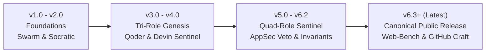

# CHANGELOG: UltimateGravity Autonomous Engineering System

All notable changes to the UltimateGravity system architecture are documented in this file.

---

## 🧭 Evolution Milestones

> [!NOTE]
> **Lineage & Versioning Note**: Versions `v1.0.0` through `v6.2.0` document the pre-release architectural research iterations and private laboratory prototypes engineered by [@MasterPandaa](https://github.com/MasterPandaa). Version `v6.3.0` marks the initial canonical public open-source release on GitHub.

---

## [v6.3.1] - 2026-11-22

### Added & Optimized
- **Unified Launch Engine (`github-craft`)**: Absorbed `readme-craft` into `github-craft` ($L_0 \le 60$ lines), unifying all 5 Signatures of Mastery and PaperOrchestra ingestion while eliminating skill sprawl.
- **GitHub Actions CI Automation**: Deployed Windows runner pipeline (`.github/workflows/bench.yml`) executing 26 deterministic regression tests on push with dynamic status badge.
- **Community Governance Suite**: Established 100% GitHub Community Health score with root `SECURITY.md`, `CONTRIBUTING.md`, `CODE_OF_CONDUCT.md`, and YAML issue forms.
- **Multi-AI Audit Hardening**: Enforced 100% numerical consistency across all docs, banned unprovable superlatives, and mandated isolated notes-file release drafting.
- **Search Indexing Accelerator**: Codified profile pinning and backlink discovery protocols to bypass Googlebot search engine crawl lag.
- **Skill Redundancy Purge**: Converted `readme-craft` into a backward-compatible 19-line redirect to `github-craft`.

---

## [v6.3.0] - 2026-11-21

### Added & Optimized
- **Automated Regression Suite (`bench-runner.js`)**: Standalone zero-dependency test runner validating 26 regression test cases across Browser, Sequential Code, Core Rules, and Skill Activation suites.
- **Lexical-First Grep Hierarchy**: Replaced heavy vector embeddings with exact regex codebase search, eliminating semantic drift and saving ~1.5 GB RAM.
- **Dual-Gate Memory Compaction (MaxIM)**: Enforced capacity-constrained memory bounds ($|S_t| \le C$) via Predictive Sufficiency and Recursive Consistency gates.
- **Production Harness Subsystems**: Codified empirical 7-subsystem architecture across the Agent Loop, LLM Provider, Tools Sandbox, Memory, Safety, Orchestration, and Extension surfaces.
- **Offline Sleep & Synthetic Rehearsal**: Integrated post-session consolidation (`memory-trimmer.js`) with benchmark rehearsal to prevent invariant forgetting.
- **Unified IT Operational Resilience (`it-soft-skills`)**: Consolidated 11 community skills into one lean meta-skill ($L_0 \le 60$ lines) for 4-tier audience translation and incident triage.
- **PRD-to-Engineering Matrix**: Integrated 3-layer spec decomposition (Story $\to$ Contract $\to$ Assertion) into `clean-code-fullstack`.
- **GitHub Launch Architect (`github-craft`)**: Authored 7-pillar repository launch playbook with 21:9 banner specs, evergreen About descriptions, and 18 trending SEO topics.

### Fixed & Cleaned
- **Reference Integrity**: Repaired broken link in `agent-judge/SKILL.md` pointing to missing `references/rubrics.md`.
- **Telemetry Ledger Hygiene**: Purged 8 stale ghost telemetry records from `skill-usage.json`.

---

## [v6.2.0] - 2026-11-16

### Added & Optimized
- **Quad-Role Architecture Synchronization**: Full parity across `fullstack-developer`, `qa-engineer`, `data-engineer`, and `security-engineer`.
- **Wazuh FIM & LOLBin Correlation**: File integrity monitoring for agent configuration roots (`~/.gemini`) and Sysmon Event ID correlation.
- **Rad Spacing Hierarchy & 10-Pass UI Unslop**: 40% spacing scale ($1.4\times$) and Pass 0 Design Archetypes eliminating multi-variable CSS churn.
- **STRIDE Threat Modeling & Container Hardening**: Pre-implementation architectural threat analysis and non-root Docker isolation.
- **HackerOne VRT 7-Question Validation Gate**: Objective falsification checks preventing severity inflation in security audits.

---

## [v6.1.0] - 2026-11-13

### Optimized & Cleaned
- **Host Footprint Pruning**: Reclaimed 1.79 GB disk space by decommissioning redundant background workers and legacy virtual environments.
- **Slack QA Notification Probe (`slack-qa-notify.ps1`)**: Automated webhook dispatch on test regressions and security veto halts.
- **Universal Operational Invariants (§4.H)**: Codified Elephant-Goldfish Review, Minimal Verifiable Blast Radius (MVBR < 50 lines), Call-Graph Reachability Triage, and Filesystem-First OpenAPI invariants.

---

## [v6.0.0] - 2026-11-11

### Added (Canonical Milestone)
- **Universal Context Packets (`task-dag --consumes`)**: Eliminated multi-agent context bleed by passing verified schema slices instead of raw chat histories.
- **Codebase Precedence Anchor (§4.B)**: Grounding principle where live repository source code and verified tests strictly override outdated documentation.
- **AST Outline Extractor (`ast-outline.js`)**: Sub-millisecond syntax skeleton generator pruning files >300 lines by ~85% token volume.
- **Dynamic MCP Profiler (`mcp-profile.js`)**: Tool gatekeeper keeping active MCP tools $\le 150$ on 8GB RAM host environments.

---

## [v5.0.0] - 2026-11-05

### Added & Optimized
- **Startup Token Diet**: Reduced Turn-0 system prompt payload by 67% via Progressive Disclosure.
- **Language Boundary Enforcement (§4.G)**: Mandated 100% English for all system skills, rules, scripts, and commit messages.
- **GoLive Production Deployment Safety**: Safe 5-stage deployment protocol across Vercel, Supabase, Cloudflare, and Stripe.

---

## [v4.0.0] - 2026-10-29

### Added & Optimized
- **Tri-Role Architecture Genesis**: Partitioned responsibilities into Full Stack Developer, QA & SDET, and Data Engineer.
- **Solo Direct Primary Loop Default**: Adopted Anthropic Applied AI standard folding 95% of workflows into a single high-speed agent loop.
- **Mandatory Step 0 Skill Ingestion**: Enforced fail-closed gate requiring subagents to read domain skills and quote operational invariants before code mutation.
- **Strict 3-Point Context Anchors & 4 UI States**: Codified pre-mutation caller/contract verification and mandatory UI states (Loading, Empty, Error, Success).
- **Persona Swarm Archival**: Decommissioned 12 legacy Bijuu persona subagents into `config/agents-archive/` to eliminate routing ambiguity.

---

## [v3.5.0] - 2026-10-29

### Added & Optimized
- **Pre-Emptive Diagnostic Watchdog Hook (`diagnostic-watchdog-hook.js`)**: Integrated instantaneous post-edit syntax verification (<150ms) for JSON, Python, and JavaScript on `PostToolUse` events.
- **Step Checkpoint & Differential Revert Engine (`step-checkpoint.js`)**: Engineered zero-git snapshot engine enabling differential inspection and instant state rollbacks.
- **Live Browser Error Sentinel (`browser-sentinel.js`)**: Deployed native Microsoft Edge headless probe detecting Vite overlay errors, React SSR hydration mismatches, and 500 crashes with ~20 MB transient RAM.
- **Rust-Powered Fast Topology Scanner**: Integrated native `fd.exe` binary into workspace indexer, accelerating directory scans to <350ms.

---

## [v3.0.0] - 2026-10-28

### Added & Optimized
- **Continuous File History & Shadow-Copy Rewind (`file-rewind.js`)**: Implemented automated pre-mutation snapshots on `PreToolUse` hooks with instant rollback safety net.
- **Stateful Persistent PowerShell Engine (`agy-exec.ps1`)**: Engineered session snapshots preserving working directory (CWD), environment variables, and virtualenvs across agent tool calls.
- **Background Incremental Workspace Indexer (`workspace-indexer.js`)**: Deployed incremental repository topology caching injecting fresh project context on `PostToolUse`.
- **Structured Task DAG State Machine (`task-dag.js`)**: Implemented dependency-aware task orchestration (`blockedBy`), cycle detection, and automatic Mermaid graph visualization.
- **Local Skill Telemetry Ledger (`skill-telemetry.js`)**: Built invocation frequency tracking and usage heatmaps in `skill-usage.json` to identify dormant skill pruning candidates.

---

## [v2.0.0] - 2026-10-26

### Added & Optimized
- **Regularized Recursive Self-Improvement (Google Research RRSI)**: Codified noise-adjusted safety floor ($S' \ge S^* - \delta$), token-ROI cost gates, and cosine-annealed L0 edit budgets.
- **Two-Pillar Research Decomposition (ZJU PaperGym)**: Separated methodological innovation from experimental execution with <5% anti-criterion leakage enforcement.
- **Socratic Codebase Derivation (Rederive Engine)**: Implemented first-principles inductive codebase analysis replacing passive documentation reading.
- **Web Escalation Hierarchy (Browser-Harness Standard)**: Established 3-tier fetch escalation (HTTP Fetch $\to$ Stealth Scrape $\to$ Headless Browser) slashing browser token overhead by ~60%.
- **Semantic Intent Declaration (Foremerge Protocol)**: Mandated explicit operation declarations (`replace/extend/deprecate`) prior to shared git worktree mutations.

---

## [v1.5.0] - 2026-10-24

### Added & Optimized
- **Design Token & 8pt Spacing Scale (@7thco.ui Standards)**: Enforced off-black color palettes, strict 8pt spacing rhythm (4/8/16/24/32px), and micro-interaction states across UI components.
- **3-Pillar Actionable Error Microcopy**: Standardized user error presentation requiring What Happened + Why + Direct Actionable CTA, prohibiting dead-end error dialogs.
- **Bloom Filter Cache Defense**: Integrated in-memory probabilistic filter patterns eliminating 99%+ redundant high-latency database queries.
- **Multi-Platform Public Scraper (`agent-reach`)**: Built structured zero-API data extraction across Reddit, X (Twitter), YouTube transcripts, GitHub, and RSS feeds.
- **Anti-Yes-Man Protocol**: Deployed proactive architectural critique filters enforcing blast-radius disclosure and objective risk falsification before code mutation.

---

## [v1.0.0] - 2026-10-23

### Added (Initial Research Prototype)
- **Autonomous Peer Squad Architecture**: Orchestrated 12 horizontal specialist worker personas with explicit task isolation boundaries.
- **Master Skill System Specification**: Standardized 80 specialized capability manifests with high-contrast display names, positive triggers, and negative routing boundaries.
- **Multi-Service MCP Ecosystem**: Integrated 12 Model Context Protocol servers across monitoring, database, browser scraping, and developer tools.
- **Automated Credential Session Keeper (`mcp-auth-keeper-safe.js`)**: Automated background token refresh and authentication state persistence on session startup.
- **Interactive SVG Architecture Visualizer (`architecture_map.html`)**: Built interactive node-graph visualizer for exploring inter-module system dependencies.
