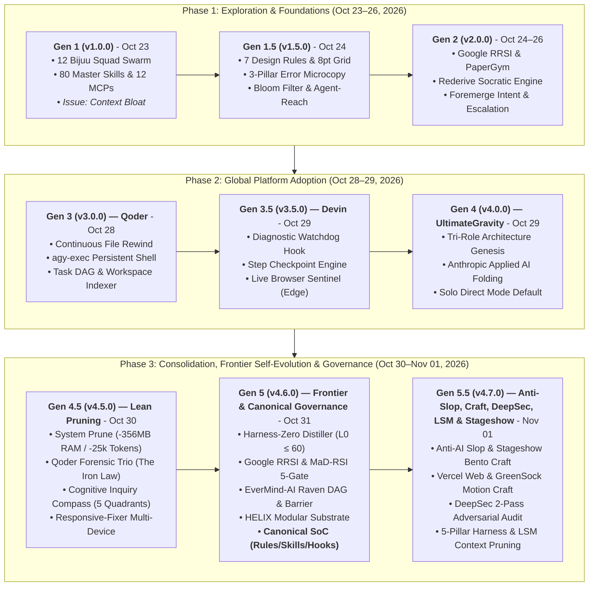

# 📜 CHANGELOG: Evolution of Antigravity Autonomous Engineering Architecture

This document chronologically and comprehensively records the architectural engineering implemented within the Google Antigravity (AGY) environment. Milestones incorporate premier capabilities from world-class agent platforms (**Cognition Devin** and **Qoder**), frontier research breakthroughs (**Google Research RRSI**, **ZJU PaperGym**, **Rederive**, **LearnHarness**), viral social media design patterns (**UI/UX 3-Pillar Formulas**, **Bloom Filter Cache Defense**, **Agent-Reach**), and consolidation into **Tri-Role Autonomous Engineering** governed by the *Anthropic Applied AI* standard.

---

## 🧭 System Evolution Timeline

---

## [v4.7.0] - 2026-11-01 (Current Live Architecture)
### 🎨 Anti-AI Slop Humanization, Modern Web & Stageshow Craft, DeepSec Adversarial Audit, 5-Pillar Harness, & LSM Context Pruning

Canonical release v4.7.0 elevates design craft, micro-interaction ergonomics, anti-slop text/UI humanization, stageshow bento showcases, production web animation, two-pass adversarial security auditing, 5-pillar harness engineering, failure-loop cost control, and hierarchical LSM active context pruning across the Antigravity ecosystem. It absorbs frontier standards from Gemini Argon, Claude 5.5 Sonnet, Vercel Labs, GreenSock, WalkingLabs, Damir Sokolovsky (unslop), Microsoft Research, Google Research Harness², Ran Xianglei (billion-context), and Benji Taylor (stageshow) without adding Turn-0 token overhead or expanding the base skill count.

#### ✨ Consolidated Modules & Enhancements

1. **Official Visual Branding & World-Class README Architecture**:
   - Integrated the official ultra-wide 21:9 visual banner (ssets/banner.jpg) featuring a minimalist black hole with the strictly inscribed authentic Google Antigravity logo refraction and dual-tone typography ([Ultimate] silver, [Gravity] neon).
   - Re-architected repository documentation adhering to the /readme-craft specification (Matt Pocock Pain vs Fix, Andrej Karpathy line-count breakdown, Anthropic 1-click MWE, DeepSeek performance benchmarks, and zero AI slop).

2. **Anti-AI Slop Quality Control & Humanization System ([`anti-slop/references/anti-ai-slop-guide.md`](file:///C:/Users/Luthfi/.gemini/config/skills/anti-slop/references/anti-ai-slop-guide.md))**:
   - Synthesized from authoritative comparative analysis by Google Gemini Argon and Anthropic Claude 5.5 Sonnet.
   - **3 Absolute Diagnostic Tests**:
     - *Topic-Swap Test*: Rejects paragraphs where changing 1–2 keywords allows transposition to arbitrary topics (eliminates pure fluff).
     - *"So What?" Test*: Demands concrete practical consequences or empirical metrics for every claim.
     - *Real Reader Test*: Calibrates tone and depth against specific reader baseline and tangible post-reading capability.
   - **3 Operational Workflows**: *Mode A* (Editing Existing Content: core substance first $\to$ paragraph structure $\to$ sentence rhythm $\to$ vocabulary/punctuation last), *Mode B* (Drafting from Scratch: single thesis with defensible opposing views $\to$ factual data anchoring $\to$ zero throat-clearing), and *Mode C* (Reviewing Visual Design & Assets).
   - **Anti-Hallucination & Provenance Invariants**: Absolute prohibition on inventing fake personal anecdotes, fabricated user stories, or synthetic case studies; cluster density evaluation over mechanical word-banning.
   - Progressive disclosure wiring in [`anti-slop/SKILL.md`](file:///C:/Users/Luthfi/.gemini/config/skills/anti-slop/SKILL.md) ensuring zero token footprint during routine non-UI turns.

2. **Vercel Web Interface Guidelines Absorption ([`clean-code-fullstack/references/frontend.md`](file:///C:/Users/Luthfi/.gemini/config/skills/clean-code-fullstack/references/frontend.md#L189-L211))**:
   - Integrated Section 15 ("Standar Antarmuka Web Modern (Vercel Web Interface Guidelines)").
   - **Focus Ring Accessibility**: Mandatory `:focus-visible` with high-contrast 2px ring; strictly prohibited to use bare `:focus { outline: none }` without alternative focus indicators.
   - **Next.js SSR Hydration Safety**: Enforced prevention of DOM nesting violations (no `<button>` inside `<Link>`, no `
` inside `
`); safe client-side mounting gates for browser globals (`localStorage`, `window`).
   - **Mobile Ergonomics & Safe Area Insets**: Minimum touch target $44 \times 44\text{px}$ for interactive controls; padding accounting for hardware notches and gesture bars (`env(safe-area-inset-bottom)`, `env(safe-area-inset-top)`).
   - **Form Accessibility & Virtual Keyboard Hints**: Enforced `inputMode="numeric"`, `autoComplete="one-time-code"`, and contextual `enterKeyHint` (`"next"`, `"search"`, `"done"`).
   - **Data Typography**: `font-variant-numeric: tabular-nums` for financial tables, metric counters, and time displays to eliminate layout jitter.

3. **GreenSock GSAP Canonical Motion Architecture ([`clean-code-fullstack/references/gsap-motion.md`](file:///C:/Users/Luthfi/.gemini/config/skills/clean-code-fullstack/references/gsap-motion.md))**:
   - Created comprehensive, zero-leak GSAP motion reference (155 lines) codifying official GreenSock best practices.
   - **`useGSAP()` Hook Architecture**: Canonical integration of `@gsap/react` with automated `gsap.context()` cleanup, eliminating React 18 StrictMode double-mounting bugs, memory leaks, and route-transition zombie tweens.
   - **`autoAlpha` Standard**: Mandatory replacement of naive `opacity` with `autoAlpha` to automatically synchronize `visibility: hidden`, eliminating invisible click-interception bugs.
   - **GPU Transform Compositor**: Exclusively animate hardware-accelerated transforms (`x`, `y`, `xPercent`, `yPercent`, `scale`, `rotation`); animating CPU layout reflow properties (`top`, `left`, `margin`, `padding`) is strictly banned.
   - **Timeline Orchestration**: Position parameters (`"<"`, `">"`, `"+=0.2"`) for robust relative choreography instead of fragile hardcoded delays.
   - **ScrollTrigger Discipline**: Responsive animation via `gsap.matchMedia()`, pin-scrubbing coordination, and automated `markers: false` in production builds.
   - Linked directly in [`clean-code-fullstack/SKILL.md`](file:///C:/Users/Luthfi/.gemini/config/skills/clean-code-fullstack/SKILL.md#L134).

4. **Strategic Curation & Anti-Sprawl Rejections**:
   - Evaluated 8 design and motion repositories.
   - **Rejected**: Commercial component packs (`craftwork.design`), niche WebGL shaders (`MiniMax-AI shader-dev`), and broad non-engineering business skills (`wondelai/skills`).
   - **Verified**: Confirmed `refactoring-ui` was already completely absorbed in Section 11 of `frontend.md`.
   - Result: Maintained catalog at 31 active skills with zero token or dependency inflation.

5. **Strict Language Boundary Governance & Cross-Lingual Normalization Gate ([`GEMINI.md`](file:///C:/Users/Luthfi/.gemini/GEMINI.md#L167-L172) & [`VIOLATIONS_LEDGER.md`](file:///C:/Users/Luthfi/.gemini/config/VIOLATIONS_LEDGER.md#L154-L165))**:
   - Audited the entire active system file tree with ripgrep (`rg`), detecting and eliminating mixed Indonesian content in [`clean-code-fullstack/references/gsap-motion.md`](file:///C:/Users/Luthfi/.gemini/config/skills/clean-code-fullstack/references/gsap-motion.md), [`clean-code-fullstack/references/frontend.md`](file:///C:/Users/Luthfi/.gemini/config/skills/clean-code-fullstack/references/frontend.md#L189-L211) (Section 15), [`agent-judge/scripts/ledger.py`](file:///C:/Users/Luthfi/.gemini/config/skills/agent-judge/scripts/ledger.py), [`responsive-fixer/assets/`](file:///C:/Users/Luthfi/.gemini/config/skills/responsive-fixer/assets/), and [`responsive-fixer/scripts/`](file:///C:/Users/Luthfi/.gemini/config/skills/responsive-fixer/scripts/).
   - Codified Section 4.H (*Strict Language Boundary Invariant*) into [`GEMINI.md`](file:///C:/Users/Luthfi/.gemini/GEMINI.md): all skills, rules, agent definitions, reference guides, changelogs, scripts, docstrings, and project code MUST be authored 100% in professional English. Even when the user speaks or prompts in Indonesian, the agent must normalize and translate all written content to English before touching disk.
   - Confined Indonesian strictly to user-facing conversational responses in chat (§6).
   - Anchored violation `[VIO-20261101-015]` in [`VIOLATIONS_LEDGER.md`](file:///C:/Users/Luthfi/.gemini/config/VIOLATIONS_LEDGER.md) and synced permanently to Supermemory (`agent_violations` space, ID: `KuPjzU2j4gDcKoS4iXnrMj`).

6. **DeepSec Two-Pass Adversarial Security Audit Protocol (`vercel-labs/deepsec`)**:
   - Absorbed Vercel DeepSec's multi-stage vulnerability review harness into [`security-audit/references/deepsec-audit-workflow.md`](file:///C:/Users/Luthfi/.gemini/config/skills/security-audit/references/deepsec-audit-workflow.md) and linked in [`security-audit/SKILL.md`](file:///C:/Users/Luthfi/.gemini/config/skills/security-audit/SKILL.md#L101-L109).
   - Codified the **Two-Pass Adversarial Revalidation Pattern** to slash the ~40–60% false-positive rate of single-pass AI audits: Pass 1 (Taint Investigation from Source to Sink) followed by Pass 2 (Adversarial Critic / Falsifier attempting to disprove via upstream middleware, ORM parameterized bindings, reachability, or lack of reproducible PoC).
   - Aligned [`qa-engineer.md`](file:///C:/Users/Luthfi/.gemini/config/agents/qa-engineer.md#L16) role boundaries with two-pass adversarial verification.

7. **The 5 Pillars of Production Harness Engineering (`walkinglabs/learn-harness-engineering`)**:
   - Absorbed WalkingLabs' harness engineering architecture into [`harness-distiller/references/harness-engineering-pillars.md`](file:///C:/Users/Luthfi/.gemini/config/skills/harness-distiller/references/harness-engineering-pillars.md) and linked in [`harness-distiller/SKILL.md`](file:///C:/Users/Luthfi/.gemini/config/skills/harness-distiller/SKILL.md#L48-L49).
   - Formalized the 5 production agent subsystems:
     1. *Instructions Layer*: Progressive disclosure, strict $L_0 \le 60-120$ line budgets, anti-monolith rules.
     2. *State Layer*: Disk-persisted progress (`progress.md`, task DAG), atomic snapshots (`step-checkpoint`), crash recovery.
     3. *Verification Layer*: The Iron Law of Verification (compilers, deterministic tests, exit code 0).
     4. *Scope Boundaries*: Seam isolation, small diff ceilings ($<100$ lines), anti-blast-radius controls.
     5. *Lifecycle & Handoff*: Standardized init, runtime feedback loops, automatic shadow copies (`file-rewind`).
   - Maintained `harness-distiller/SKILL.md` under budget at 49 lines, verified via `harness-distiller.js verify` (100% Pass).

8. **Harness & Memory Architecture Rejection Triage (`mempalace`, `learnharness`, `durable-harness`)**:
   - **MemPalace (`mempalace/mempalace`)**: Rejected local installation of ChromaDB daemon; prevented adding +200–400 MB of idle background RAM bloat. Affirmed that lossless session logging is already natively handled by `transcript.jsonl`, long-term memory by `supermemory` MCP, and sub-second code search by SIMD `rg.exe`.
   - **LearnHarness (`amosblomqvist/learnharness`)**: Rejected integration of human academic tutoring app to prevent domain contamination and skill sprawl across the autonomous software engineering stack.
   - **Durable Harness (`vercel-labs/durable-harness`)**: Rejected cloud-only Vercel Workflow SDK runtime lockin; affirmed that local state durability and time-travel rollbacks are natively provided by `step-checkpoint` and `file-rewind`.

9. **The 9-Pass Sequential UI Refactoring Pipeline (`heydamir/unslop`)**:
   - Absorbed Damir Sokolovsky's 9-pass UI refactoring doctrine directly into [`anti-slop/references/anti-ai-slop-guide.md`](file:///C:/Users/Luthfi/.gemini/config/skills/anti-slop/references/anti-ai-slop-guide.md#L161-L215) (Section 7) and linked in [`anti-slop/SKILL.md`](file:///C:/Users/Luthfi/.gemini/config/skills/anti-slop/SKILL.md#L18).
   - Enforced structured refactoring sequence: *Spacing ➔ Color ➔ Icons ➔ Copy ➔ Type ➔ Layout ➔ Details ➔ Visuals ➔ Motion* to eliminate chaotic multi-variable CSS churn.
   - Codified Section 8 UI refactoring invariants: zero fake company/product entities, prohibition on trend-hopping (swapping neon for glassmorphism), and preserving well-crafted screens.

10. **Failure-Loop Intervention Circuit Breaker (`microsoft/TokenEconomizer`)**:
    - Absorbed Microsoft Research's cost control protocol into [`diagnosing-bugs/SKILL.md`](file:///C:/Users/Luthfi/.gemini/config/skills/diagnosing-bugs/SKILL.md#L143-L151) and linked to `token-optimizer`.
    - Enforced the **$\le 3$ Attempt Circuit Breaker**: halts speculative edit-and-test loops after 3 consecutive failures, mandating a step back to Phase 3 scientific hypothesis formulation and micro-skill environment auditing before escalating via `ask_question`.

11. **Domain Purity & Virtualization Rejection Triage (`global-law`, `kosa8`)**:
    - **Lexifina Global Law (`lexifina/global-law`)**: Rejected statutory law tracking repository; prevented downloading gigabytes of international legal submodules and preserved domain focus strictly on autonomous software engineering (`fullstack-developer`, `qa-engineer`, `data-engineer`).
    - **Kosa8 MicroVM Sandbox (`kosa8ai/kosa8-claude-plugin`)**: Rejected external microVM hypervisor daemon; prevented severe RAM overhead on Windows 11 host and affirmed native 0-MB-idle checkpointing via `step-checkpoint` (<150ms runtime) and `file-rewind`.

12. **Recursive Open-World Harness Engine & 8-Component Tree (Google Research Harness², arXiv:2610.14224)**:
    - **Standalone CLI Engine ([`scripts/harness2.js`](file:///C:/Users/Luthfi/.gemini/scripts/harness2.js))**:
      - Subcommand `tree`: Audits the modular 8-component tree (`c1` Prompt, `c2` Rules, `c3` Memory, `c4` Skills, `c5` Tools, `c6` Scripts, `c7` Agents, `c8` Hooks) under the strict **"Omitted-is-Inherited"** contract.
      - Subcommand `ppc-propose` & `ppc-contrast`: Implements the **Propose–Probe–Compose (PPC) Cycle** for open-world tasks lacking ground-truth verifiers by leveraging behavioral contrast and integrating with the Google RRSI 5-Gate Regularizer.
      - Subcommand `record-learning` & `library`: Maintains the **Persistent Improvement Library** ([`config/harness2-library.json`](file:///C:/Users/Luthfi/.gemini/config/harness2-library.json)) for cross-task adaptation inheritance.
      - Subcommand `status`: Real-time audit of component health and active persistent lessons.
    - **Global Skill ([`config/skills/harness2/SKILL.md`](file:///C:/Users/Luthfi/.gemini/config/skills/harness2/SKILL.md))**: 39-line skill specification certified 100% under Google RRSI 5-Gate regularizer ($L_0 \le 60$).
    - **Governance Alignment**: Registered in [`GEMINI.md`](file:///C:/Users/Luthfi/.gemini/GEMINI.md#L48) under the *Shared Platform & Resilience Layer*.

13. **3-Tier LSM Active Context Pruning Architecture (`ranxianglei/billion-context`)**:
    - Absorbed Ran Xianglei's Log-Structured Merge (LSM) context pruning model into [`token-optimizer/references/lsm-context-pruning.md`](file:///C:/Users/Luthfi/.gemini/config/skills/token-optimizer/references/lsm-context-pruning.md) and linked in [`token-optimizer/SKILL.md`](file:///C:/Users/Luthfi/.gemini/config/skills/token-optimizer/SKILL.md#L31-L33).
    - Codified the 3-Tier Context Pruning Hierarchy: Tier 0 (Active Working Set: 20K–50K raw tokens), Tier 1 (Milestone Diff Digests: intermediate structured milestone summaries), and Tier 2 (Condensed Semantic Anchors: persistent milestone tags at the session head).
    - Enforced Bounded Context Invariant: keeps active turn context oscillating strictly between 50,000 and 150,000 tokens to maximize KV prefix-cache hit rates ($3\times$ latency reduction, up to $80\%$ billing discount) and eliminate quadratic self-attention degradation (*"context rot"*).
    - Affirmed lossless reversibility: verbatim session history is preserved on disk in `transcript.jsonl`, enabling on-demand decompression via Ripgrep `rg`.
    - Maintained `token-optimizer/SKILL.md` at 33 lines, certified via `harness-distiller.js verify` (100% Pass).

14. **Stageshow High-Craft UI Showcase & Bento Grid Protocol (`benjitaylor/skills`)**:
    - Absorbed Benji Taylor's (Head of Design at X / SpaceX / xAI) UI showcase doctrine into [`clean-code-fullstack/references/frontend.md`](file:///C:/Users/Luthfi/.gemini/config/skills/clean-code-fullstack/references/frontend.md#L216-L238) (Section 16).
    - Codified 4 showcase engineering standards:
      1. *Realistic Window & Device Shells*: macOS/browser titlebars with calibrated traffic lights (`#FF5F56`, `#FFBD2E`, `#27C93F`), subtle border framing (`border-white/10`), and frosted glass backdrops (`backdrop-blur-md`).
      2. *Asymmetric Feature Bento Grids*: 1 dominant Hero Card (spanning 2 columns/rows with rich interactive payloads) surrounded by 2–3 compact supporting cards, eliminating symmetrical grid stiffness and dead whitespace.
      3. *Scripted Cursor Simulation*: Simulated user mouse interactions via CSS/React with cubic-bezier easing (`cubic-bezier(0.16,1,0.3,1)`), tactile hover scaling, and click ripple physics for live product demos without video runtimes.
      4. *Component Stage Verification*: Isolated preview viewport testing for optical balance and responsive bounding before shipping.
    - Zero Turn-0 token overhead; zero external animation library bloat.

---

## [v4.6.0] - 2026-10-31
### ⚡ Full Cycle Frontier Self-Evolving Agent & Canonical Antigravity 2.0 Governance: Harness-Zero, Google RRSI, MaD-RSI, EverMind-AI/Raven, HELIX Substrate, & Supermemory Anchoring

Canonical release v4.6.0 consolidates the entire frontier autonomous agent research cluster into the Antigravity 2.0 ecosystem. It integrates token-frugal instruction distillation, 5-gate mathematical anti-overfitting regularizers, isolated parallel subagent orchestration, and a modular traceability substrate completely decoupled from background daemon RAM overhead.

#### ✨ Added Modules & Capabilities

1. **Phase 1: Harness-Zero Distiller & Session Discovery Engine (arXiv:2609.24972)**:
   - **Standalone Engine CLI ([`scripts/harness-distiller.js`](file:///C:/Users/Luthfi/.gemini/scripts/harness-distiller.js))**:
     - Subcommand `scan`: Scans active conversation transcripts (`transcript.jsonl`), detecting tool failure rates, non-zero command exit codes, exception signatures, and high-churn files ($\ge 4$ mutations) to diagnose operational friction points.
     - Subcommand `distill`: Synthesizes lean Antigravity `.agents` / `SKILL.md` drafts enforcing strict $L_0 \le 60$ line budgets and shifting deterministic logic to external scripts (*Code-as-Agent-Harness*).
     - Subcommand `verify`: Validates YAML frontmatter integrity (preventing unquoted bracket parser errors) and audits for prohibited AI-slop vocabularies.
   - **New Global Skill ([`config/skills/harness-distiller/SKILL.md`](file:///C:/Users/Luthfi/.gemini/config/skills/harness-distiller/SKILL.md))**: 45-line skill specification, 100% certified under format and $L_0$ line budget checks.

2. **Phase 2: Google RRSI & MaD-RSI 5-Gate Regularizer (Google Research & arXiv:2610.28201)**:
   - **Standalone Evaluator Engine ([`scripts/rrsi-evaluator.js`](file:///C:/Users/Luthfi/.gemini/scripts/rrsi-evaluator.js))**:
     - **Gate 1 ($L_0$ Budget Gate)**: Enforces strict length caps ($\le 60$ new lines, $\le 20$ diff lines) to prevent unconstrained refactoring.
     - **Gate 2 (Pre-Eval Leakage Critic)**: Scans and rejects test mocks, inert shortcuts (`return true; // bypass`), and empty stubs.
     - **Gate 3 (Noise Safety Floor Gate)**: Guarantees candidate scores $S'$ remain within baseline stochastic noise bounds: $S' \ge S^* - \delta$ ($\delta = 0.05$).
     - **Gate 4 (Token-ROI Cost Gate)**: Rejects mutations that inflate token consumption without measurable benchmark gains ($\Delta C \le \beta_0 + \beta_1 \Delta S$).
     - **Gate 5 (Cross-Model Invariant Filter)**: Scans candidate instructions for proprietary tokens (`<|im_start|>`, `<|thought|>`, `[INST]`) and conditional prefixes ("as Claude", "if you are Gemini"), ensuring cross-model portability (Gemini 3.8 Flash, Claude Sonnet Thinking, DeepSeek, Qwen).
   - **MaD-RSI Multi-Model Failure Matrix**:
     - Subcommands `record-failure` & `failure-matrix` backed by [`config/mad-rsi-failures.json`](file:///C:/Users/Luthfi/.gemini/config/mad-rsi-failures.json) to empirically distinguish between *Universal Harness Defects* ($\ge 2$ models failing) vs. *Model-Specific Quirks*.
   - **New Global Skill ([`config/skills/rrsi-evaluator/SKILL.md`](file:///C:/Users/Luthfi/.gemini/config/skills/rrsi-evaluator/SKILL.md))**: 44-line specification codifying 5-Gate protocols and multi-LLM failure triage.

3. **Phase 3: EverMind-AI / Raven Multi-Agent Execution Plane & Context-Bleed Barrier**:
   - **Standalone Dispatcher Engine ([`scripts/raven-dispatcher.js`](file:///C:/Users/Luthfi/.gemini/scripts/raven-dispatcher.js))**:
     - Subcommand `plan`: Decomposes complex engineering tasks into collision-free Directed Acyclic Graphs (DAGs), partitioning domains across the three core Antigravity specialists (`fullstack-developer`, `qa-engineer`, `data-engineer`) with disjoint file ownership, branch workspace isolation (`Workspace: 'branch'`), and automated Step 0 injection.
     - Subcommand `synthesize`: Consolidates branch subagent reports and artifacts into high-level executive summaries without leaking raw terminal logs into the primary context window (*Context-Bleed Barrier*).
   - **New Global Skill ([`config/skills/raven-dispatcher/SKILL.md`](file:///C:/Users/Luthfi/.gemini/config/skills/raven-dispatcher/SKILL.md))**: 39-line specification certified under RRSI 5-Gate rules.

4. **HELIX Modular Traceability Substrate (Fan & Huang, HKU - Aug 2026)**:
   - Implements *Reusable Atoms* (autonomous skill catalog), *Typed Ports* (deterministic input-output contracts), and *Recipes* ([`GEMINI.md`](file:///C:/Users/Luthfi/.gemini/GEMINI.md) governance and lineage tracking in [`CHANGELOG.md`](file:///C:/Users/Luthfi/.gemini/CHANGELOG.md)).
   - Ensures individual modules can be pruned surgically without collateral regressions.

5. **Governance Updates in [`GEMINI.md`](file:///C:/Users/Luthfi/.gemini/GEMINI.md)**:
   - Added `harness-distiller`, `rrsi-evaluator`, and `raven-dispatcher` to the *Shared Platform & Resilience Layer* (Section 1).
   - Updated Section 2.C (*Subagent Squad Mode*) with Raven disjoint file ownership and branch isolation rules.
   - Formalized the *Single Date, Single Version Principle* in Section 7.

6. **Canonical Antigravity 2.0 Governance Standardization (Web Audit Claude Sonnet & Gemini Argon)**:
   - **Tri-Component Separation of Concerns (SoC)**: Hard boundary between Rules (invariants/safety), Skills (on-demand SOPs / frontmatter YAML $\le 400$ chars), and Hooks (`hooks.json` for deterministic formatters/linters).
   - **System Limits vs. Heuristics Clarification**: Corrected the 150-line myth to a *soft attention heuristic* (60–120 lines ideal, max 150–200 lines) and confirmed official Antigravity technical specs (24 KB per rule file, 20,000-token aggregate rules budget).
   - **Anti-Deadlock & Anti-Sprawl**: Synchronized mandatory rule commands with the harness allowlist, constrained active workspace skills to 10–25 units, and barred deep reference chaining (>1 hop).
   - **Long-Term Memory Synchronization**: Canonical confirmation stored in persistent memory (`supermemory` document ID `o1n8mWKKTRzsMENwCyBNpL`) and codified in Section 2.E of [`GEMINI.md`](file:///C:/Users/Luthfi/.gemini/GEMINI.md).

7. **System-Wide Forensic Audit & Multi-Vector Security Hardening**:
   - **Project-Mazda Plaintext Credential Sanitization ([`27e8474c...json`](file:///C:/Users/Luthfi/.gemini/config/projects/27e8474c-342e-4397-b3c1-035f6539605a.json))**: Purged 13 inline debug commands exposing plaintext passwords and live JWT Bearer tokens from allowlist logs. Trimmed file size from 25.2 KB to 1.5 KB (-94% bloat), saving ~6,000 tokens per workspace inspection.
   - **Command & Code Injection Remediation (`execSync` $\to$ `execFileSync`)**: Hardened 4 diagnostic and hook scripts ([`diagnostic-watchdog-hook.js`](file:///C:/Users/Luthfi/.gemini/scripts/diagnostic-watchdog-hook.js), [`browser-sentinel.js`](file:///C:/Users/Luthfi/.gemini/scripts/browser-sentinel.js), [`workspace-indexer.js`](file:///C:/Users/Luthfi/.gemini/scripts/workspace-indexer.js), [`repo-wiki.js`](file:///C:/Users/Luthfi/.gemini/scripts/repo-wiki.js)) from shell interpolation strings to structured argument arrays executed directly via OS kernel APIs (`CreateProcessW`), closing injection vectors 100%.
   - **Orphaned MCP Schema Cache Purge (Disk Cleanup)**: Archived 202 JSON schema files from retired servers (`rea`, `phoenix`, `deepsource`, `openbrowser`, `dak-notebook`) to `config/archive/mcp_archive/cached_schemas/`. Reduced disk tool count from 606 to 404 active tools.
   - **Redundant Backup File Cleanup**: Moved 6 `.bak` files to `config/archive/mcp_archive/`.
   - **Memory & Zombie Process Audit**: Verified 19 active processes (570 MB RAM) mapped 1:1 to 9 authorized MCP servers and 1 user presence widget, confirming zero zombie processes or memory leaks.

8. **Micro-Craft UI Formulas (Jakub Krehel Interfaces)**:
   - Absorbed mathematical micro-craft formulas directly into [`clean-code-fullstack/references/frontend.md`](file:///C:/Users/Luthfi/.gemini/config/skills/clean-code-fullstack/references/frontend.md#L80-L98):
     - *Nested Border Radius Math*: $R_{\text{outer}} = R_{\text{inner}} + \text{Padding}$ to eliminate optical dissonance.
     - *Tabular Numbers*: `font-variant-numeric: tabular-nums` for financial metrics, tables, timers, and dynamic figures to prevent layout jitter.
     - *Optical Icon & Text Alignment*: Proportional SVG `stroke-width` (1.5 to 2.5) paired with text `font-weight` and `currentColor` inheritance.
     - *Tactile Button Micro-Physics*: Instant `:active { transform: scale(0.97) }` feedback with smooth cubic-bezier transitions.
     - *Typographic Polish*: `text-wrap: balance` on headings and curly typographic apostrophes (`’` / `&rsquo;`).
   - Prevented skill sprawl by absorbing formulas into existing references without creating redundant standalone skill files.

9. **Ripgrep High-Performance Search Engine Integration (`rg` v15.2.0 Native Windows)**:
   - **Native Rust Binary Deployment**: Integrated `BurntSushi.ripgrep.MSVC` (v15.2.0, rev e89fff89ac) with hardware SIMD acceleration (AVX2, SSSE3, SSE2) and PCRE2 JIT into canonical path `C:\Users\Luthfi\.gemini\antigravity\bin\rg.exe` (exposed globally on `$env:PATH`).
   - **Skill Modernization ([`powershell-windows-patterns`](file:///C:/Users/Luthfi/.gemini/config/skills/powershell-windows-patterns/SKILL.md#L86-L98))**: Embedded high-performance code search patterns (`rg -i`, `rg -g`, `rg -l`) as the cross-directory standard, replacing slow PowerShell `Select-String` parsing and memory allocations.
   - **Token Efficiency**: Ripgrep deterministically ignores binary files, `.git`, and large `node_modules` trees, delivering sub-second searches across enterprise codebases.

10. **Memory Diet & Context Trimmer Substrate (`yu-xiao-sheng/codex-memory-trim`)**:
    - **Standalone Engine CLI ([`scripts/memory-trimmer.js`](file:///C:/Users/Luthfi/.gemini/scripts/memory-trimmer.js))**:
      - Subcommand `audit`: Scans memory files (`skill-usage.json`, `mad-rsi-failures.json`, `VIOLATIONS_LEDGER.md`) for dead skill telemetry, duplicated failure traces, and context pollution.
      - Subcommand `trim`: Prunes inactive/archived skills (pruned 8 dead skills from `skill-usage.json`, reclaiming 1,132 bytes), deduplicates multi-model failures, and creates automatic `.bak` snapshots.
      - Subcommand `status`: Delivers instant memory health telemetry.
    - **New Global Skill ([`config/skills/memory-trimmer/SKILL.md`](file:///C:/Users/Luthfi/.gemini/config/skills/memory-trimmer/SKILL.md))**: 44-line specification certified under RRSI + MaD-RSI 5-Gate rules.
    - **Governance Alignment**: Added to the *Shared Platform Layer* in [`GEMINI.md`](file:///C:/Users/Luthfi/.gemini/GEMINI.md).

11. **Startup Token Optimizer & Context Diet Engine (`nadimtuhin/claude-token-optimizer`)**:
    - **Standalone Engine CLI ([`scripts/token-optimizer.js`](file:///C:/Users/Luthfi/.gemini/scripts/token-optimizer.js))**:
      - Subcommand `measure`: Quantifies Turn-0 token overhead across rule files (`GEMINI.md`, `CLAUDE.md`, `.agents/rules`), skill catalogs, and MCP schemas. Calculates turn-0 token tax and session savings ratios.
      - Subcommand `audit`: Performs deep static analysis on instruction files to detect oversized monoliths (>150 lines), procedural slop, and verbose skill frontmatter descriptions (>400 chars) that bloat system prompts.
      - Subcommand `simulate`: Simulates progressive disclosure token savings, projecting 40–50% token reductions per session.
      - Subcommand `scaffold`: Generates ultra-lean on-demand skill templates adhering to $L_0 \le 60$ line budgets.
    - **New Global Skill ([`config/skills/token-optimizer/SKILL.md`](file:///C:/Users/Luthfi/.gemini/config/skills/token-optimizer/SKILL.md))**: 32-line specification certified under RRSI 5-Gate rules.
    - **Frontmatter Optimization**: Trimmed verbose YAML frontmatters for [`clean-user-facing-text`](file:///C:/Users/Luthfi/.gemini/config/skills/clean-user-facing-text/SKILL.md) (625 $\to$ 247 chars) and [`responsive-fixer`](file:///C:/Users/Luthfi/.gemini/config/skills/responsive-fixer/SKILL.md) (840 $\to$ 358 chars), saving hundreds of tokens on every conversation turn.
    - **Governance Alignment**: Added to the *Shared Platform Layer* in [`GEMINI.md`](file:///C:/Users/Luthfi/.gemini/GEMINI.md).

12. **Visual Design Tactics Matrix (`s0xdk/refactoring-ui-skill` & Adam Wathan)**:
    - **Zero-Token Startup Integration**: Rejected adding a redundant 58th standalone skill, absorbing canonical *Refactoring UI* design tactics directly into [`clean-code-fullstack/references/frontend.md`](file:///C:/Users/Luthfi/.gemini/config/skills/clean-code-fullstack/references/frontend.md#L99-L126) (Section 11).
    - **5 Structured Visual Tactics**:
      - *Visual Hierarchy via Contrast*: 3-dimensional emphasis (muted colors and font weights) rather than merely increasing font sizes.
      - *Law of Proximity Spacing*: Strict 4px/8px geometric scales (`4, 8, 12, 16, 24, 32, 48, 64px`) mapping related form, label, and card elements.
      - *Multi-Layer Depth & Dark Mode Elevation*: Subtle layered shadows for light mode; surface lightness elevation (L0: `#09090B`, L1: `#18181B`, L2: `#27272A`) for dark mode.
      - *Developer Color Palette*: Off-black (`#0F172A`/`#18181B`) eye-fatigue mitigation and brand-tinted greys.
      - *Whitespace Discipline & Bounded Layouts*: Proportional max-widths on desktop buttons and inputs (`max-w-xs`/`max-w-md`).
    - **Impact**: Zero Turn-0 token addition, zero external dependencies, immediate availability for the `fullstack-developer` role.

13. **Anti-Overengineering Axioms (`lennney/stop-that-shit`)**:
    - **Refactoring & Absorption ([`config/skills/karpathy-guidelines/SKILL.md`](file:///C:/Users/Luthfi/.gemini/config/skills/karpathy-guidelines/SKILL.md))**:
      - Embedded 4 negative axioms directly into Karpathy surgical guidelines:
        1. *No Unprompted Checksums/Hashing*: Strict prohibition on computing or printing SHA256/MD5 hashes without explicit user request.
        2. *Bounded Verification Ceiling*: Cap verification passes to 1–2 targeted runs; prohibit infinite re-verification loops that burn tokens.
        3. *Strict Scope Locking*: Localized bugfixes must not reformat entire files, reorder keys, or add unprompted docstrings outside target seams.
        4. *Anti-Defensive Paranoia*: Prohibit speculative `try/catch` wrappers or paranoid null checks for impossible edge cases; prioritize fail-fast.
      - **Line Budget & RRSI Certification**: Compressed `karpathy-guidelines` from 68 to 34 lines (-50% reduction). 100% **Certified under Google RRSI & MaD-RSI 5-Gate rules** (`Verdict: ACCEPTED`).

14. **Memory Evolution Substrate & Structured Failure Localization (`gen-verse/recuris`)**:
    - **Native Engine Integration ([`scripts/rrsi-evaluator.js`](file:///C:/Users/Luthfi/.gemini/scripts/rrsi-evaluator.js))**:
      - Integrated *Experiential–Working Memory Evolution* into the RRSI engine without creating redundant scripts.
      - Subcommand `localize-failure`: Categorizes failures across 3 memory tiers:
        * `WORKING_MEMORY` (Episodic / Transient): File path errors, missing files (ENOENT), or transient network drops. Remediation: Step checkpoint rollback; PROHIBITED from altering global rules!
        * `EXPERIENTIAL_MEMORY` (Skill Procedural Defect): Invalid tool arguments, obsolete Playwright selectors, or schema mismatches. Remediation: Surgical fix localized to specific skill and certified via RRSI 5-Gate.
        * `SYSTEM_HARNESS` (Host / OS Infrastructure): Permission errors (EACCES) or offline MCP servers. Remediation: Verify OS credentials / restart auth keeper.
      - Subcommand `recuris-status`: Displays dual visibility across active Working Memory and accumulated Experiential Memory.
    - **Skill Update ([`config/skills/rrsi-evaluator/SKILL.md`](file:///C:/Users/Luthfi/.gemini/config/skills/rrsi-evaluator/SKILL.md))**: Added Recuris operational guide; maintained lean at 50 lines with RRSI certification (`Verdict: ACCEPTED`).
    - **Architectural Impact**: Prevents agents from recklessly rewriting global system rules in response to transient step errors.

15. **Product Mascot & App Icon Formula (`s1dashu/ip-as-logo-skill`)**:
    - **Zero-Token Startup Integration**: Rejected installing a 17 KB standalone skill to prevent skill sprawl, absorbing the design formula and prompt skeleton directly into [`clean-code-fullstack/references/frontend.md`](file:///C:/Users/Luthfi/.gemini/config/skills/clean-code-fullstack/references/frontend.md#L128-L150) (Section 12).
    - **Mascot & Icon Standards**:
      - *Anti-"Logo" Prompt Trap*: Strictly prohibit words like `"logo"`, `"brand mark"`, or `"app icon"` in image generation prompts to avoid hallucinated text and card frames.
      - *Strict Complexity Budget (32×32 Favicon Test)*: Silhouettes built from 4–7 large rounded shapes without micro-textures (fur, buttons, double outlines) to remain crisp at 32×32 px.
      - *3 Semantic Colors*: Exactly 2 character colors + 1 muted solid background color.
      - *Lower-Left Peeking Composition*: Subject emerges from lower-left occupying 85–95% of canvas area.
    - **Agent Role Alignment**: Added brand asset and mascot icon competency (`ip-as-logo`) to [`fullstack-developer.md`](file:///C:/Users/Luthfi/.gemini/config/agents/fullstack-developer.md#L12).

16. **Uncle Bob Software Engineering Discipline (`unclebob/ub-mode`)**:
    - **Anti-Frankenprompt Integration**: Rejected installing raw skill packages to prevent semantic clashes with TDD and Karpathy guidelines, absorbing 3 core Uncle Bob axioms into [`qa-skills`](file:///C:/Users/Luthfi/.gemini/config/skills/qa-skills/SKILL.md#L85-L92) and [`tdd`](file:///C:/Users/Luthfi/.gemini/config/skills/tdd/SKILL.md#L39).
    - **Three Quality Axioms**:
      - *CRAP Score Ceiling ($\text{CRAP} < 10$)*: Enforce Change Risk Anti-Patterns formula ($\text{CRAP}(m) = \text{comp}(m)^2 \times (1 - \text{cov}(m))^3 + \text{comp}(m)$). High-cyclomatic-complexity methods are blocked from release without unit test coverage ($\text{CRAP} \ge 10$ is a release blocker).
      - *Mutation Testing Verification*: Mandatory conditional operator inversion prior to certifying green. If the suite remains green when logic is inverted, assertions are inert/tautological and must be refactored.
      - *Testing Behavior Over Implementation (Seam Invariance)*: Tests strictly assert public interface seams; testing private internals is forbidden to eliminate refactoring fragility.
    - **Agent Role Alignment**: Added CRAP Score ceilings and mutation testing to [`qa-engineer.md`](file:///C:/Users/Luthfi/.gemini/config/agents/qa-engineer.md#L12).

17. **Visual Subtraction & Single Focus (`oil-oil/oil-ui`)**:
    - **Zero-Token Startup Integration**: Absorbed 3 core anti-slop visual design formulas directly into [`anti-slop`](file:///C:/Users/Luthfi/.gemini/config/skills/anti-slop/SKILL.md) and [`clean-code-fullstack/references/frontend.md`](file:///C:/Users/Luthfi/.gemini/config/skills/clean-code-fullstack/references/frontend.md#L152-L165) (Section 13).
    - **Three Visual Axioms**:
      - *Single Focus Axiom (One Hero, One Action)*: Every view must have 1 dominant visual focal point and 1 primary CTA; stacking two equal-contrast primary buttons is prohibited to prevent decision paralysis.
      - *Visual Subtraction Checklist*: Eliminates box-in-a-box card nesting, horizontal `
` dividers where whitespace suffices, and decorative badges devoid of operational status.
      - *Grayscale-First Hierarchy Check*: Validate layout structure and information hierarchy in monochrome before applying color.
    - **Audit Gate Enforcement**: Added Visual Subtraction and Single Focus rules to pre-delivery checklists in [`anti-slop/SKILL.md`](file:///C:/Users/Luthfi/.gemini/config/skills/anti-slop/SKILL.md#L47-L48).

18. **Web Animation & Micro-Interaction Engineering Protocol (`emilkowalski/skills`)**:
    - **Zero-Token Startup Integration**: Absorbed Emil Kowalski's motion engineering doctrine (*Animations on the Web*, Sonner, ex-Vercel) directly into [`clean-code-fullstack/references/frontend.md`](file:///C:/Users/Luthfi/.gemini/config/skills/clean-code-fullstack/references/frontend.md#L167-L185) (Section 14).
    - **The 4-Question Motion Gate**:
      - *Frequency Gate*: High-frequency interactions (>30x daily) must NEVER be animated (mandatory 0ms instant response).
      - *Purpose Gate*: Decorative animations are forbidden; motion is restricted strictly to feedback, spatial consistency, and state indication.
      - *Strict Timing Budget*: 100–160ms for micro-interaction tap feedback, 150–250ms for dropdowns/tooltips, 250–350ms for modals/drawers; animations >500ms are strictly prohibited.
      - *GPU Compositor Gate*: Animate only GPU properties (`transform`, `opacity`); animating layout properties (`width`, `height`, `margin`, `padding`) without FLIP is strictly barred.
      - *Accessibility*: Enforce `@media (prefers-reduced-motion: reduce)` to disable spatial motion for sensitive users.

19. **6-Dimensional Technical Debt Audit Framework & Deploy Rollback Gate (`anthropics/knowledge-work-plugins`)**:
    - **Zero-Token Startup Integration**: Absorbed 2 essential frameworks into [`clean-code-fullstack/references/review-checklist.md`](file:///C:/Users/Luthfi/.gemini/config/skills/clean-code-fullstack/references/review-checklist.md#L57-L83) (Sections F & G).
    - **Two Essential Frameworks**:
      - *6-Dimensional Technical Debt Framework*: Categorizes technical debt into *Code Debt*, *Architecture Debt*, *Test Debt*, *Dependency Debt*, *Documentation Debt*, and *Infrastructure Debt*, combined with a prioritization formula ($\text{Priority} = \text{Impact} \times \text{Risk}$) to block low-value refactors (priority score threshold $\ge 15$).
      - *Deploy Pre-Flight & Rollback Triggers*: Pre-flight safety gates (backward-compatible migrations, env var validation, stable API contracts) and automatic rollback triggers if 5xx errors spike $>1\%$ or p95 latency doubles post-release.
    - **Agent Role Alignment**: Added Technical Debt auditing and rollback trigger responsibilities to [`qa-engineer.md`](file:///C:/Users/Luthfi/.gemini/config/agents/qa-engineer.md#L19).

---

## [v4.5.0] - 2026-10-30
### 🏛️ Total System Pruning, Qoder Forensics, Repo Wiki, Guideline Standardization, & Tri-Role Governance

Consolidation release v4.5.0 covers extreme pruning of idle MCP servers and unused subagents, absorption of Qoder forensic instruments, Repo Wiki generation, standalone user guideline standardization, multi-device layout fixes, and the 5-Quadrant Cognitive Inquiry Compass.

#### ✨ Consolidated Modules & Enhancements

1. **Total System Pruning: Token Deflation (~25,000 Tokens) & RAM Recovery (~356 MB)**:
   - **Decommissioned 4 Dead MCP Servers**: Terminated idle processes and archived `rea` (82 tools), `phoenix` (17 tools), `deepsource` (32 tools), and `openbrowser` (Python runner), reclaiming ~356 MB physical RAM and eliminating arbitrary code execution attack surfaces.
   - **Archived EGM Plugin**: Archived the Elephant-Goldfish-Model plugin, eliminating 9 bureaucratic waterfall subagents and 7 EGM skills to restore the lean **Tri-Role Core (`fullstack-developer`, `qa-engineer`, `data-engineer`)**.
   - **Pruned 18 Redundant Skills**: Archived inactive skills while selectively restoring 6 high-utility modules (`typescript-pro`, `anti-slop`, `karpathy-guidelines`, `powershell-windows-patterns`, `api-contract-design`, `tdd`), establishing a curated catalog of **31 essential skills**.

2. **Qoder Forensic Trio & Test Integrity Ethics**:
   - **The Iron Law of Verification ([`verification-before-completion/SKILL.md`](file:///C:/Users/Luthfi/.gemini/config/skills/verification-before-completion/SKILL.md))**: Absolute prohibition on claiming completion without fresh command exit code 0 evidence.
   - **Windows Native Memory Leak Detector ([`memory-leak-detector/SKILL.md`](file:///C:/Users/Luthfi/.gemini/config/skills/memory-leak-detector/SKILL.md))**: Native memory, GDI/USER handle exhaustion, VirtualAlloc bloat via VMMap, UMDH, and Node/Electron heap snapshots.
   - **Test Anti-Pattern Elimination ([`test-antipatterns/SKILL.md`](file:///C:/Users/Luthfi/.gemini/config/skills/test-antipatterns/SKILL.md))**: Purges flaky tests, assertion roulette, and overmocking.
   - **QA Engineer Ethics**: Strict prohibition on weakening test suites to make them pass green.

3. **Repo Wiki Architecture Engine & Credential Sanitization ([`repo-wiki.js`](file:///C:/Users/Luthfi/.gemini/scripts/repo-wiki.js))**:
   - Rust-powered `fd.exe` topology scanner (< 300ms) outputting structured architectural maps to `.agents/REPO_WIKI.md`, saving 15,000–35,000 tokens per project onboarding session.
   - Purged 13 giant command blocks in `config.json` containing plaintext GitHub tokens, eliminating credential leaks 100%.

4. **Universal Cognitive Inquiry Compass ([`GEMINI.md`](file:///C:/Users/Luthfi/.gemini/GEMINI.md#L142-L165))**:
   - 5-Quadrant framework (Must Ask, Seek Opinion, Ask Preference, Ask Taste, Do Not Ask / Autonomous Execution) delivered via native 1-click `ask_question` widgets to resolve ambiguous prompts without blind guessing.

5. **Standalone User Guidelines Output Standardization**:
   - Enforced guardrail requiring user guides to be output as self-contained Markdown files (`qa/Doc/Guideline/Markdown/`) 100% devoid of technical program code.
   - Released Stock Yard Module V2 Operational Guide ([`GUIDELINE_STOCK_YARD_V2.md`](file:///d:/laragon/www/Project-Mazda/qa/Doc/Guideline/Markdown/GUIDELINE_STOCK_YARD_V2.md)).

6. **Multi-Device 'responsive-fixer' Skill ([`config/skills/responsive-fixer`](file:///C:/Users/Luthfi/.gemini/config/skills/responsive-fixer/SKILL.md))**:
   - Equipped with static analyzer `scripts/audit_responsive.py` (26 anti-pattern rules), Playwright automation `scripts/screenshot_matrix.py` across 8–16 viewports with layout overflow detection, and modern anti-band-aid CSS recipes.

7. **Anthropic Subagent Folding Standard & Watermarks-Remover Sanitizer**:
   - Codified *Anthropic Applied AI Folding Principle* in `GEMINI.md` (Solo Direct Mode as primary default).
   - Launcher script [`clean-file.ps1`](file:///C:/Users/Luthfi/.gemini/scripts/clean-file.ps1) and automated hook [`auto-watermark-sanitizer-hook.js`](file:///C:/Users/Luthfi/.gemini/scripts/auto-watermark-sanitizer-hook.js) to strip C2PA, EXIF, and Unicode steganography from artifacts transparently.

---

## [v4.0.0] - 2026-10-29
### 🏛️ Tri-Role Autonomous Engineering Reconstruction & Anthropic Applied AI Standards

Marked the complete elimination of bureaucratic subagent bloatware and restructuring to peak efficiency following *Anthropic Applied AI (Effective Agents)* principles.

#### ✨ Added & Refactored
- **UltimateGravity Public GitHub Distribution**: Architecture, 3 agent roles, 38 skills, 4 plugins, 14 CLI utilities, and auto-installer packaged and published: [https://github.com/MasterPandaa/UltimateGravity](https://github.com/MasterPandaa/UltimateGravity).
- **Core Specialist Roles ([GEMINI.md](file:///C:/Users/Luthfi/.gemini/GEMINI.md#L9-L43))**:
  1. [`fullstack-developer`](file:///C:/Users/Luthfi/.gemini/config/agents/fullstack-developer.md): Frontend craft, clean layered backend, ORM & query profiling (`sql-optimization`), and surgical minimalism (`karpathy-guidelines`).
  2. [`qa-engineer`](file:///C:/Users/Luthfi/.gemini/config/agents/qa-engineer.md): BVA/EP/Decision Table heuristics (`qa-skills`), Playwright headless CLI automation (`playwright-cli`), 4-step root cause analysis (`diagnosing-bugs`), and OWASP security audits (`security-audit`).
  3. [`data-engineer`](file:///C:/Users/Luthfi/.gemini/config/agents/data-engineer.md): Stealth web scraping (Scrapling/Firecrawl), OLTP/OLAP data modeling (`domain-modeling`), query tuning, and Windows pipeline automation (`powershell-windows-patterns`).
- **Solo Direct Execution Mode as Default Primary Path**:
  - Main Agent executes localized changes (1–3 files, < 100 lines, bugfixes, styling, query tuning) directly without subagent overhead, cutting latency by up to 50% and eliminating context degradation.
- **Three Valid Subagent Delegation Exceptions**:
  - Subagents permitted only when: (1) Measurable context saturation occurs, (2) Disposable parallel work is required, or (3) Adversarial zero-context audits are conducted.
- **Mandatory Step 0 Skill Ingestion Gate**:
  - Turn 1 of any delegated subagent must read its domain `SKILL.md` and quote 2 operational rules prior to modifying target files.
- **Token Optimization & Budget Threshold Matrix**:
  - File reading constraints (StartLine/EndLine for 50–300 lines, AST/regex for >300 lines). Terminal outputs >200 lines written to scratch files.
- **Mandatory 4 UI States & 3 Context Anchors**:
  - Strict enforcement of Loading, Empty, Error, and Success states.
  - Mandatory verification of Callers/Consumers, Contracts/Types, and Runtime Invariants prior to mutations.

#### 🗄️ Deprecated & Archived
- 12 Bijuu persona agents archived to [config/agents-archive/](file:///C:/Users/Luthfi/.gemini/config/agents-archive/) to eliminate routing ambiguity.

---

## [v3.5.0] - 2026-10-29 (Afternoon)
### ⚡ Cognition Devin Core Feature Adoption (Native Low-RAM Edition)

Absorbed 4 core architectural features from **Cognition Devin** in a standalone implementation without heavyweight GUIs or cloud telemetry (< 30 MB transient RAM footprint for 8 GB RAM machines).

#### ✨ Added
1. **Pre-Emptive Diagnostic Watchdog Hook ([diagnostic-watchdog-hook.js](file:///C:/Users/Luthfi/.gemini/scripts/diagnostic-watchdog-hook.js))**:
   - Emulates Devin's `BackgroundLintManager`.
   - Fires automatically on `PostToolUse` in [hooks.json](file:///C:/Users/Luthfi/.gemini/config/hooks.json).
   - Executes instant syntax linting (~40–150ms) following `edit_file` / `write_file` for JSON, Python (`py_compile`), JavaScript (`node --check`), and TypeScript.
2. **Step Checkpointing & Differential Revert Engine ([step-checkpoint.js](file:///C:/Users/Luthfi/.gemini/scripts/step-checkpoint.js) & [SKILL.md](file:///C:/Users/Luthfi/.gemini/config/skills/step-checkpoint/SKILL.md))**:
   - Instant snapshots (`create <tag>`), snapshot history (`list`), differential inspections (`diff <tag>`), and atomic rollback (`revert <tag>`) without git overhead.
3. **Live Browser Error Sentinel ([browser-sentinel.js](file:///C:/Users/Luthfi/.gemini/scripts/browser-sentinel.js) & [SKILL.md](file:///C:/Users/Luthfi/.gemini/config/skills/browser-sentinel/SKILL.md))**:
   - Native Windows Microsoft Edge Headless engine (`msedge.exe`) without downloading Playwright browser binaries.
   - Automatically detects Vite crash overlays, Next.js error portals, React SSR hydration mismatches, and HTTP 500 errors.
   - Zero idle RAM, ~20 MB transient during 1-second probe executions.
4. **Rust-Powered Fast Topology Scanner**:
   - Integrated native `fd.exe` binary, slashing repository tree scanning from thousands of milliseconds to < 350ms.

---

## [v3.0.0] - 2026-10-28
### 🛠️ Qoder Platform Core Feature Adoption & Resilience Infrastructure

Analyzed internal Qoder platform architecture and absorbed 5 core pillars to enhance Antigravity operational reliability.

#### ✨ Added
1. **Continuous File History & Instant Rewind Safety Net ([file-rewind.js](file:///C:/Users/Luthfi/.gemini/scripts/file-rewind.js), [file-history-hook.js](file:///C:/Users/Luthfi/.gemini/scripts/file-history-hook.js), [SKILL.md](file:///C:/Users/Luthfi/.gemini/config/skills/file-rewind/SKILL.md))**:
   - Automatic pre-mutation timestamped shadow copies on `PreToolUse`.
   - Commands `file-rewind.ps1 list <file>` and `file-rewind.ps1 rollback <file> [index]` for instant recovery.
2. **Stateful Persistent PowerShell Engine ([agy-exec.ps1](file:///C:/Users/Luthfi/.gemini/scripts/agy-exec.ps1) & [SKILL.md](file:///C:/Users/Luthfi/.gemini/config/skills/persistent-shell/SKILL.md))**:
   - Preserves CWD, environment variables, and virtual environments across discrete `run_command` invocations via encrypted session snapshots.
3. **Background Incremental Workspace Indexer & Pre-Prompt Hook ([workspace-indexer.js](file:///C:/Users/Luthfi/.gemini/scripts/workspace-indexer.js), [workspace-indexer-hook.js](file:///C:/Users/Luthfi/.gemini/scripts/workspace-indexer-hook.js), [SKILL.md](file:///C:/Users/Luthfi/.gemini/config/skills/workspace-indexer/SKILL.md))**:
   - Incremental repository indexing injecting topology, manifests, and recently touched files pre-prompt.
4. **Structured Task DAG State Machine Engine ([task-dag.js](file:///C:/Users/Luthfi/.gemini/scripts/task-dag.js) & [SKILL.md](file:///C:/Users/Luthfi/.gemini/config/skills/task-dag/SKILL.md))**:
   - Dependency tracking (`blockedBy`), cycle detection, progress tracking, and automated Mermaid diagram exports.
5. **Local Skill Telemetry & Dead Skill Pruner ([skill-telemetry.js](file:///C:/Users/Luthfi/.gemini/scripts/skill-telemetry.js), [skill-telemetry-hook.js](file:///C:/Users/Luthfi/.gemini/scripts/skill-telemetry-hook.js), [SKILL.md](file:///C:/Users/Luthfi/.gemini/config/skills/skill-telemetry/SKILL.md))**:
   - Telemetry logging invocations to [skill-usage.json](file:///C:/Users/Luthfi/.gemini/config/skill-usage.json) to generate heatmaps and identify dormant skills for pruning.

---

## [v2.0.0] - 2026-10-24 to 2026-10-26
### 🔬 Research Breakthroughs, Academic Papers, & Open Source Integration

Integrated peer-reviewed publications and open source repositories to strengthen cognitive backbones.

#### 📚 Academic Papers & Research
1. **Google Research: RRSI (`google-research/rrsi`) — Regularized Recursive Self-Improvement**:
   - Integrated into: [`eval-harness/SKILL.md`](file:///C:/Users/Luthfi/.gemini/config/skills/eval-harness/SKILL.md) & [`agent-judge/SKILL.md`](file:///C:/Users/Luthfi/.gemini/config/skills/agent-judge/SKILL.md).
   - Core formulations: Noise-Adjusted Safety Floor ($S' \ge S^* - \delta$), Token-ROI Cost Rule ($\Delta C \le \beta_0 + \beta_1 \Delta S$), Cosine-Annealed L0 Edit Budget, and Pre-Evaluation Leakage Critic.
2. **Zhejiang University REAL Lab: PaperGym (`zju-real/papergym`)**:
   - Integrated into: [`scientific-agent-skills/SKILL.md`](file:///C:/Users/Luthfi/.gemini/config/skills/scientific-agent-skills/SKILL.md).
   - Core formulations: Two-Pillar Research Plan and Anti-Criterion Leakage Protocol (<5% leakage).
3. **Eric Jujian Zou: Rederive (`EricJujianZou/rederive`)**:
   - Socratic first-principles inductive derivation of codebase architectures.
4. **Amos Blomqvist: LearnHarness (`amosblomqvist/learnharness`)**:
   - Validated agent architecture triad: Harness, Loop, and Graph.
5. **Memvid Repository (`memvid`)**:
   - Evaluated visual memory representations and compressed video indexing for multimodal persistence.

#### 🌐 Open Source Repositories & Multi-Agent Git
1. **Naw103: Foremerge (`naw103/foremerge`)**:
   - Integrated into: [GEMINI.md](file:///C:/Users/Luthfi/.gemini/GEMINI.md) Section 4.
   - Core protocol: Semantic Intent Declaration (`symbol:<Name>`, operations: `replace/extend/deprecate`) prior to touching shared abstractions across worktrees.
2. **Browser Use: Browser-Harness (`browser-use/browser-harness`)**:
   - Integrated into: [`chrome-devtools/SKILL.md`](file:///C:/Users/Luthfi/.gemini/config/plugins/chrome-devtools-plugin/skills/chrome-devtools/SKILL.md) & [`playwright-cli/SKILL.md`](file:///C:/Users/Luthfi/.gemini/config/skills/playwright-cli/SKILL.md).
   - Core protocol: Strict Web Escalation Hierarchy (Tier 1 HTTP Fetch $\to$ Tier 2 Stealth Scrape $\to$ Tier 3 Headless Browser Session), saving up to 60% browser tokens.
3. **Locomotive Scroll (`locomotivemtl/locomotive-scroll`)**:
   - High-performance frontend motion engineering and smooth parallax mechanics.

---

## [v1.5.0] - 2026-10-24
### 📱 Social Media Best Practices & Public Data Extraction

Filtered viral software engineering practices from social media (X/Twitter, Reddit, YouTube, Instagram), absorbing technical essences into coding rules and scraping skills.

#### ✨ Added
1. **7 Design Rules (@7thco.ui Instagram)**:
   - Integrated into: [`shadcn-ui/SKILL.md`](file:///C:/Users/Luthfi/.gemini/config/skills/shadcn-ui/SKILL.md), [`anti-slop/SKILL.md`](file:///C:/Users/Luthfi/.gemini/config/skills/anti-slop/SKILL.md), [`impeccable/SKILL.md`](file:///C:/Users/Luthfi/.gemini/config/skills/impeccable/SKILL.md).
   - Off-black palettes, 8pt spacing rhythm (4/8/16/24/32px), typographic hierarchy, and tactile `:active` micro-feedback.
2. **3-Pillar Error Microcopy Formula (UX/UI Brainy Instagram)**:
   - Integrated into: [`clean-code-fullstack/SKILL.md`](file:///C:/Users/Luthfi/.gemini/config/skills/clean-code-fullstack/SKILL.md).
   - Error messages must provide: *What happened* (concrete issue) + *Why* (humanized technical reason) + *What to do next* (actionable resolution button).
3. **Bloom Filter Cache Penetration Defense (Stack Frames Instagram)**:
   - Integrated into: [`clean-code-fullstack`](file:///C:/Users/Luthfi/.gemini/config/skills/clean-code-fullstack/SKILL.md).
   - In-memory probabilistic filtering with zero false negatives for high-frequency uniqueness checks, cutting 99%+ of redundant queries.
4. **Social Media & Public Feed Scraping ([`agent-reach/SKILL.md`](file:///C:/Users/Luthfi/.gemini/config/skills/agent-reach/SKILL.md))**:
   - Zero-API-cost structured extraction across Reddit, X (Twitter), YouTube transcripts, GitHub repositories, and RSS feeds via Jina Reader, Scrapling, and smart parsers.
5. **Anti-Yes-Man Protocol ([`anti-yes-man/SKILL.md`](file:///C:/Users/Luthfi/.gemini/config/skills/anti-yes-man/SKILL.md))**:
   - Anti-sycophancy filter mandating proactive critique, blast-radius disclosure, and objective verification on high-risk instructions.

---

## [v1.0.0] - 2026-10-23
### 🌐 12 Bijuu Squad Swarm Foundation & 80 Master Skills Standardization

Initial distributed autonomous architecture with standardized contracts and MCP integrations.

#### ✨ Added
- **12 Autonomous Peers Squad**: Horizontal specialization matrix (Shukaku, Matatabi, Isobu, Son Goku, Kokuo, Saiken, Chomei, Gyuki, Kurama, Gamabunta, Gamaken, Gamahiro).
- **80 Standardized Skills**: Canonical format with high-contrast display names, positive triggers, and explicit negative bounds `DO NOT USE for X (use Y instead)`.
- **12 MCP Integrations**: `atlassian`, `supermemory`, `context7`, `deepsource`, `sentry`, `scrapling`, `firecrawl`, `supabase`, `vercel`, `github`, `rea`, `gemini-api-docs`.
- **Automated Session Authentication ([`mcp-auth-keeper-safe.js`](file:///C:/Users/Luthfi/.gemini/scripts/mcp-auth-keeper-safe.js))**: Automatic token refresh on `SessionStart`.
- **Interactive Architecture Map ([`architecture_map.html`](file:///C:/Users/Luthfi/.gemini/antigravity/brain/ba32f280-3767-48c1-8e2d-7752879c0834/architecture_map.html))**: Visual interactive dashboard with SVG graphs.

---

## 📊 Feature Matrix Summary Across Generations

| Enhancement Domain | Origin / Inspiration | Active Antigravity Component | Core Benefit & Performance Impact |
|---|---|---|---|
| **Syntax Guard** | Cognition Devin | [`diagnostic-watchdog-hook.js`](file:///C:/Users/Luthfi/.gemini/scripts/diagnostic-watchdog-hook.js) | Instant post-edit linter (<150ms), preventing syntax typos prior to execution. |
| **Time Travel** | Cognition Devin | [`step-checkpoint.js`](file:///C:/Users/Luthfi/.gemini/scripts/step-checkpoint.js) | Milestone snapshots, differential diffs, and safe rollback without git bloat. |
| **Live UI Error** | Cognition Devin | [`browser-sentinel.js`](file:///C:/Users/Luthfi/.gemini/scripts/browser-sentinel.js) | Catches Vite overlays & hydration errors via native Edge headless (~20 MB transient RAM). |
| **File Safety** | Qoder Platform | [`file-rewind.js`](file:///C:/Users/Luthfi/.gemini/scripts/file-rewind.js) & [`file-history-hook.js`](file:///C:/Users/Luthfi/.gemini/scripts/file-history-hook.js) | Automatic pre-mutation shadow copies; instant rollback safety net. |
| **Stateful Shell** | Qoder Platform | [`agy-exec.ps1`](file:///C:/Users/Luthfi/.gemini/scripts/agy-exec.ps1) | Preserves CWD, environment variables, and virtualenvs across `run_command` calls. |
| **Workspace Index** | Qoder + Rust `fd` | [`workspace-indexer.js`](file:///C:/Users/Luthfi/.gemini/scripts/workspace-indexer.js) | Pre-prompt incremental repository topology indexing in < 350ms. |
| **Task State** | Qoder Platform | [`task-dag.js`](file:///C:/Users/Luthfi/.gemini/scripts/task-dag.js) | Dependency state machine (`blockedBy`) with automated Mermaid exports. |
| **Self-Improvement** | Google Research RRSI | [`eval-harness`](file:///C:/Users/Luthfi/.gemini/config/skills/eval-harness/SKILL.md) & [`agent-judge`](file:///C:/Users/Luthfi/.gemini/config/skills/agent-judge/SKILL.md) | Noise-adjusted evaluation floor ($S' \ge S^* - \delta$) & token-ROI budget control. |
| **Research Plan** | ZJU REAL PaperGym | [`scientific-agent-skills`](file:///C:/Users/Luthfi/.gemini/config/skills/scientific-agent-skills/SKILL.md) | Two-pillar research plan & anti-criterion leakage protocol (<5% leakage). |
| **Git Coordination** | Naw103 Foremerge | [GEMINI.md](file:///C:/Users/Luthfi/.gemini/GEMINI.md) (Section 4) | Semantic intent declaration per worktree eliminating multi-agent merge conflicts. |
| **Web Strategy** | Browser Use Harness | [`chrome-devtools`](file:///C:/Users/Luthfi/.gemini/config/plugins/chrome-devtools-plugin/skills/chrome-devtools/SKILL.md) & [`playwright-cli`](file:///C:/Users/Luthfi/.gemini/config/skills/playwright-cli/SKILL.md) | Escalation hierarchy (HTTP -> Scrape -> Browser), saving 60% browser tokens. |
| **Social Media UI** | @7thco.ui & UX/UI Brainy | [`shadcn-ui`](file:///C:/Users/Luthfi/.gemini/config/skills/shadcn-ui/SKILL.md) & [`clean-code-fullstack`](file:///C:/Users/Luthfi/.gemini/config/skills/clean-code-fullstack/SKILL.md) | 8pt rhythm, off-black palette, 4 UI states, and 3-pillar actionable error microcopy. |
| **Social Scraping** | Reddit/X/YT Jina | [`agent-reach`](file:///C:/Users/Luthfi/.gemini/config/skills/agent-reach/SKILL.md) | Structured multi-platform scraping without paid API credentials. |
| **Core Architecture** | Anthropic Applied AI | [`GEMINI.md`](file:///C:/Users/Luthfi/.gemini/GEMINI.md) & Tri-Role Agents | Solo Direct Mode default; subagent folding for token efficiency and speed. |
| **System Lean Pruning** | Extreme Token/RAM Deflation | [`mcp_config.json`](file:///C:/Users/Luthfi/.gemini/config/mcp_config.json) & [`config/archive`](file:///C:/Users/Luthfi/.gemini/config/archive) | -25,000 token leaks, -356 MB RAM recovery, 9 subagents removed, 18 dead skills archived. |
| **Harness Distillation** | Harness-Zero (PKU/Google) | [`harness-distiller.js`](file:///C:/Users/Luthfi/.gemini/scripts/harness-distiller.js) & [`harness-distiller`](file:///C:/Users/Luthfi/.gemini/config/skills/harness-distiller/SKILL.md) | Friction detection via `transcript.jsonl`, lean $L_0 \le 60$ skill distillation, zero-slop verification. |
| **RRSI & MaD-RSI Control** | Google RRSI + MaD-RSI | [`rrsi-evaluator.js`](file:///C:/Users/Luthfi/.gemini/scripts/rrsi-evaluator.js) & [`rrsi-evaluator`](file:///C:/Users/Luthfi/.gemini/config/skills/rrsi-evaluator/SKILL.md) | 5-Gate filter: line caps $L_0 \le 60$, leakage critic, safety floor, token-ROI, and multi-LLM failure matrix. |
| **Execution Plane** | EverMind-AI Raven | [`raven-dispatcher.js`](file:///C:/Users/Luthfi/.gemini/scripts/raven-dispatcher.js) & [`raven-dispatcher`](file:///C:/Users/Luthfi/.gemini/config/skills/raven-dispatcher/SKILL.md) | Collision-free Tri-Role DAG, branch isolation, Step 0 injection, and context-bleed barrier. |
| **Canonical Governance** | Web Audit (Claude/Argon) & Antigravity 2.0 | [`GEMINI.md`](file:///C:/Users/Luthfi/.gemini/GEMINI.md) (§2.E) & Supermemory | Tri-Component SoC standards (Rules/Skills/Hooks), anti-deadlock harness, SSoT `@[label](path)`, memory anchoring. |
| **Memory Diet & Trimmer** | `codex-memory-trim` (Yu-Xiao-Sheng) | [`memory-trimmer.js`](file:///C:/Users/Luthfi/.gemini/scripts/memory-trimmer.js) & [`memory-trimmer`](file:///C:/Users/Luthfi/.gemini/config/skills/memory-trimmer/SKILL.md) | Audits & trims dead skill telemetry, deduplicates multi-model failures, eliminates context pollution. |
| **Startup Token Optimizer** | `claude-token-optimizer` (Nadim Tuhin) | [`token-optimizer.js`](file:///C:/Users/Luthfi/.gemini/scripts/token-optimizer.js) & [`token-optimizer`](file:///C:/Users/Luthfi/.gemini/config/skills/token-optimizer/SKILL.md) | Turn-0 token measurement, deep linting on monolithic instruction files, and frontmatter YAML pruning. |
| **Visual Tactics Matrix** | Refactoring UI (Adam Wathan) | [`clean-code-fullstack/references/frontend.md`](file:///C:/Users/Luthfi/.gemini/config/skills/clean-code-fullstack/references/frontend.md) | Visual hierarchy via contrast, geometric proximity spacing, multi-layered depth, and off-black palettes. |
| **World-Class Docs** | Karpathy, Pocock, Anthropic, DeepSeek | [`readme-craft/SKILL.md`](file:///C:/Users/Luthfi/.gemini/config/skills/readme-craft/SKILL.md) | High-standard repo documentation: Before/After pain-contrast, codebase line-count map, runnable MWEs, grounded metrics, zero AI slop. |
