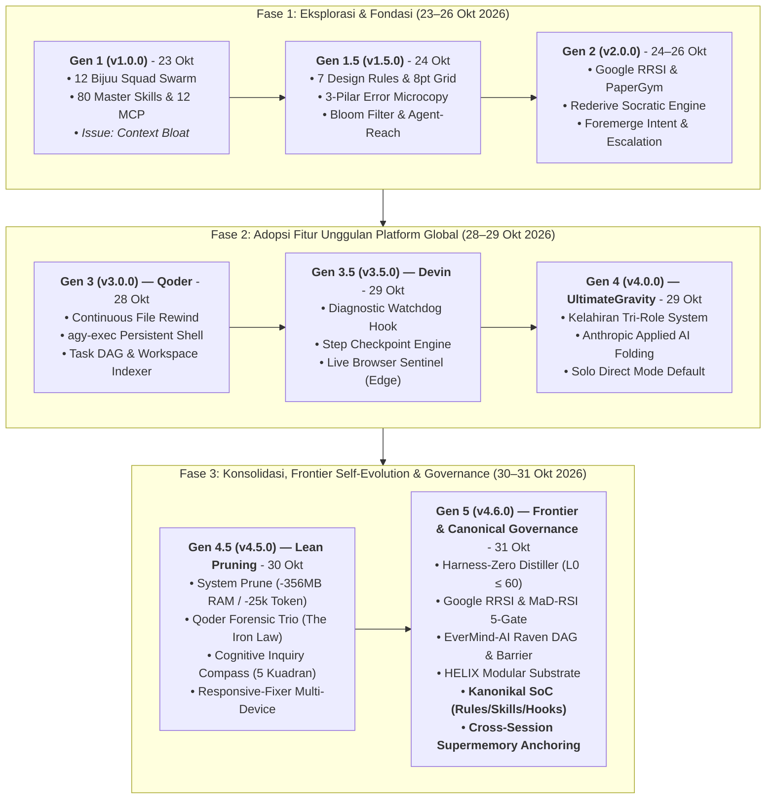

# 📜 CHANGELOG: Evolusi Arsitektur Antigravity Autonomous Engineering

Dokumen ini merekam secara kronologis dan komprehensif seluruh rekayasa arsitektural yang telah diimprovisasi pada lingkungan Google Antigravity (AGY). Pembaruan mencakup integrasi fitur unggulan dari platform kelas dunia (**Devin** dan **Qoder**), penyerapan terobosan riset dari paper/jurnal (**Google Research RRSI**, **ZJU PaperGym**, **Rederive**, **LearnHarness**), adopsi standar viral dari media sosial (**UI/UX Formula**, **Bloom Filter**, **Agent-Reach**), hingga konsolidasi akhir ke **Tri-Role Autonomous Engineering** berbasis standar *Anthropic Applied AI*.

---

## 🧭 Ringkasan Garis Waktu Evolusi Sistem

---

## [v4.6.1] - 2026-11-01
### 🎨 Official Visual Branding Identity, Ultra-Wide 21:9 Banner, & World-Class README Craft

Pembaruan v4.6.1 memutakhirkan identitas visual kanonikal repositori dan dokumentasi teknis kelas dunia:

#### ✨ Modul & Dokumentasi yang Ditambahkan / Dimutakhirkan (Added / Changed)
1. **Identitas Visual Resmi (`assets/banner.jpg`)**:
   - Menambahkan banner resmi ultra-wide 21:9 (1376 × 590 px) berbasis konsep *minimalist cosmic black hole*.
   - Mengintegrasikan siluet resmi **logo Google Antigravity asli** yang terkalibrasi secara presisi dan terkurung rapi (*strictly inscribed*) di dalam batas sirkular bola hitam (`R = 188 px`, clearance 15–20 px dari event horizon rim) dengan efek pendaran neon halus (*gravitational lensing light refraction*).
   - Tipografi terpusat modern memadukan *brushed metallic silver* pada kata **[Ultimate]** dan gradien neon kosmik (*cyan, royal blue, deep violet, magenta*) pada kata **[Gravity]**.
2. **Dokumentasi README Standar Dunia (`README.md`)**:
   - Ditulis ulang secara komprehensif mengikuti standar keahlian **`/readme-craft`**:
     - *The Matt Pocock Principle*: Tabel kontras nyata *The Pain vs. The Fix*.
     - *The Andrej Karpathy Principle*: Pemetaan arsitektur berkas dan hitungan baris kode dalam 10 detik.
     - *The Anthropic Principle*: Contoh MWE instalasi 1-klik yang dapat langsung dijalankan.
     - *The DeepSeek Principle*: Metrik performa terukur (sub-350ms scan, penghematan token 60–80%, eliminasi telephone game).
     - *Zero AI Slop*: Pembersihan seluruh klise pembuka AI generik demi scannability maksimal.

---

## [v4.6.0] - 2026-10-31 (Current Live Architecture)
### ⚡ Siklus Penuh Frontier Self-Evolving Agent & Tata Kelola Kanonikal Antigravity 2.0: Harness-Zero, Google RRSI, MaD-RSI, EverMind-AI/Raven, Substrat HELIX, & Supermemory Anchoring

Pembaruan kanonikal v4.6.0 (2026-10-31) menuntaskan integrasi komprehensif atas seluruh gugus riset arsitektur agen otonom terkini tahun 2026 ke dalam ekosistem Antigravity 2.0. Pembaruan ini menggabungkan penyulingan instruksi hemat token, regulasi matematis 5 gembok anti-overfitting, orkestrasi subagent paralel terisolasi, serta substrat ketertelusuran modular yang sepenuhnya bebas dari konsumsi memori daemon latar belakang.

#### ✨ Modul & Kapabilitas yang Ditambahkan (Added)

1. **Fase 1: Harness-Zero Distiller & Session Discovery Engine (arXiv:2609.24972)**:
   - **Engine CLI Mandiri ([`scripts/harness-distiller.js`](file:///C:/Users/Luthfi/.gemini/scripts/harness-distiller.js))**:
     - Subcommand `scan`: Memindai log percakapan aktif (`transcript.jsonl`), mengidentifikasi tingkat kegagalan tool, command exit code $\ne 0$, signature exception, serta mendeteksi berkas dengan frekuensi sentuhan tinggi (*high-churn files* $\ge 4$) untuk mendiagnosis titik friksi kerja.
     - Subcommand `distill`: Menyusun draf skill berformat Antigravity `.agents` / `SKILL.md` dengan penegakan anggaran baris ketat $L_0 \le 60$ baris serta memisahkan logika deterministik ke skrip eksternal (*Code-as-Agent-Harness*).
     - Subcommand `verify`: Memvalidasi integritas YAML frontmatter (mencegah bug unquoted bracket parser) dan memindai kamus kata terlarang *AI slop*.
   - **Skill Global Baru ([`config/skills/harness-distiller/SKILL.md`](file:///C:/Users/Luthfi/.gemini/config/skills/harness-distiller/SKILL.md))**: Spesifikasi skill 45 baris, 100% lolos verifikasi format dan anggaran baris $L_0$.

2. **Fase 2: Google RRSI & MaD-RSI 5-Gate Regularizer (Google Research & arXiv:2610.28201)**:
   - **Engine Evaluator Mandiri ([`scripts/rrsi-evaluator.js`](file:///C:/Users/Luthfi/.gemini/scripts/rrsi-evaluator.js))**:
     - **Gate 1 ($L_0$ Budget Gate)**: Membatasi panjang teks instruksi ($\le 60$ baris baru, $\le 20$ baris diferensial) guna mencegah refaktor liar.
     - **Gate 2 (Pre-Eval Leakage Critic)**: Memindai dan memblokir tiruan pengujian (*test mocks*), jalan pintas semu (`return true; // bypass`), dan fungsi kosong (*inert machinery*).
     - **Gate 3 (Noise Safety Floor Gate)**: Memastikan skor kandidat $S'$ tidak jatuh di bawah ambang batas toleransi stochastic noise baseline: $S' \ge S^* - \delta$ ($\delta = 0.05$).
     - **Gate 4 (Token-ROI Cost Gate)**: Menolak mutasi yang membengkakkan token tanpa peningkatan skor nyata ($\Delta C \le \beta_0 + \beta_1 \Delta S$).
     - **Gate 5 (Cross-Model Invariant Filter)**: Memindai draf instruksi terhadap tag hak milik model tertentu (`<|im_start|>`, `<|thought|>`, `[INST]`) dan kalimat kondisional ("as Claude", "if you are Gemini") untuk menjamin netralitas dan portabilitas penuh saat pengguna berganti model (Gemini 3.8 Flash, Claude Sonnet Thinking, DeepSeek, Qwen).
   - **MaD-RSI Multi-Model Failure Matrix**:
     - Subcommand `record-failure` & `failure-matrix` dengan persistensi [`config/mad-rsi-failures.json`](file:///C:/Users/Luthfi/.gemini/config/mad-rsi-failures.json) untuk mengklasifikasikan secara empiris antara *Universal Harness Defect* ($\ge 2$ model mengalami error sama) vs *Model-Specific Quirk*.
   - **Skill Global Baru ([`config/skills/rrsi-evaluator/SKILL.md`](file:///C:/Users/Luthfi/.gemini/config/skills/rrsi-evaluator/SKILL.md))**: Spesifikasi skill 44 baris yang memuat protokol 5-Gate dan audit kegagalan multi-LLM.

3. **Fase 3: EverMind-AI / Raven Multi-Agent Execution Plane & Context-Bleed Barrier**:
   - **Engine Dispatcher Mandiri ([`scripts/raven-dispatcher.js`](file:///C:/Users/Luthfi/.gemini/scripts/raven-dispatcher.js))**:
     - Subcommand `plan`: Memecah tugas rekayasa kompleks ke dalam Directed Acyclic Graph (DAG) bebas tabrakan (*collision-free*), memetakan domain ke tiga spesialis inti Antigravity (`fullstack-developer`, `qa-engineer`, `data-engineer`) dengan partisi berkas eksklusif (*disjoint file ownership*), isolasi workspace (`Workspace: 'branch'`), dan injeksi otomatis blok `[MANDATORY STEP 0 - COMPLEMENTARY SKILLS INGESTION GATE]`.
     - Subcommand `synthesize`: Mengonsolidasikan laporan dan artefak dari subagent branch menjadi satu rangkuman tingkat tinggi tanpa membocorkan ratusan baris log terminal mentah ke *context window* agen utama (*Context-Bleed Barrier*).
   - **Skill Global Baru ([`config/skills/raven-dispatcher/SKILL.md`](file:///C:/Users/Luthfi/.gemini/config/skills/raven-dispatcher/SKILL.md))**: Spesifikasi skill 39 baris yang lolos audit 5 Gembok RRSI.

4. **Substrat Modular & Silsilah Lacak HELIX (Fan & Huang, HKU - Agustus 2026)**:
   - Mengadopsi prinsip *Reusable Atoms* (katalog skill mandiri), *Typed Ports* (kontrak masukan-keluaran deterministik), dan *Recipes* (tata kelola [`GEMINI.md`](file:///C:/Users/Luthfi/.gemini/GEMINI.md) serta ketertelusuran silsilah di [`CHANGELOG.md`](file:///C:/Users/Luthfi/.gemini/CHANGELOG.md)).
   - Memastikan bahwa setiap komponen dapat dipangkas secara presisi tanpa menimbulkan regresi fungsi pada bagian lain.

5. **Pembaruan Tata Kelola ([`GEMINI.md`](file:///C:/Users/Luthfi/.gemini/GEMINI.md))**:
   - Menambahkan `harness-distiller`, `rrsi-evaluator`, dan `raven-dispatcher` ke dalam *Shared Platform & Resilience Layer* (Bagian 1).
   - Memperbarui Bagian 2.C (*Subagent Squad Mode*) dengan protokol partisi file eksklusif dan isolasi branch Raven.
   - Mengesahkan *Prinsip Satu Tanggal Satu Versi* pada Bagian 7.

6. **Standardisasi Kanonikal Arsitektur Antigravity 2.0 (Audit Dokumen Web Claude Sonnet & Gemini Argon)**:
   - **Pemisahan Tanggung Jawab (SoC) Tiga Pilar**: Menetapkan batas tegas antara Rules (invarian/keamanan), Skills (SOP on-demand/semantic routing via frontmatter YAML $\le 400$ karakter), dan Hooks (`hooks.json` untuk linter/formatter deterministik).
   - **Klarifikasi Batas Sistem vs Heuristik**: Mengoreksi mitos hard limit 150 baris menjadi *soft attention heuristic* ($60-120$ baris ideal, max 150-200 baris), serta mengonfirmasi batas teknis resmi Antigravity (24 KB per file rule dan aggregate rules budget 20.000 token).
   - **Pencegahan Double Enforcement Deadlock & Anti-Sprawl**: Sinkronisasi perintah wajib rules ke dalam allowlist harness, pembatasan katalog skill aktif ke 10–25 unit, serta larangan rantai referensi mendalam (*no deep chaining* $> 1$ hop).
   - **Sinkronisasi Memori Jangka Panjang**: Pengesahan kanonikal ke persistent memory (`supermemory` document ID `o1n8mWKKTRzsMENwCyBNpL`) dan pengukuhan Bagian 2.E pada [`GEMINI.md`](file:///C:/Users/Luthfi/.gemini/GEMINI.md).

---

## [v4.5.0] - 2026-10-30
### 🏛️ Total System Pruning, Forensik Qoder, Repo Wiki, Standardisasi Guidelines, & Tata Kelola Tri-Role System

Pembaruan kanonikal v4.5.0 (2026-10-30) merangkum seluruh konsolidasi arsitektural yang dieksekusi sepanjang hari, mencakup pembersihan total (*extreme pruning*) atas tumpukan MCP dan subagent yang tidak terpakai, penyerapan instrumen forensik Qoder, pembangunan Repo Wiki, standardisasi dokumen panduan pengguna, perbaikan tata letak multi-perangkat, serta perumusan Kompas Kognitif 5 Kuadran.

#### ✨ Rangkuman Modul & Peningkatan Sepanjang Hari (Consolidated Modules)

1. **Total System Pruning: Deflasi Token (~25.000 Token) & Pembebasan RAM (~356 MB)**:
   - **Eliminasi 4 Server MCP Mati**: Menghentikan proses idle dan mengarsipkan `rea` (82 tools), `phoenix` (17 tools), `deepsource` (32 tools), dan `openbrowser` (Python runner), memulihkan ~356 MB RAM fisik dan menutup celah keamanan eksekusi kode arbitrer.
   - **Pengarsipan Plugin EGM**: Memindahkan plugin Elephant-Goldfish-Model ke arsip, mengeliminasi 9 subagent birokrasi waterfall dan 7 skills EGM untuk mengembalikan sistem murni ke **Tri-Role Inti (`fullstack-developer`, `qa-engineer`, `data-engineer`)**.
   - **Pembersihan 18 Skill Redundan**: Mengarsipkan skill mati dan merestorasi secara selektif 6 skill berdaya guna tinggi (`typescript-pro`, `anti-slop`, `karpathy-guidelines`, `powershell-windows-patterns`, `api-contract-design`, `tdd`) menghasilkan katalog ramping **31 skills esensial**.

2. **Penyerapan Trio Skills Forensik Qoder & Penegakan Etika Integritas Tes**:
   - **The Iron Law of Verification ([`verification-before-completion/SKILL.md`](file:///C:/Users/Luthfi/.gemini/config/skills/verification-before-completion/SKILL.md))**: Larangan mutlak menyatakan selesai sebelum membuktikan hasil dengan fresh command exit code 0.
   - **Windows Native Memory Leak Detector ([`memory-leak-detector/SKILL.md`](file:///C:/Users/Luthfi/.gemini/config/skills/memory-leak-detector/SKILL.md))**: Profiler kebocoran GDI/USER handles, VirtualAlloc bloat via VMMap, UMDH, dan Electron/Node heap snapshot.
   - **Pembersihan Anti-Pattern Pengujian ([`test-antipatterns/SKILL.md`](file:///C:/Users/Luthfi/.gemini/config/skills/test-antipatterns/SKILL.md))**: Purger tes rapuh, flaky tests, assertion roulette, dan overmocking.
   - **Etika QA Engineer**: Penegakan larangan mutlak melemahkan test suite hanya agar terlihat hijau.

3. **Repo Wiki Architecture Engine & Sanitasi Kredensial ([`repo-wiki.js`](file:///C:/Users/Luthfi/.gemini/scripts/repo-wiki.js))**:
   - Pemindai topologi repositori bertenaga Rust `fd.exe` (< 300ms) yang menghasilkan ringkasan arsitektur terstruktur di `.agents/REPO_WIKI.md` dengan penghematan 15.000–35.000 token per orientasi proyek.
   - Menghapus 13 blok perintah raksasa di `config.json` yang memuat referensi token plaintext GitHub, menutup celah kebocoran token 100%.

4. **Universal Cognitive Inquiry Compass ([`GEMINI.md`](file:///C:/Users/Luthfi/.gemini/GEMINI.md#L130-L153))**:
   - Kerangka kerja 5 kuadran (Harus Tanya, Butuh Pendapat, Tanya Preferensi, Tanya Selera, Dilarang Tanya/Eksekusi Mandiri) berbasis widget interaktif 1-klik native `ask_question` untuk menangani *lazy prompts* tanpa tebakan buta.

5. **Standardisasi Output Dokumen Panduan Pengguna (Guidelines Mandiri)**:
   - Penegakan guardrail pada [`.agents/rules/qa-inspector.md`](file:///d:/laragon/www/Project-Mazda/.agents/rules/qa-inspector.md) dan [`.agents/skills/qa-inspection/SKILL.md`](file:///d:/laragon/www/Project-Mazda/.agents/skills/qa-inspection/SKILL.md) §8.10: setiap panduan pengguna wajib berformat Markdown `.md` mandiri di `qa/Doc/Guideline/Markdown/` dan 100% bebas dari kode program teknis.
   - Perilisan panduan operasional Modul Stock Yard Versi 2 ([`GUIDELINE_STOCK_YARD_V2.md`](file:///d:/laragon/www/Project-Mazda/qa/Doc/Guideline/Markdown/GUIDELINE_STOCK_YARD_V2.md)).

6. **Integrasi Skill 'responsive-fixer' Multi-Perangkat ([`config/skills/responsive-fixer`](file:///C:/Users/Luthfi/.gemini/config/skills/responsive-fixer/SKILL.md))**:
   - Dilengkapi pemindai statis `scripts/audit_responsive.py` (26 aturan anti-pattern layout), otomasi Playwright `scripts/screenshot_matrix.py` lintas 8–16 viewport dengan deteksi overflow layout, dan resep layout CSS modern anti-band-aid.

7. **Standar Pelipatan Subagent Anthropic & Watermarks-Remover Sanitizer**:
   - Penegakan *Anthropic Applied AI Folding Principle* di `GEMINI.md` (Solo Direct Mode sebagai default utama; pelipatan subagent).
   - Script launcher [`clean-file.ps1`](file:///C:/Users/Luthfi/.gemini/scripts/clean-file.ps1) dan hook otomatis [`auto-watermark-sanitizer-hook.js`](file:///C:/Users/Luthfi/.gemini/scripts/auto-watermark-sanitizer-hook.js) untuk membersihkan metadata C2PA, EXIF, dan steganografi Unicode dari artefak secara transparan.

---

## [v4.0.0] - 2026-10-29
### 🏛️ Rekonstruksi Tri-Role Autonomous Engineering & Anthropic Applied AI Standard

Generasi ke-4 menandai pembersihan total *bloatware* birokrasi subagent dan restrukturisasi sistem ke efisiensi puncak berstandar *Anthropic Applied AI (Effective Agents)*.

#### ✨ Ditambahkan / Dirombak (Added & Refactored)
- **Distribusi Resmi Repositori GitHub (UltimateGravity)**: Seluruh arsitektur, 3 role agen, 38 skills, 4 plugins, 14 CLI tools, dan skrip auto-installer dipaketkan dan dirilis ke repositori publik: [https://github.com/MasterPandaa/UltimateGravity](https://github.com/MasterPandaa/UltimateGravity).
- **Tri-Role Spesialis Utama ([GEMINI.md](file:///C:/Users/Luthfi/.gemini/GEMINI.md#L9-L43))**:
  1. [`fullstack-developer`](file:///C:/Users/Luthfi/.gemini/config/agents/fullstack-developer.md): Menguasai frontend craft (React/Next.js/Tailwind), clean layered backend, ORM & query profiling (`sql-optimization`), dan bedah tipe presisi minimalis (`karpathy-guidelines`).
  2. [`qa-engineer`](file:///C:/Users/Luthfi/.gemini/config/agents/qa-engineer.md): Menangani heuristik BVA/EP/Decision Table (`qa-skills`), Playwright headless CLI automation (`playwright-cli`), investigasi akar masalah 4 langkah (`diagnosing-bugs`), dan audit keamanan OWASP (`security-audit`).
  3. [`data-engineer`](file:///C:/Users/Luthfi/.gemini/config/agents/data-engineer.md): Menangani scraping stealth multi-tier (Scrapling/Firecrawl), data modeling OLTP/OLAP (`domain-modeling`), query tuning, pipeline ingest Windows (`powershell-windows-patterns`), dan sanitasi integritas AI (`ai-infra-guard`).
- **Solo Direct Execution Mode sebagai Default Jalur Utama**:
  - Main Agent mengeksekusi langsung perubahan kode lokal (1–3 file, < 100 baris, bugfix, UI styling, query tuning) tanpa overhead delegasi subagent. Memangkas latensi hingga 50% dan mencegah hilangnya konteks (*the telephone game*).
- **Tiga Pengecualian Delegasi Sah**:
  - Subagent hanya diizinkan meluncur jika: (1) Jenuhnya konteks utama terukur (*measurable context bloat*), (2) Pekerjaan paralel yang dapat dibuang (*disposable parallel work*), atau (3) Audit independen zero-context tanpa bias (*adversarial audit* via Elephant-Goldfish Model / EGM).
- **Mandatory Step 0 Skill Ingestion Gate**:
  - Jika subagent dipanggil, Turn 1 diwajibkan membaca berkas `SKILL.md` domainnya dan mengutip 2 aturan operasional sebelum menyentuh berkas target (*fail-closed gate*).
- **Token Optimization & Budget Threshold Matrix**:
  - Aturan batasan pembacaan berkas (StartLine/EndLine untuk 50–300 baris, AST/regex untuk >300 baris). Output terminal >200 baris wajib ditulis ke scratch file untuk menjaga headroom context window.
- **Mandatory 4 UI States & 3 Context Anchors**:
  - Penegakan mutlak 4 state interaktif: *Loading*, *Empty*, *Error*, dan *Success*.
  - Penegakan verifikasi 3 jangkar sebelum mutasi: *Callers/Consumers*, *Contracts/Types*, dan *Runtime Invariants*.

#### 🗄️ Diarsipkan / Dihapus (Deprecated & Archived)
- 12 Agen Persona Bijuu (`shukaku`, `matatabi`, `isobu`, `son-goku`, `kokuo`, `saiken`, `chomei`, `gyuki`, `kurama`, `gamabunta`, `gamaken`, `gamahiro`) resmi diarsipkan ke [config/agents-archive/](file:///C:/Users/Luthfi/.gemini/config/agents-archive/) untuk mengeliminasi kebingungan perutean (*routing ambiguity*).

---

## [v3.5.0] - 2026-10-29 (Sore)
### ⚡ Adopsi Fitur Unggulan Platform Devin (Native Low-RAM Edition)

Menyerap 4 fitur arsitektural inti dari **Cognition Devin** secara mandiri (*standalone*) tanpa memasang GUI berat maupun cloud telemetry, dirancang khusus dengan profil memori ultra-ringan (< 30 MB transient) untuk mesin RAM 8 GB.

#### ✨ Ditambahkan (Added)
1. **Pre-Emptive Diagnostic Watchdog Hook ([diagnostic-watchdog-hook.js](file:///C:/Users/Luthfi/.gemini/scripts/diagnostic-watchdog-hook.js))**:
   - Meniru sistem `BackgroundLintManager` milik Devin.
   - Terintegrasi otomatis pada event `PostToolUse` berkas [hooks.json](file:///C:/Users/Luthfi/.gemini/config/hooks.json).
   - Melakukan linter dan verifikasi sintaks instan (~40–150ms) sesaat setelah berkas diedit/ditulis (`edit_file` / `write_file`) untuk format JSON, Python (`py_compile`), JavaScript (`node --check`), dan delimiter TypeScript.
   - Langsung menyuntikkan peringatan (*ephemeral feedback*) ke giliran berikutnya jika ada sintaks rusak sebelum user menyadarinya.
2. **Step Checkpointing & Differential Revert Engine ([step-checkpoint.js](file:///C:/Users/Luthfi/.gemini/scripts/step-checkpoint.js) & [SKILL.md](file:///C:/Users/Luthfi/.gemini/config/skills/step-checkpoint/SKILL.md))**:
   - Meniru kapabilitas snapshot/revert state Devin tanpa overhead git commit kotor.
   - Memungkinkan pembuatan checkpoint instan (`create <tag>`), melihat riwayat checkpoint (`list`), inspeksi perbandingan diferensial (`diff <tag>`), dan *instant restore* (`revert <tag>`).
3. **Live Browser Error Sentinel ([browser-sentinel.js](file:///C:/Users/Luthfi/.gemini/scripts/browser-sentinel.js) & [SKILL.md](file:///C:/Users/Luthfi/.gemini/config/skills/browser-sentinel/SKILL.md))**:
   - Meniru panel *Devin Live Browser Preview*.
   - Menggunakan engine bawaan Windows **Microsoft Edge Headless** (`msedge.exe`) secara instan tanpa menguras ratusan MB download browser Playwright.
   - Otomatis mendeteksi crash overlay Vite (`<vite-error-overlay>`), Next.js runtime error portal (`__next_error__`), React SSR Hydration mismatch, serta HTTP 500 error.
   - Nol RAM saat idle, ~20 MB transient selama 1 detik pengujian.
4. **Rust-Powered Fast Topology Scanner**:
   - Mengintegrasikan utilitas biner native `fd.exe` ke dalam pemindaian workspace indexer, memangkas waktu pemindaian pohon repositori dari ribuan milidetik menjadi < 350 milidetik.

---

## [v3.0.0] - 2026-10-28
### 🛠️ Adopsi Fitur Unggulan Platform Qoder & Infrastruktur Resiliensi

Menganalisis sistem internal Qoder (`C:\Users\Luthfi\.qoder`) dan menyerap 5 pilar arsitektur terbaiknya untuk memperkuat keandalan operasional Antigravity.

#### ✨ Ditambahkan (Added)
1. **Continuous File History & Instant Rewind Safety Net ([file-rewind.js](file:///C:/Users/Luthfi/.gemini/scripts/file-rewind.js), [file-history-hook.js](file:///C:/Users/Luthfi/.gemini/scripts/file-history-hook.js), [SKILL.md](file:///C:/Users/Luthfi/.gemini/config/skills/file-rewind/SKILL.md))**:
   - Meniru sistem *File History Shadow Copy* Qoder.
   - Hook `PreToolUse` otomatis membuat salinan bayangan (*shadow snapshot*) bertanda waktu ke direktori internal sebelum AI melakukan mutasi apa pun via `edit_file` atau `write_file`.
   - Dilengkapi perintah `file-rewind.ps1 list <file>` dan `file-rewind.ps1 rollback <file> [index]` untuk pemulihan instan jika terjadi suntingan salah.
2. **Stateful Persistent PowerShell Engine ([agy-exec.ps1](file:///C:/Users/Luthfi/.gemini/scripts/agy-exec.ps1) & [SKILL.md](file:///C:/Users/Luthfi/.gemini/config/skills/persistent-shell/SKILL.md))**:
   - Mengatasi batasan utama AI bawaan di mana setiap eksekusi terminal berada di sub-shell terisolasi yang kehilangan CWD, variabel lingkungan, dan virtualenv.
   - Menyimpan status sesi ke snapshot terenkripsi di `shell-snapshots/`, menjaga sesi PowerShell persisten antar pemanggilan `run_command`.
3. **Background Incremental Workspace Indexer & Pre-Prompt Hook ([workspace-indexer.js](file:///C:/Users/Luthfi/.gemini/scripts/workspace-indexer.js), [workspace-indexer-hook.js](file:///C:/Users/Luthfi/.gemini/scripts/workspace-indexer-hook.js), [SKILL.md](file:///C:/Users/Luthfi/.gemini/config/skills/workspace-indexer/SKILL.md))**:
   - Meniru sistem `qoder-context` yang memetakan topologi proyek secara inkremental.
   - Hook `PostToolUse` memperbarui indeks ringkas repositori (topologi direktori, dependensi `package.json`/`requirements.txt`, berkas yang baru dimodifikasi) untuk disuntikkan secara presisi ke konteks giliran berikutnya.
4. **Structured Task DAG State Machine Engine ([task-dag.js](file:///C:/Users/Luthfi/.gemini/scripts/task-dag.js) & [SKILL.md](file:///C:/Users/Luthfi/.gemini/config/skills/task-dag/SKILL.md))**:
   - Meniru sistem orkestrasi task berarah Qoder.
   - Manajemen status eksekusi tugas berbasis dependensi (`blockedBy`), validasi pencegahan siklus (*circular dependency check*), pelacakan progres real-time, dan ekspor diagram Mermaid otomatis.
5. **Local Skill Telemetry & Dead Skill Pruner ([skill-telemetry.js](file:///C:/Users/Luthfi/.gemini/scripts/skill-telemetry.js), [skill-telemetry-hook.js](file:///C:/Users/Luthfi/.gemini/scripts/skill-telemetry-hook.js), [SKILL.md](file:///C:/Users/Luthfi/.gemini/config/skills/skill-telemetry/SKILL.md))**:
   - Meniru analitik penggunaan tools Qoder.
   - Hook `PreToolUse` pada `read_file` dan `invoke_subagent` mencatat frekuensi eksekusi skill ke [skill-usage.json](file:///C:/Users/Luthfi/.gemini/config/skill-usage.json), menghasilkan peta panas (*heatmap*), dan mengidentifikasi kandidat skill pasif untuk pemangkasan beban token.

---

## [v2.0.0] - 2026-10-24 s.d. 2026-10-26
### 🔬 Penyerapan Terobosan Riset, Paper Akademis & Repositori Open Source

Tahap ini membedah berbagai jurnal dan repositori riset global melalui protokol **SERAP - PILAH - DAMPAK** guna memperkuat logika dasar agen (*agentic cognitive backbone*).

#### 📚 Terobosan Paper & Jurnal Ilmiah
1. **Google Research: RRSI (`google-research/rrsi`) — Regularized Recursive Self-Improvement**:
   - Diserap ke: [`eval-harness/SKILL.md`](file:///C:/Users/Luthfi/.gemini/config/skills/eval-harness/SKILL.md) & [`agent-judge/SKILL.md`](file:///C:/Users/Luthfi/.gemini/config/skills/agent-judge/SKILL.md).
   - **Formulasi Inti yang Diintegrasikan**:
     - *Noise-Adjusted Safety Floor*: Mutasi kode/prompt hanya diterima jika skor evaluasi $S' \ge S^* - \delta$.
     - *Token-ROI Cost Rule*: Perbaikan performa wajib memperhitungkan lonjakan biaya token ($\Delta C \le \beta_0 + \beta_1 \Delta S$).
     - *Cosine-Annealed L0 Edit Budget*: Batas baris kode yang boleh diedit mengecil seiring berjalannya iterasi untuk mencegah refaktor liar.
     - *Pre-Evaluation Leakage Critic*: Memastikan data evaluasi tidak bocor ke fase inferensi.
2. **Zhejiang University REAL Lab: PaperGym (`zju-real/papergym`)**:
   - Diserap ke: [`scientific-agent-skills/SKILL.md`](file:///C:/Users/Luthfi/.gemini/config/skills/scientific-agent-skills/SKILL.md).
   - **Formulasi Inti yang Diintegrasikan**:
     - *Two-Pillar Research Plan*: Pemisahan ketat antara Inovasi Metodologi (*Methodological Innovation*) dan Desain Eksperimen (*Experimental Design*).
     - *Anti-Criterion Leakage Protocol*: Kriteria verifikasi penelitian tidak boleh dapat diprediksi dari premis/prompt awal (kebocoran dijaga $< 5\%$).
3. **Eric Jujian Zou: Rederive (`EricJujianZou/rederive`)**:
   - Diserap ke: Logika analisis kode & penalaran arsitektur.
   - **Formulasi Inti yang Diintegrasikan**:
     - *Socratic First-Principles Derivation*: Pembongkaran pemahaman *codebase* dari prinsip pertama secara induktif alih-alih membaca pasif dokumentasi.
4. **Amos Blomqvist: LearnHarness (`amosblomqvist/learnharness`)**:
   - Mengonfirmasi validitas arsitektur agen berbasis **Triad: Harness, Loop, dan Graph**.
5. **Memvid Repository (`memvid`)**:
   - Evaluasi representasi memori visual dan pengindeksan video terkompresi untuk persistensi multimodal jangka panjang.

#### 🌐 Terobosan Repositori Open Source & Multi-Agent Git
1. **Naw103: Foremerge (`naw103/foremerge`)**:
   - Diserap ke: [GEMINI.md](file:///C:/Users/Luthfi/.gemini/GEMINI.md) Section 4.
   - **Protokol Inti**: *Semantic Intent Declaration* (`symbol:<Name>`, operasi: `replace/extend/deprecate`) sebelum menyentuh abstraksi bersama di git worktrees guna mencegah tabrakan semantik (*merge conflict* & *stranded code*).
2. **Browser Use: Browser-Harness (`browser-use/browser-harness`)**:
   - Diserap ke: [`chrome-devtools/SKILL.md`](file:///C:/Users/Luthfi/.gemini/config/plugins/chrome-devtools-plugin/skills/chrome-devtools/SKILL.md) & [`playwright-cli/SKILL.md`](file:///C:/Users/Luthfi/.gemini/config/skills/playwright-cli/SKILL.md).
   - **Protokol Inti**: *Strict Web Escalation Hierarchy* (Tier 1 HTTP Fetch $\to$ Tier 2 Stealth Anti-Bot Scrape $\to$ Tier 3 Headless Browser Session). Memangkas penggunaan token hingga 60% dibanding meluncurkan browser untuk semua tugas.
3. **Locomotive Scroll (`locomotivemtl/locomotive-scroll`)**:
   - Diserap ke: Rekayasa animasi frontend & *smooth parallax* berkinerja tinggi.

---

## [v1.5.0] - 2026-10-24
### 📱 Adopsi Praktik Terbaik Media Sosial & Ekstraksi Data Publik

Menyaring konten viral rekayasa perangkat lunak dari media sosial (Instagram, X/Twitter, Reddit, YouTube) dan menyerap esensi teknisnya ke dalam aturan koding dan skill scraping.

#### ✨ Ditambahkan (Added)
1. **Formula 7 Design Rules (@7thco.ui Instagram)**:
   - Diserap ke: [`shadcn-ui/SKILL.md`](file:///C:/Users/Luthfi/.gemini/config/skills/shadcn-ui/SKILL.md), [`anti-slop/SKILL.md`](file:///C:/Users/Luthfi/.gemini/config/skills/anti-slop/SKILL.md), [`impeccable/SKILL.md`](file:///C:/Users/Luthfi/.gemini/config/skills/impeccable/SKILL.md).
   - Penegakan palet *off-black* (menghapus `#000` mentah di atas `#fff`), ritme spacing berbasis skala 8pt (4/8/16/24/32px), hirarki tipografi tajam, dan umpan balik mikro pada status `:active`.
2. **Formula 3-Pilar Error Microcopy (UX/UI Brainy Instagram)**:
   - Diserap ke: [`clean-code-fullstack/SKILL.md`](file:///C:/Users/Luthfi/.gemini/config/skills/clean-code-fullstack/SKILL.md).
   - Standar penyajian pesan error UI wajib memenuhi 3 unsur: *What happened* (masalah nyata) + *Why* (alasan teknis manusiawi) + *What to do next* (solusi langsung) dengan tombol aksi terarah (*Direct CTA Action Button*), melarang error buntu tanpa panduan.
3. **Bloom Filter Cache Penetration Defense (Stack Frames Instagram)**:
   - Diserap ke: Referensi arsitektur backend [`clean-code-fullstack`](file:///C:/Users/Luthfi/.gemini/config/skills/clean-code-fullstack/SKILL.md).
   - Pola perlindungan basis data berlatensi tinggi via filter probabilistik in-memory (0 false negatives) untuk pengecekan eksistensi data (*username/slug lookup*) secara instan, memotong $99\%+$ beban kueri redundan.
4. **Scraping Media Sosial & Feed Publik ([agent-reach/SKILL.md`](file:///C:/Users/Luthfi/.gemini/config/skills/agent-reach/SKILL.md))**:
   - Ekstraksi data terstruktur tanpa biaya API berbayar dari **Reddit**, **X (Twitter)**, **Transkrip YouTube**, **Repositori GitHub**, dan **RSS Feeds** melalui kombinasi Jina Reader, Scrapling, dan parser cerdas.
5. **Anti-Yes-Man Protocol ([anti-yes-man/SKILL.md`](file:///C:/Users/Luthfi/.gemini/config/skills/anti-yes-man/SKILL.md))**:
   - Filter anti-sycophancy yang melarang AI bertindak sebagai pemuja instruksi (*yes-man*). Mewajibkan kritik proaktif, penyingkapan risiko tersembunyi (*blast radius*), dan validasi objektif sebelum modifikasi berisiko.

---

## [v1.0.0] - 2026-10-23
### 🌐 Fondasi Swarm 12 Bijuu Squad & Standarisasi 80 Master Skills

Fase inisiasi arsitektur otonom terdistribusi dengan standarisasi kontrak dan MCP.

#### ✨ Ditambahkan (Added)
- **12 Autonomous Peers Squad**: Formasi spesialisasi horizontal (Shukaku, Matatabi, Isobu, Son Goku, Kokuo, Saiken, Chomei, Gyuki, Kurama, Gamabunta, Gamaken, Gamahiro).
- **Standarisasi 80 Skills**: Format kanonikal dengan display name kontras tinggi `[High-Contrast Name]`, trigger positif, dan batasan negatif eksplisit `DO NOT USE for X (use Y instead)`.
- **12 MCP Integrations**: `atlassian`, `supermemory`, `context7`, `deepsource`, `sentry`, `scrapling`, `firecrawl`, `supabase`, `vercel`, `github`, `rea`, `gemini-api-docs`.
- **Sesi Otentikasi Terotomasi ([mcp-auth-keeper-safe.js](file:///C:/Users/Luthfi/.gemini/scripts/mcp-auth-keeper-safe.js))**: Penyegaran token kredensial otomatis saat inisiasi sesi (`SessionStart`).
- **Peta Arsitektur Interaktif ([architecture_map.html](file:///C:/Users/Luthfi/.gemini/antigravity/brain/ba32f280-3767-48c1-8e2d-7752879c0834/architecture_map.html))**: Dashboard visual interaktif dengan visualisasi graf SVG untuk eksplorasi relasi komponen.

---

## 📊 Matriks Ringkasan Fitur Unggulan Antar Generasi

| Domain Peningkatan | Asal Sumber / Inspirasi | Komponen Aktif di Antigravity | Manfaat Utama & Dampak Performa |
|---|---|---|---|
| **Syntax Guard** | Cognition Devin | [`diagnostic-watchdog-hook.js`](file:///C:/Users/Luthfi/.gemini/scripts/diagnostic-watchdog-hook.js) | Linter instan pasca-edit (<150ms), cegah typo & broken syntax sebelum dieksekusi. |
| **Time Travel** | Cognition Devin | [`step-checkpoint.js`](file:///C:/Users/Luthfi/.gemini/scripts/step-checkpoint.js) | Snapshot berkas per milestone tugas, perbandingan diff, dan rollback aman tanpa git bloat. |
| **Live UI Error** | Cognition Devin | [`browser-sentinel.js`](file:///C:/Users/Luthfi/.gemini/scripts/browser-sentinel.js) | Tangkap Vite overlay & hydration error via Edge headless native (RAM transient ~20 MB). |
| **File Safety** | Qoder Platform | [`file-rewind.js`](file:///C:/Users/Luthfi/.gemini/scripts/file-rewind.js) & [`file-history-hook.js`](file:///C:/Users/Luthfi/.gemini/scripts/file-history-hook.js) | Shadow-copy otomatis sebelum mutasi berkas; instant rollback safety net. |
| **Stateful Shell** | Qoder Platform | [`agy-exec.ps1`](file:///C:/Users/Luthfi/.gemini/scripts/agy-exec.ps1) | Mempertahankan CWD, environment variables, dan venv antar eksekusi `run_command`. |
| **Workspace Index** | Qoder + Rust `fd` | [`workspace-indexer.js`](file:///C:/Users/Luthfi/.gemini/scripts/workspace-indexer.js) | Indeks topologi repositori inkremental pre-prompt dalam waktu < 350 milidetik. |
| **Task State** | Qoder Platform | [`task-dag.js`](file:///C:/Users/Luthfi/.gemini/scripts/task-dag.js) | State machine pelacakan dependensi (`blockedBy`) dan visualisasi Mermaid. |
| **Self-Improvement** | Google Research RRSI | [`eval-harness`](file:///C:/Users/Luthfi/.gemini/config/skills/eval-harness/SKILL.md) & [`agent-judge`](file:///C:/Users/Luthfi/.gemini/config/skills/agent-judge/SKILL.md) | Noise-adjusted evaluation floor ($S' \ge S^* - \delta$) & token-ROI budget control. |
| **Research Plan** | ZJU REAL PaperGym | [`scientific-agent-skills`](file:///C:/Users/Luthfi/.gemini/config/skills/scientific-agent-skills/SKILL.md) | Two-pillar research plan & anti-criterion leakage protocol (<5% leakage). |
| **Git Coordination** | Naw103 Foremerge | [GEMINI.md](file:///C:/Users/Luthfi/.gemini/GEMINI.md) (Section 4) | Semantic intent declaration per worktree untuk eliminasi konflik merge multi-agent. |
| **Web Strategy** | Browser Use Harness | [`chrome-devtools`](file:///C:/Users/Luthfi/.gemini/config/plugins/chrome-devtools-plugin/skills/chrome-devtools/SKILL.md) & [`playwright-cli`](file:///C:/Users/Luthfi/.gemini/config/skills/playwright-cli/SKILL.md) | Escalation hierarchy (HTTP -> Scrape -> Browser), pangkas 60% token browser. |
| **Social Media UI** | @7thco.ui & UX/UI Brainy | [`shadcn-ui`](file:///C:/Users/Luthfi/.gemini/config/skills/shadcn-ui/SKILL.md) & [`clean-code-fullstack`](file:///C:/Users/Luthfi/.gemini/config/skills/clean-code-fullstack/SKILL.md) | 8pt rhythm, off-black palette, 4 UI states, dan 3-pilar actionable error microcopy. |
| **Social Scraping** | Reddit/X/YT Jina | [`agent-reach`](file:///C:/Users/Luthfi/.gemini/config/skills/agent-reach/SKILL.md) | Ekstraksi terstruktur multi-platform media sosial tanpa kebutuhan kredensial API berbayar. |
| **Core Architecture** | Anthropic Applied AI | [`GEMINI.md`](file:///C:/Users/Luthfi/.gemini/GEMINI.md) & Tri-Role Agents | Solo Direct Mode utama; subagent terlipat (*folded*) untuk efisiensi token & kecepatan. |
| **System Lean Pruning** | Extreme Token/RAM Deflation | [`mcp_config.json`](file:///C:/Users/Luthfi/.gemini/config/mcp_config.json) & [`config/archive`](file:///C:/Users/Luthfi/.gemini/config/archive) | -25.000 token leak, -356 MB RAM recovery, 9 subagent bloat removed, 18 dead skills archived. |
| **Harness Distillation** | Harness-Zero (PKU/Google) | [`harness-distiller.js`](file:///C:/Users/Luthfi/.gemini/scripts/harness-distiller.js) & [`harness-distiller`](file:///C:/Users/Luthfi/.gemini/config/skills/harness-distiller/SKILL.md) | Deteksi friction log `transcript.jsonl`, penyulingan skill ramping beranggaran $L_0 \le 60$ baris, zero-slop verification. |
| **RRSI & MaD-RSI Control** | Google RRSI + MaD-RSI | [`rrsi-evaluator.js`](file:///C:/Users/Luthfi/.gemini/scripts/rrsi-evaluator.js) & [`rrsi-evaluator`](file:///C:/Users/Luthfi/.gemini/config/skills/rrsi-evaluator/SKILL.md) | 5-Gate filter: batasan baris $L_0 \le 60$, deteksi kebocoran/mock, safety floor, token-ROI, multi-model invariant, dan matriks kegagalan multi-LLM. |
| **Execution Plane** | EverMind-AI Raven | [`raven-dispatcher.js`](file:///C:/Users/Luthfi/.gemini/scripts/raven-dispatcher.js) & [`raven-dispatcher`](file:///C:/Users/Luthfi/.gemini/config/skills/raven-dispatcher/SKILL.md) | Partisi Tri-Role DAG bebas tabrakan (*disjoint ownership*), isolasi branch, injeksi Step 0, dan context-bleed barrier. |
| **Canonical Governance** | Web Audit (Claude/Argon) & Antigravity 2.0 | [`GEMINI.md`](file:///C:/Users/Luthfi/.gemini/GEMINI.md) (§2.E) & Supermemory | Standarisasi Tri-Komponen SoC (Rules/Skills/Hooks), anti-deadlock harness, penegakan SSoT `@[label](path)`, dan memory anchoring. |
