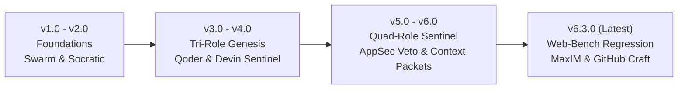

# CHANGELOG: UltimateGravity Autonomous Engineering System

All notable changes to the UltimateGravity system architecture are documented in this file.

---

## 🧭 Evolution Milestones

> [!NOTE]
> **Lineage & Versioning Note**: Versions `v1.0.0` through `v6.2.0` document the pre-release architectural research iterations and private laboratory prototypes engineered by [@MasterPandaa](https://github.com/MasterPandaa). Version `v6.3.0` marks the initial canonical public open-source release on GitHub.

---

## [v6.3.0] - 2026-11-21

### 🚀 Highlights
Major release adding automated regression benchmarking, lexical-first retrieval hierarchy, information-theoretic memory compaction, unified IT operational resilience, and the `github-craft` repository launch engine.

### Added & Optimized
- **GitHub Launch & Conversion Engine (`github-craft`)**: Authored comprehensive repository launch skill ($L_0 \le 60$ lines) and 5 modular reference guides codifying high-conversion README architecture, evergreen transformation About descriptions, 18-topic algorithmic discovery, scannable milestone changelogs, automated GitHub releases via `gh` CLI, and 21:9 banner/badge specifications.
- **Automated Regression Suite (`bench-runner.js`)**: Standalone, zero-dependency test runner executing 26 deterministic regression test cases across 4 suites:
  - `browser-resilience.jsonl`: Visual SSIM $\ge 0.98$, DOM accessibility, and anti-bot challenge boundaries.
  - `code-sequential.jsonl`: Multi-step state accumulation ($N \to N+1$), Zod schemas, and 4 UI states.
  - `core-rules.jsonl`: 15 system hygiene checks, Quad-Role invariants, and token budgets.
  - `skill-activation.jsonl`: Trigger sensitivity ($D_1 \ge 4$), Step 0 mandatory ingestion, and telemetry attributability.
- **Lexical-First Grep Hierarchy (PwC Labs & Code Search Studies)**: Proved exact regex search outperforms dense vector embeddings by eliminating semantic drift ("false friends") and saving ~1.5 GB RAM by removing vector DBs.
- **Dual-Gate Memory Compaction (Google Research & DeepMind)**: Enforced capacity-constrained bounds ($|S_t| \le C$) across task handoffs:
  - *Forward Gate (Predictive Sufficiency)*: Retains only unfulfilled criteria, contracts, and next-step actions.
  - *Backward Gate (Recursive Consistency)*: Mandates 100% entailment from physical tool execution logs.
- **7 Canonical Subsystems of Production Harnesses (Empirical 11-Agent Study)**: Codified empirical study of 11 production coding agents ($\text{Agent} = \text{Model} + \text{Harness}$) across the Agent Loop, LLM Provider, Tools Sandbox, Memory, Safety, Orchestration, and Extension Surfaces.
- **Offline Sleep & Rehearsal Paradigm (Google Research)**: Post-session consolidation (`memory-trimmer.js`) paired with synthetic benchmark rehearsal (`bench-runner.js run`) to prevent catastrophic forgetting.
- **Unified IT Soft Skills (`it-soft-skills`)**: Consolidated and translated 11 raw community skills into one high-efficiency English meta-skill ($L_0 \le 60$ lines) with 4-tier audience translation (Executive, Client, User, Engineer), SEV 1–4 incident triage, and blameless post-mortem RCA.
- **PRD-to-Engineering Decomposition Matrix (phuryn/pm-skills)**: 3-layer spec decomposition (Story $\to$ Contract $\to$ Assertion) integrated into `clean-code-fullstack`.

### Fixed & Cleaned
- **Reference Integrity**: Repaired broken link in `agent-judge/SKILL.md` pointing to missing `references/rubrics.md`.
- **Telemetry Hygiene**: Purged 8 stale ghost telemetry records from `skill-usage.json`.

---

## [v6.2.0] - 2026-11-16

### Added & Optimized
- **Quad-Role Architecture Synchronization**: Full parity across `fullstack-developer`, `qa-engineer`, `data-engineer`, and `security-engineer`.
- **Wazuh FIM & LOLBin Correlation**: File integrity monitoring for agent configuration roots (`~/.gemini`) and Sysmon Event ID correlation.
- **Rad Spacing Hierarchy & 10-Pass UI Unslop**: 40% spacing scale ($1.4\times$) and Pass 0 Design Archetypes eliminating multi-variable CSS churn.
- **STRIDE Threat Modeling & Container Hardening**: Pre-implementation architectural threat analysis and non-root Docker isolation.
- **HackerOne VRT 7-Question Validation Gate**: Objective falsification checks preventing severity inflation in security audits.

---

## [v6.1.0] - 2026-11-13

### Optimized & Cleaned
- **Host Footprint Pruning**: Reclaimed 1.79 GB disk space by decommissioning redundant background workers and legacy virtual environments.
- **Slack QA Notification Probe (`slack-qa-notify.ps1`)**: Automated webhook dispatch on test regressions and security veto halts.
- **Universal Operational Invariants (§4.H)**: Codified Elephant-Goldfish Review, Minimal Verifiable Blast Radius (MVBR < 50 lines), Call-Graph Reachability Triage, and Filesystem-First OpenAPI invariants.

---

## [v6.0.0] - 2026-11-11

### Added (Canonical Milestone)
- **Universal Context Packets (`task-dag --consumes`)**: Eliminated multi-agent context bleed by passing verified schema slices instead of raw chat histories.
- **Codebase Precedence Anchor (§4.B)**: Grounding principle where live repository source code and verified tests strictly override outdated documentation.
- **AST Outline Extractor (`ast-outline.js`)**: Sub-millisecond syntax skeleton generator pruning files >300 lines by ~85% token volume.
- **Dynamic MCP Profiler (`mcp-profile.js`)**: Tool gatekeeper keeping active MCP tools $\le 150$ on 8GB RAM host environments.

---

## [v5.0.0] - 2026-11-05

### Added & Optimized
- **Startup Token Diet**: Reduced Turn-0 system prompt payload by 67% via Progressive Disclosure.
- **Language Boundary Enforcement (§4.G)**: Mandated 100% English for all system skills, rules, scripts, and commit messages.
- **GoLive Production Deployment Safety**: Safe 5-stage deployment protocol across Vercel, Supabase, Cloudflare, and Stripe.

---

## [v4.0.0] - 2026-10-29

### Added
- **Tri-Role Architecture Genesis**: Partitioned responsibilities into Full Stack Developer, QA & SDET, and Data Engineer.
- **Solo Direct Primary Loop Default**: Adopted Anthropic Applied AI standard folding 95% of workflows into a single high-speed agent loop.
- **Diagnostic Watchdog Hook**: Real-time pre-commit syntax linter catching JS/TS runtime crashes.
- **Devin Live Browser Sentinel**: Headless Edge probe detecting React hydration failures and unhandled exceptions.
- **Qoder File Rewind**: Continuous shadow-copy versioning capturing automatic file snapshots prior to mutations.
