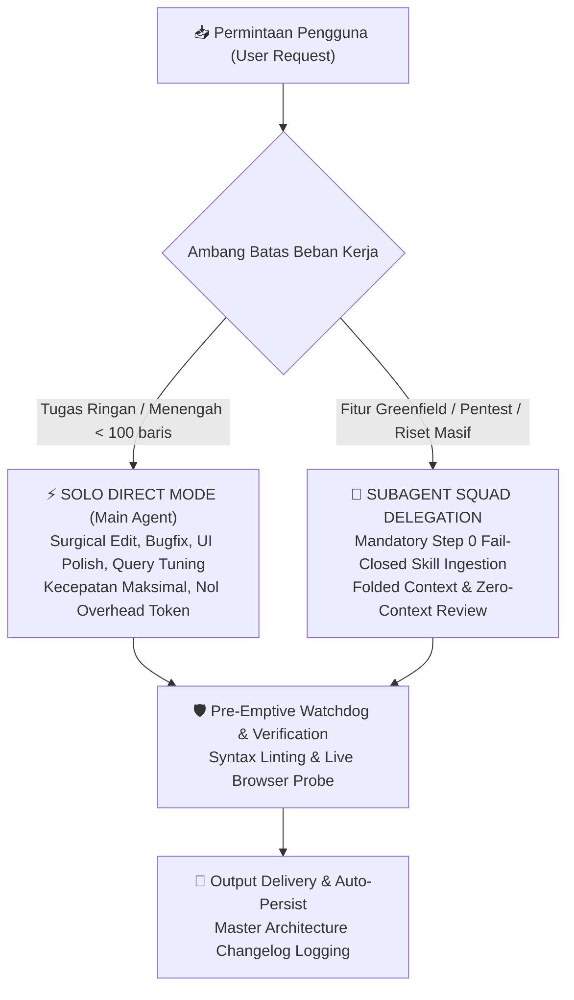

# 🌌 UltimateGravity: Tri-Role Autonomous Engineering System for Antigravity

[](LICENSE)
[](https://deepmind.google)
[](GEMINI.md)
[](CHANGELOG.md)

**UltimateGravity** adalah distribusi arsitektur rekayasa perangkat lunak otonom generasi ke-4 untuk **Google Antigravity (AGY)**. Dirancang dengan mengadopsi fitur terbaik dari **Devin** (Cognition) dan **Qoder**, menyerap terobosan riset akademis (**Google Research RRSI**, **ZJU PaperGym**, **Rederive**, **LearnHarness**), serta menegakkan standar **Anthropic Applied AI** (*Solo Direct Mode* sebagai jalur utama).

---

## ⚡ Quickstart (1-Click Installation)

### Opsi A: Menggunakan Git Clone (Disarankan)

1. Buka PowerShell / Terminal di laptop Anda, lalu clone repositori ini:
   ```powershell
   git clone https://github.com/MasterPandaa/UltimateGravity.git
   cd UltimateGravity
   ```

2. Jalankan installer otomatis:
   ```powershell
   powershell -ExecutionPolicy Bypass -File .\install.ps1
   ```
   *Skrip akan secara otomatis:*
   - Mengonfigurasi seluruh arsitektur ke folder `~/.gemini`.
   - Menyesuaikan jalur sistem ke profil pengguna Anda (`%USERPROFILE%`).
   - Mendaftarkan folder `bin/` ke **User PATH Windows**.
   - Membuat backup otomatis jika Anda memiliki konfigurasi `.gemini` sebelumnya.

3. **Buka / Restart IDE Google Antigravity**. Seluruh aturan, 3 Agen Inti, 9 Subagent EGM, 38 Skills, Hooks linter, dan 13 CLI tools langsung aktif!

---

## 🏛️ Arsitektur & Topologi Sistem



---

## 👥 Roster Agen & Subagent

### 1. Tiga Role Spesialis Utama (`config/agents/`)
- **Fullstack Developer (`fullstack-developer`)**: React/Next.js/Tailwind craft, layered clean backend, ORM & query profiling (`sql-optimization`), dan bedah tipe presisi minimalis (`karpathy-guidelines`).
- **QA & SDET Engineer (`qa-engineer`)**: Boundary Value Analysis (BVA), Equivalence Partitioning, Playwright headless browser automation, loop investigasi 4 langkah (`diagnosing-bugs`), dan audit keamanan OWASP.
- **Data Engineer (`data-engineer`)**: Scraping multi-tier (Scrapling stealth anti-bot bypass & Firecrawl), pemodelan ERD/OLAP, optimasi kueri analitik, pipeline Windows PowerShell, dan sanitasi integritas AI (`ai-infra-guard`).

### 2. Sembilan Subagent EGM (Elephant-Goldfish Model di `config/plugins/`)
Persona independen untuk audit *zero-context adversarial review* (mencegah agen men-cap jempol karyanya sendiri):
- `egm-design`: Kritik sistem arsitektur & skalabilitas.
- `egm-zoom-out`: Skeptisisme terhadap over-engineering (YAGNI).
- `egm-comprehension`: Audit keterbacaan dari perspektif pembaca baru.
- `egm-structural`: Validasi tata letak & hierarki heading.
- `egm-style`: Copy editing teknis & eliminasi kalimat bertele-tele.
- `egm-codebase-details`: Verifikasi implementasi kode terhadap dokumen.
- `egm-implementation-readiness`: Kesiapan eksekusi instruksi kerja.
- `egm-synthesizer`: Penggabung laporan temuan multi-persona.
- `egm-bootstrap-orchestrator`: Partisi dan orkestrasi dokumentasi.

---

## 💻 14 Perintah CLI Global (Bisa Dipanggil dari Terminal Mana Saja)

Setelah instalasi, buka PowerShell atau Command Prompt baru. Seluruh perintah ini dapat dipanggil langsung dari direktori proyek mana saja:

| Perintah CLI | Fungsi Utama | Contoh Pemanggilan |
|---|---|---|
| `file-rewind` | Salinan bayangan (*shadow copy*) & instant rollback aman | `file-rewind list src/app.js`<br>`file-rewind rollback src/app.js` |
| `step-checkpoint` | Snapshot state & differential revert antar milestone tugas | `step-checkpoint create v1`<br>`step-checkpoint diff v1` |
| `task-dag` | State machine dependensi tugas (`blockedBy`) & ekspor Mermaid | `task-dag list`<br>`task-dag mermaid` |
| `workspace-index` | Pemetaan topologi proyek inkremental pre-prompt (<350ms) | `workspace-index scan` |
| `browser-sentinel` | Probe dev server (Vite/Next.js) & deteksi hydration error | `browser-sentinel probe http://localhost:3000` |
| `agy-exec` | Eksekusi PowerShell persisten (menjaga CWD, venv, state) | `agy-exec "Get-ChildItem"` |
| `skill-usage` | Telemetri frekuensi pemanggilan skill & deteksi dead skills | `skill-usage summary` |
| `tier-manager` | Mengarsipkan atau mengaktifkan skill/agent on-demand | `tier-manager list` |
| `fd` | Biner native Rust untuk pencarian berkas ultra-cepat | `fd -e tsx` |

---

## 🔬 Terobosan Riset & Praktik Terbaik yang Diserap

1. **Google Research RRSI (`google-research/rrsi`)**:
   - Noise-adjusted floor ($S' \ge S^* - \delta$) & Token-ROI budget gate ($\Delta C \le \beta_0 + \beta_1 \Delta S$).
2. **ZJU REAL PaperGym (`zju-real/papergym`)**:
   - Two-pillar research plan (Metodologi vs Eksperimen) & Anti-criterion leakage protocol (<5%).
3. **Cognition Devin Low-RAM Edition**:
   - Pre-emptive diagnostic watchdog hook (<150ms post-edit linter) & live Edge headless browser sentinel (0 MB idle).
4. **Qoder Platform Architecture**:
   - Continuous file history, stateful persistent shell, dan background incremental indexer.
5. **Git Foremerge Protocol (`naw103/foremerge`)**:
   - Semantic intent declaration untuk eliminasi konflik merge multi-agent worktrees.
6. **UI/UX Craft Standards**:
   - Standar 8pt spacing rhythm, palet off-black `#0F172A`, 4 UI states eksplisit, dan 3-pilar actionable error microcopy.

---

## 🛠️ Pemasangan Opsional Peralatan Berat (Heavyweight Tools)

Untuk menjaga repositori tetap ringan (< 10 MB), perkakas berikut dipasang terpisah sesuai kebutuhan:

- **Nuclei (OWASP Security Scanner)**:
  ```powershell
  winget install projectdiscovery.nuclei
  ```
- **Playwright Headless Browser Engine**:
  ```powershell
  npx playwright install
  ```
- **Scrapling Stealth Anti-Bot Scraper**:
  ```powershell
  pip install scrapling
  ```

---

## 📋 Persyaratan Sistem
- **OS**: Windows 10 / 11 (64-bit)
- **Runtime**: [Node.js](https://nodejs.org) v18+ (LTS)
- **Shell**: PowerShell 5.1 atau PowerShell 7+

---

## 📄 Lisensi
Didistribusikan di bawah lisensi [MIT](LICENSE). Copyright (c) 2026 MasterPandaa.
