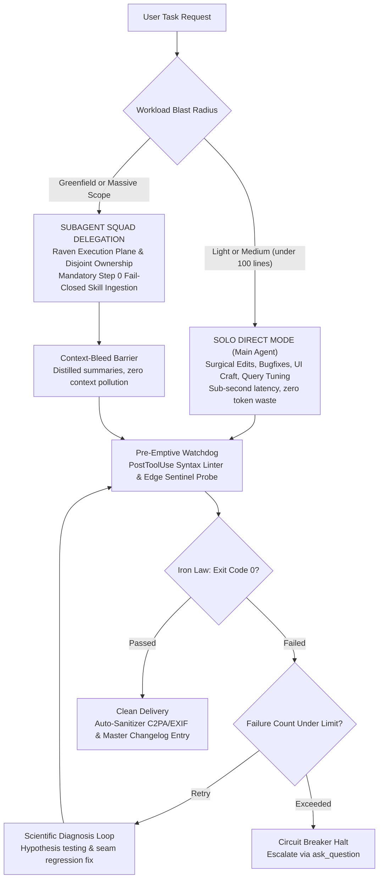

<div align="center">
  
  <br /><br />
  <h1>UltimateGravity</h1>
  <p><strong>Tri-Role Autonomous Engineering & Frontier Self-Evolving Agent System for Google Antigravity</strong></p>
  <p><em>Anti-AI Slop Humanization, Modern Web & Stageshow Craft, DeepSec Adversarial Auditing, 5-Pillar Harness, & 3-Tier LSM Context Pruning</em></p>

  [](LICENSE)
  [](https://deepmind.google)
  [](GEMINI.md)
  [](CHANGELOG.md)
  [](install.ps1)
</div>

---

## ⚡ The Pain vs. The Fix

| Without UltimateGravity (Standard AI Assistants) | With UltimateGravity v4.7.0 |
|---|---|
| **AI Slop & Generic Tropes**: Verbose boilerplate, empty adjectives (*"blazing fast"*, *"game-changing"*), decorative non-functional gradients, and robotic copy. | **Anti-AI Slop & 9-Pass Refactoring**: 3 absolute diagnostic tests (*Topic-Swap*, *"So What?"*, *Real Reader*) and sequential UI refactoring (*Spacing ➔ Color ➔ Icons ➔ Copy ➔ Type ➔ Layout ➔ Details ➔ Visuals ➔ Motion*). |
| **Context Rot & Quadratic Degradation**: Unbounded raw token accumulation in long sessions degrades model attention and skyrockets billing costs. | **3-Tier LSM Active Context Pruning**: Bounded active context (50k–150k tokens) via Tier 0 Working Set, Tier 1 Milestone Diff Digests, and Tier 2 Semantic Anchors, slashing latency by $3\times$ with up to $80\%$ KV-cache discounts. |
| **False-Positive Security Hallucinations**: Single-pass AI audits generate 40–60% false alarms, flagging unreachable vulnerabilities without working PoCs. | **DeepSec Two-Pass Adversarial Audit**: Pass 1 Taint Source-to-Sink investigation coupled with Pass 2 Adversarial Critic Falsifier disproving unexploitable findings. |
| **Telephone Game Bloat & Subagent Drift**: Fragmenting tasks across dozens of uncoordinated subagents causes context bleed, sync drift, and token exhaustion. | **Solo Direct Primary Loop**: Anthropic Applied AI standard folds 95% of workflows into a single high-speed agent loop with progressive skill disclosure. |
| **Assumed Fixes & Irreversible Edits**: Declaring completion without running code; faulty edits overwrite source files permanently. | **The Iron Law & Time-Travel Safety**: Mandatory terminal exit code 0, live Edge sentinel browser probe, continuous shadow copies (`file-rewind`), and milestone snapshots (`step-checkpoint`). |

---

## 🚀 Quickstart (1-Click Setup)

Copy and run in PowerShell to provision the complete v4.7.0 canonical architecture into `~/.gemini`:

```powershell
# 1. Clone the master repository
git clone https://github.com/MasterPandaa/UltimateGravity.git
cd UltimateGravity

# 2. Run automated Windows installer
powershell -ExecutionPolicy Bypass -File .\install.ps1

# 3. Verify terminal tools
workspace-index scan
# => Scanned 35 skills, 3 specialist agents, and 18 CLI tools. Ready!
```

> [!NOTE]
> Restart Google Antigravity IDE or your active PowerShell terminal after installation to load the updated `PATH` and active rules.

---

## 📂 Codebase at a Glance

```text
UltimateGravity/
├── assets/
│   ├── banner.jpg               # Ultra-wide 21:9 official repository banner
│   └── banner.png               # Lossless high-fidelity visual asset
├── bin/                         # 18 cross-directory Windows CLI executables
│   ├── agy-exec.bat             # Persistent PowerShell session engine
│   ├── browser-sentinel.bat     # Edge headless hydration & runtime crash probe
│   ├── file-rewind.bat          # Shadow-copy rollback engine
│   ├── harness-distiller.bat    # Friction log scanner & L0 <= 60 instruction distiller
│   ├── step-checkpoint.bat      # Atomic milestone snapshot engine
│   ├── task-dag.bat             # Dependency-aware state machine
│   └── workspace-index.bat      # Sub-350ms Rust-powered topology scanner
├── config/
│   ├── agents/                  # 3 Core Specialist autonomous roles
│   │   ├── fullstack-developer  # Modern Web, GSAP motion, Vercel guidelines, SQL
│   │   ├── qa-engineer          # DeepSec 2-pass audit, Playwright E2E, BVA heuristics
│   │   └── data-engineer        # Scrapling, Firecrawl, ETL pipelines, ERD models
│   ├── hooks/                   # Deterministic lifecycle hooks (syntax, watermark)
│   └── skills/                  # 35+ curated Tier 1 engineering SOPs
├── scripts/                     # Node.js & PowerShell background automation engines
│   ├── harness2.js              # Google Harness2 8-component open-world engine
│   ├── harness-distiller.js     # L0 prompt distillation & session discovery
│   └── workspace-indexer.js     # Incremental project topology mapper
├── tools/watermarks-remover/    # Native C2PA, EXIF, and AI watermark stripper
├── GEMINI.md                    # Canonical governance rules, token budgets & inquiry compass
├── CHANGELOG.md                 # Master canonical evolution record (v1.0 -> v4.7.0)
└── install.ps1                  # Idempotent 1-click Windows installer (~160 lines)
```

---

## 🏛️ System Topology & Execution Flow



---

## 👥 Roster: 3 Core Specialist Roles

The system operates across **3 Core Specialist Roles** with zero bureaucratic overhead:

### 1. Full Stack Developer (`fullstack-developer`)
- **Frontend Craft & Vercel Standards**: React, Next.js SSR hydration safety, high-contrast `:focus-visible` rings, $44 \times 44\text{px}$ touch targets, hardware notch safe-area insets (`env(safe-area-inset-bottom)`), and `font-variant-numeric: tabular-nums` to eliminate layout jitter.
- **Stageshow & Motion Architecture**: Asymmetric Bento grids (1 dominant Hero Card + 2–3 compact supporting cards), realistic macOS/device window shells, and `@gsap/react` `useGSAP()` lifecycle-safe tweens (zero memory leaks, strict GPU transform compositing).
- **Backend & Systems**: High-performance REST, GraphQL, and gRPC design (`api-contract-design`), clean layered architecture, structured error envelopes, and strict runtime validation (Zod/Pydantic).
- **Data Layer & ORM**: Relational schema design, safe migrations, composite indexes, query profiling via `EXPLAIN ANALYZE` (`sql-optimization`), and ACID transactions.
- **Surgical Precision**: Advanced type contracts (`typescript-pro`), anti-complexity guidelines (`karpathy-guidelines`), and native Windows automation (`powershell-windows-patterns`).

### 2. Quality Assurance & SDET (`qa-engineer`)
- **DeepSec Two-Pass Adversarial Audit**: Pass 1 Taint Source-to-Sink vulnerability tracing paired with Pass 2 Adversarial Falsifier review to eliminate false alarms.
- **Testing Strategy**: Boundary Value Analysis (BVA), Equivalence Partitioning, Decision Tables, and comprehensive test matrices (`qa-skills`).
- **Browser Automation & E2E**: Playwright headless browser suites (`playwright-cli`), layout overflow detection, network request tracing, and visual regression testing.
- **Scientific Diagnosis & TDD**: 4-step hypothesis testing loop (`diagnosing-bugs`) with $\le 3$ attempt circuit breaker (`TokenEconomizer`), and test-first interface seam cycles (`tdd`).
- **Testing Integrity**: Absolute proof enforcement (`verification-before-completion`), flaky test purging (`test-antipatterns`), and desktop memory leak profiler (`memory-leak-detector`).

### 3. Data Engineer (`data-engineer`)
- **Multi-Tier Web Scraping**: Scrapling (stealth browser, anti-bot bypass, headless) and Firecrawl for block-free structured extraction (`agent-reach`).
- **Data Modeling & Warehousing**: Entity-Relationship Diagrams (ERD), OLTP transactional and OLAP analytical schemas, normalization/denormalization.
- **SQL Profiling & Tuning**: Deep composite indexing, analytical query tuning, I/O bottleneck elimination, and query planning (`sql-optimization`).
- **ETL Pipelines & Automation**: Ingestion scripts, data transformation, deduplication, runtime schema validation, and Windows pipeline automation (`powershell-windows-patterns`).

---

## 💻 18 Global CLI Commands

After installation, these commands can be called directly from any terminal or PowerShell prompt:

| Command | Subsystem | Function & Architecture | Example Syntax |
|---|---|---|---|
| `file-rewind` | Qoder Engine | Continuous shadow-copy versioning & instant file rollback | `file-rewind list src/index.ts`<br>`file-rewind rollback src/index.ts` |
| `step-checkpoint` | Devin Snapshot | Atomic workspace milestone snapshots & differential diffs | `step-checkpoint create v1`<br>`step-checkpoint diff v1` |
| `task-dag` | DAG State Machine | Dependency-aware execution graph (`blockedBy`) & Mermaid export | `task-dag list`<br>`task-dag mermaid` |
| `workspace-index` | Rust Scanner | Sub-350ms incremental pre-prompt topology scanner | `workspace-index scan` |
| `browser-sentinel` | Devin Sentinel | Edge engine dev-server probe & React hydration crash detector | `browser-sentinel probe http://localhost:3000` |
| `harness-distiller` | Harness-Zero | Friction log scanner & instruction distiller ($L_0 \le 60$ lines) | `harness-distiller scan`<br>`harness-distiller distill` |
| `harness2` | Google Harness² | 8-component open-world tree audit & Persistent Improvement Library | `harness2 tree`<br>`harness2 status` |
| `rrsi-eval` | Google RRSI | 5-Gate mathematical safety floor & cross-model invariant audit | `rrsi-eval gate-check` |
| `raven-dispatch` | Raven DAG | Collision-free subagent DAG partitioning & context barrier | `raven-dispatch plan` |
| `repo-wiki` | Fast Topology | Rust-powered `fd.exe` repository architecture summarizer | `repo-wiki generate` |
| `clean-file` | Watermark Sanitizer | Strips C2PA, EXIF, and AI steganographic artifacts from files | `clean-file "diagram.svg"`<br>`clean-file "report.pdf" -InPlace` |
| `agy-exec` | Persistent Shell | Stateful PowerShell runner preserving CWD, venvs, and variables | `agy-exec "Get-ChildItem"` |
| `skill-usage` | Telemetry | Invocations heatmap & dead skill pruning candidate detector | `skill-usage summary` |
| `tier-manager` | Governance | Archives or activates skills and agent profiles on-demand | `tier-manager list` |
| `fd` | Native Rust Binary | High-performance filesystem search engine | `fd -e tsx` |

---

## 🔬 Benchmark & Frontier Research Integration

- **Google Research Harness² (arXiv:2610.14224)**: 8-component modular tree (`c1` Prompt, `c2` Rules, `c3` Memory, `c4` Skills, `c5` Tools, `c6` Scripts, `c7` Agents, `c8` Hooks), Propose-Probe-Compose (PPC) cycle for open-world tasks without ground-truth verifiers, and cross-task Persistent Improvement Library.
- **Google Research RRSI & MaD-RSI (arXiv:2610.28201)**: Mathematical safety gates ($S' \ge S^* - \delta$) and cross-model failure matrices ensuring invariant stability across Gemini, Claude, and DeepSeek.
- **Harness-Zero Distiller (arXiv:2609.24972)**: Dynamic session discovery that prunes prompt bloat into lean $L_0 \le 60$ line specifications.
- **Vercel DeepSec (`vercel-labs/deepsec`)**: Two-pass adversarial security revalidation slashing single-pass false positives by 40–60%.
- **3-Tier LSM Active Context Pruning (`ranxianglei/billion-context`)**: Log-Structured Merge context compaction bounding active token volume to 50,000–150,000 tokens for $3\times$ latency reduction and up to 80% KV-cache cost savings.
- **Microsoft TokenEconomizer (`microsoft/TokenEconomizer`)**: $\le 3$ attempt circuit breaker halting runaway speculative edit loops before token exhaustion.
- **Damir Sokolovsky Unslop (`heydamir/unslop`)**: 9-pass sequential UI refactoring pipeline eliminating multi-variable CSS churn.
- **Benji Taylor Stageshow (`benjitaylor/skills`)**: Asymmetric bento grids, window/device shells, and `@gsap/react` `useGSAP()` zero-leak motion choreography.

---

## 🛠️ Optional Heavyweight Extensions

To preserve a featherweight repository footprint (< 15 MB), install specialized tooling on demand:

```powershell
# OWASP Automated Pentesting Scanner
winget install projectdiscovery.nuclei

# Playwright Headless Browser Automation
npx playwright install

# Scrapling Stealth Anti-Bot Web Scraper
pip install scrapling
```

---

## 📋 System Requirements

- **Operating System**: Windows 10 / Windows 11 (64-bit)
- **Runtimes**: [Node.js](https://nodejs.org) v18+ (LTS) & [Python](https://python.org) 3.10+
- **Shell**: PowerShell 5.1 (Built-in) or PowerShell 7+ (Recommended)
- **Host Platform**: Google Antigravity IDE / AGY CLI

---

## 📄 License & Attribution

Distributed under the [MIT License](LICENSE). Built by the **UltimateGravity Engineering Team** for the Google Antigravity frontier agent ecosystem.
