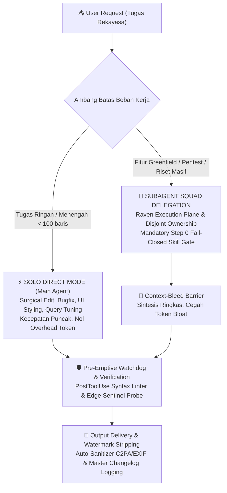

# 🌌 UltimateGravity: Tri-Role Autonomous Engineering System for Google Antigravity

[](LICENSE)
[](https://deepmind.google)
[](GEMINI.md)
[](CHANGELOG.md)

**UltimateGravity** adalah distribusi master arsitektur rekayasa perangkat lunak otonom untuk **Google Antigravity (AGY)** generasi ke-5 (v4.6.0). Sistem ini mengintegrasikan seluruh pilar terbaik dari **Devin** (Cognition) dan **Qoder**, menyerap gugus riset frontier 2026 (**Harness-Zero Distiller**, **Google Research RRSI**, **MaD-RSI 5-Gate Regularizer**, **EverMind-AI/Raven Multi-Agent DAG**, **HELIX Substrate**), serta menegakkan standar disiplin **Anthropic Applied AI** (*Solo Direct Mode* sebagai jalur utama).

---

## ⚡ Quickstart (Instalasi 1-Klik)

### Menggunakan Git Clone

1. Buka PowerShell / Terminal di komputer Anda, lalu clone repositori ini:
   ```powershell
   git clone https://github.com/MasterPandaa/UltimateGravity.git
   cd UltimateGravity
   ```

2. Jalankan installer otomatis:
   ```powershell
   powershell -ExecutionPolicy Bypass -File .\install.ps1
   ```
   *Skrip secara otomatis:*
   - Mengonfigurasi seluruh arsitektur ke folder `~/.gemini`.
   - Menyesuaikan jalur sistem ke profil pengguna Anda (`%USERPROFILE%`).
   - Mendaftarkan folder `bin/` ke **User PATH Windows**.
   - Membuat cadangan otomatis jika Anda memiliki konfigurasi `.gemini` sebelumnya.

3. **Buka / Restart IDE Google Antigravity**. Seluruh aturan, 3 Agen Spesialis, 35 Skills, Lifecycle Hooks, dan 18 CLI tools langsung aktif seketika!

---

## 🏛️ Topologi & Alur Eksekusi Sistem



---

## 👥 Roster 3 Role Spesialis Utama (`config/agents/`)

Sistem beroperasi disiplin pada 3 Role Spesialis Inti tanpa birokrasi hierarki:

1. **Fullstack Developer (`fullstack-developer`)**:
   - **Frontend Craft**: React, Next.js, Vite, TypeScript, Tailwind CSS, `shadcn-ui`, micro-interactions, responsive multi-device layout audit (`responsive-fixer`), penegakan 4 UI states (`anti-slop`, `impeccable`).
   - **Backend & Systems**: Desain REST API, GraphQL, gRPC berkinerja tinggi (`api-contract-design`), arsitektur berlapis (*layered clean architecture*), penanganan error terstruktur, validasi skema runtime ketat (Zod/Pydantic).
   - **Data Layer & ORM**: Perancangan skema relasional, migrasi database aman, indeks komposit, profiling kueri via `EXPLAIN ANALYZE` (`sql-optimization`), transaksi ACID.
   - **Type Safety & Surgical Coding**: Kontrak tipe tingkat lanjut (`typescript-pro`), simplisitas dan bedah presisi minimalis (`karpathy-guidelines`), otomatisasi sistem Windows native (`powershell-windows-patterns`).

2. **Quality Assurance & SDET (`qa-engineer`)**:
   - **Strategi & Heuristik Uji**: Boundary Value Analysis (BVA), Equivalence Partitioning, Decision Tables, test matrices (`qa-skills`).
   - **Otomasi Browser & E2E**: Suite pengujian browser headless Playwright (`playwright-cli`), network request tracing, visual regression testing, deteksi layout overflow (`responsive-fixer`).
   - **Diagnosis Bug Ilmiah & TDD**: Loop diagnosis 4 langkah (`diagnosing-bugs`) dan siklus pengujian test-first di interface seams (`tdd`).
   - **Audit Keamanan & Review**: Audit keamanan OWASP Top 10 (`security-audit`), review diff dua sumbu (`code-review`).
   - **Integritas Uji & Deteksi Leak**: Penegakan bukti mutlak (*The Iron Law* di `verification-before-completion`), pembersihan tes rapuh (`test-antipatterns`), dan profiler kebocoran memori Windows/Desktop (`memory-leak-detector`). Dilarang melemahkan test suite hanya agar terlihat hijau.

3. **Data Engineer (`data-engineer`)**:
   - **Ekstraksi & Web Scraping Multi-Tier**: Scrapling (stealth anti-bot bypass, headless) dan Firecrawl untuk ekstraksi data terstruktur (`agent-reach`).
   - **Pemodelan Data & Warehousing**: Desain skema Entity-Relationship (ERD), skema OLTP dan analitis OLAP, normalisasi/denormalisasi.
   - **SQL Profiling & Tuning**: Indexing komposit mendalam, tuning kueri analitik, eliminasi bottleneck I/O, dan query planning (`sql-optimization`).
   - **Pipeline ETL & Otomasi**: Scripting ingest data, transformasi, deduplikasi, validasi schema, dan otomasi pipeline Windows (`powershell-windows-patterns`).

---

## 💻 18 Perintah CLI Global (Bisa Dipanggil dari Terminal Mana Saja)

Setelah instalasi, buka PowerShell atau Command Prompt baru. Seluruh perintah ini dapat dipanggil langsung dari direktori proyek mana saja:

| Perintah CLI | Modul Asal | Fungsi Utama & Cara Kerja | Contoh Pemanggilan |
|---|---|---|---|
| `file-rewind` | Qoder History | Salinan bayangan (*shadow copy*) otomatis & instant rollback aman | `file-rewind list src/app.js`<br>`file-rewind rollback src/app.js` |
| `step-checkpoint` | Devin Snapshot | Snapshot state & differential revert antar milestone tugas | `step-checkpoint create v1`<br>`step-checkpoint diff v1` |
| `task-dag` | Qoder DAG | State machine pelacakan dependensi tugas (`blockedBy`) & ekspor Mermaid | `task-dag list`<br>`task-dag mermaid` |
| `workspace-index` | Fast Rust Scanner | Pemetaan topologi proyek inkremental pre-prompt (< 350ms) | `workspace-index scan` |
| `browser-sentinel` | Devin Sentinel | Probe dev server (Vite/Next.js) & deteksi hydration error via Edge native | `browser-sentinel probe http://localhost:3000` |
| `harness-distiller` | Harness-Zero | Pemindai log friksi sesi & penyuling otomatis instruksi $L_0 \le 60$ baris | `harness-distiller scan`<br>`harness-distiller distill` |
| `rrsi-eval` | Google RRSI | Evaluator regulasi 5-Gate matematis (noise floor, ROI token, leakage) | `rrsi-eval gate-check` |
| `raven-dispatch` | Raven DAG | Generator DAG subagent bebas tabrakan & sintesis context-bleed barrier | `raven-dispatch plan`<br>`raven-dispatch synthesize` |
| `repo-wiki` | Fast Topology | Generator ringkasan arsitektur repositori bertenaga Rust `fd.exe` (< 300ms) | `repo-wiki generate` |
| `clean-file` | Watermark Sanitizer | Pembersih metadata C2PA, EXIF, dan teks steganografi AI dari artefak | `clean-file "diagram.svg"`<br>`clean-file "report.pdf" -InPlace` |
| `agy-exec` | Persistent Shell | Eksekusi PowerShell persisten yang menjaga CWD, variabel lingkungan, dan venv | `agy-exec "Get-ChildItem"` |
| `skill-usage` | Telemetri | Perekaman frekuensi pemanggilan skill & deteksi dead skills | `skill-usage summary` |
| `tier-manager` | Tiered Governance | Mengarsipkan atau mengaktifkan skill/agen on-demand | `tier-manager list` |
| `fd` | Rust Binary | Biner native Rust untuk pencarian berkas ultra-cepat | `fd -e tsx` |

---

## 🔬 Terobosan Riset & Praktik Terbaik yang Diserap

1. **Harness-Zero Distiller & Session Discovery (arXiv:2609.24972)**:
   - Pemindaian otomatis log percakapan aktif untuk menemukan *high-churn files* dan *error signatures*.
   - Penyulingan instruksi koding minimalis dengan penegakan anggaran baris ketat $L_0 \le 60$ baris (*Code-as-Agent-Harness*).
2. **Google Research RRSI & MaD-RSI 5-Gate Regularizer (arXiv:2610.28201)**:
   - *Noise-Adjusted Safety Floor* ($S' \ge S^* - \delta$), *Token-ROI Cost Rule* ($\Delta C \le \beta_0 + \beta_1 \Delta S$), dan *Cross-Model Invariant Filter* untuk menjamin netralitas lintas LLM (Gemini, Claude, DeepSeek, Qwen).
   - *MaD-RSI Multi-Model Failure Matrix* untuk memilah antara cacat sistem universal vs anomali model tertentu.
3. **EverMind-AI / Raven Multi-Agent Execution Plane**:
   - DAG task partitioning dengan partisi berkas eksklusif (*disjoint file ownership*), isolasi branch terpisah, dan *Context-Bleed Barrier* yang mencegah context bloat agen utama.
4. **Substrat Modular HELIX (Fan & Huang, HKU - Agustus 2026)**:
   - Dekomposisi atomik (*Reusable Atoms, Typed Ports, Recipes*) yang memungkinkan pemangkasan komponen mati tanpa efek samping regresi.
5. **The Iron Law of Verification (`verification-before-completion`)**:
   - Mengharamkan asumsi selesai tanpa bukti segar eksekusi perintah terminal dengan exit code 0.
6. **Windows Native Memory Leak Detector (`memory-leak-detector`)**:
   - Profiler kebocoran GDI/USER handles, VirtualAlloc bloat via VMMap, UMDH, dan Electron/Node heap snapshot.
7. **Universal Cognitive Inquiry Compass (5 Kuadran Kognitif di `GEMINI.md`)**:
   - Menghilangkan tebakan buta pada *lazy prompts* dengan 5 kuadran (Harus Tanya, Butuh Pendapat, Tanya Preferensi, Tanya Selera, Dilarang Tanya) berbasis widget interaktif 1-klik native `ask_question`.
8. **Automated Zero-Watermark & Provenance Stripping Gate**:
   - Hook otomatis `PostToolUse` yang membersihkan metadata C2PA, EXIF, dan teks steganografi dari seluruh artefak dokumen dan visual secara transparan.

---

## 🛠️ Pemasangan Opsional Peralatan Berat (Heavyweight Tools)

Untuk menjaga repositori tetap ringan (< 15 MB), perkakas berikut dipasang terpisah sesuai kebutuhan:

- **Nuclei (OWASP Security Scanner)**:
  ```powershell
  winget install projectdiscovery.nuclei
  ```
- **Playwright Headless Browser Engine**:
  ```powershell
  npx playwright install
  ```
- **Scrapling Stealth Anti-Bot Scraper**:
  ```powershell
  pip install scrapling
  ```

---

## 📋 Persyaratan Sistem
- **OS**: Windows 10 / 11 (64-bit)
- **Runtime**: [Node.js](https://nodejs.org) v18+ (LTS) & [Python](https://python.org) 3.10+
- **Shell**: PowerShell 5.1 atau PowerShell 7+

---

## 📄 Lisensi
Didistribusikan di bawah lisensi [MIT](LICENSE). Copyright (c) 2026 MasterPandaa.
