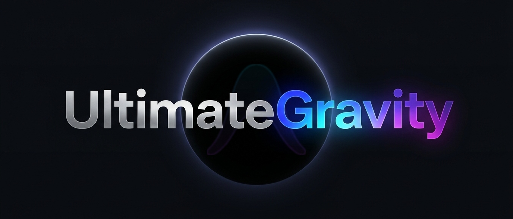
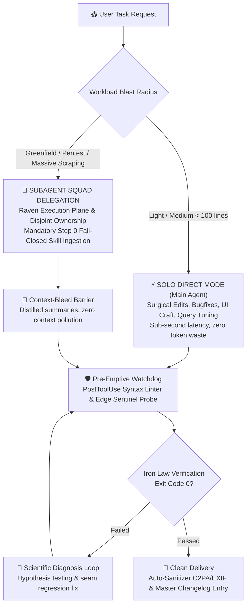

<div align="center">
  
  <br /><br />
  <h1>🌌 UltimateGravity</h1>
  <p><strong>Tri-Role Autonomous Engineering System for Google Antigravity</strong></p>

  [](LICENSE)
  [](https://deepmind.google)
  [](GEMINI.md)
  [](CHANGELOG.md)
  [](install.ps1)
</div>

---

## ⚡ The Pain vs. The Fix

| Without UltimateGravity (Standard AI Assistants) | With UltimateGravity v4.6.0 |
|---|---|
| **Telephone Game Bloat**: Spawns dozens of disconnected subagents, degrading context, wasting tokens, and causing hallucinated sync. | **Solo Direct Primary Loop**: Anthropic Applied AI standard folds 95% of workflows into a single high-speed agent loop with progressive skill disclosure. |
| **Assumed Fixes & Fake Green Tests**: Agents declare *"Done!"* without running compilers or live browsers, leaving broken builds. | **The Iron Law of Verification**: Fresh terminal command execution with verified `exit code 0` and live Edge sentinel browser probe required. |
| **Irreversible Destructive Edits**: Faulty code overwrites files irreversibly without version history or snapshot rollback. | **Continuous Shadow-Copy & Time-Travel**: Automatic background versioning (`file-rewind`) and differential milestone revert (`step-checkpoint`). |
| **Generic AI Slop & Watermarks**: Cluttered boilerplate, decorative non-functional gradients, and embedded C2PA/EXIF metadata. | **Zero AI Slop & Auto-Sanitization**: Strict 4 UI states enforcement, 8pt spatial rhythm, and automated `PostToolUse` watermark sanitizer. |

---

## 🚀 Quickstart (1-Click Setup)

Copy and run in PowerShell to provision the complete architecture into `~/.gemini`:

```powershell
# 1. Clone the master repository
git clone https://github.com/MasterPandaa/UltimateGravity.git
cd UltimateGravity

# 2. Run automated Windows installer
powershell -ExecutionPolicy Bypass -File .\install.ps1

# 3. Verify terminal tools
workspace-index scan
# => Scanned 35 skills, 3 specialist agents, and 18 CLI tools. Ready!
```

> [!NOTE]
> Restart Google Antigravity IDE or your active PowerShell terminal after installation to load the updated `PATH` and active rules.

---

## 📂 Codebase at a Glance

```text
UltimateGravity/
├── assets/
│   └── banner.jpg               # Ultra-wide 21:9 official repository banner
├── bin/                         # 18 cross-directory Windows CLI executables
│   ├── agy-exec.bat             # Persistent PowerShell session engine
│   ├── browser-sentinel.bat     # Edge headless hydration & runtime crash probe
│   ├── file-rewind.bat          # Shadow-copy rollback engine
│   ├── step-checkpoint.bat      # Atomic milestone snapshot engine
│   ├── task-dag.bat             # Dependency-aware state machine
│   └── workspace-index.bat      # Sub-350ms Rust-powered topology scanner
├── config/
│   ├── agents/                  # 3 Core Specialist autonomous roles
│   │   ├── fullstack-developer  # React, Next.js, API design, SQL profiling
│   │   ├── qa-engineer          # Playwright E2E, BVA heuristics, bug diagnosis
│   │   └── data-engineer        # Scrapling, Firecrawl, ETL pipelines, ERDs
│   ├── hooks/                   # Lifecycle automation hooks (syntax, watermark)
│   └── skills/                  # 35+ curated Tier 1 engineering SOPs
├── scripts/                     # Node.js & PowerShell background engines
├── tools/watermarks-remover/    # Native C2PA, EXIF, and AI watermark stripper
├── GEMINI.md                    # Canonical governance rules & inquiry compass
└── install.ps1                  # Idempotent 1-click Windows installer (~160 lines)
```

---

## 🏛️ System Topology & Execution Flow



---

## 👥 Roster: 3 Core Specialist Roles

The system operates across **3 Core Specialist Roles** with zero bureaucratic overhead:

### 1. Full Stack Developer (`fullstack-developer`)
- **Frontend Craft**: React, Next.js, Vite, TypeScript, Tailwind CSS, `shadcn-ui`, micro-interactions, responsive multi-device layout audits (`responsive-fixer`), and 4 UI states enforcement (`anti-slop`, `impeccable`).
- **Backend & Systems**: High-performance REST, GraphQL, gRPC design (`api-contract-design`), clean layered architecture, structured error envelopes, and runtime validation (Zod/Pydantic).
- **Data Layer & ORM**: Relational schema design, safe migrations, composite indexes, query profiling via `EXPLAIN ANALYZE` (`sql-optimization`), and ACID transactions.
- **Surgical Precision**: Advanced type contracts (`typescript-pro`), minimal complexity (`karpathy-guidelines`), and native Windows automation (`powershell-windows-patterns`).

### 2. Quality Assurance & SDET (`qa-engineer`)
- **Testing Strategy**: Boundary Value Analysis (BVA), Equivalence Partitioning, Decision Tables, and test matrices (`qa-skills`).
- **Browser Automation & E2E**: Playwright headless browser suites (`playwright-cli`), layout overflow detection, network request tracing, and visual regression testing.
- **Scientific Diagnosis & TDD**: 4-step hypothesis testing loop (`diagnosing-bugs`) and test-first interface seam cycles (`tdd`).
- **Security Audits & Reviews**: OWASP Top 10 security audits (`security-audit`) and dual-axis diff reviews (`code-review`).
- **Testing Integrity**: Absolute proof enforcement (`verification-before-completion`), flaky test purging (`test-antipatterns`), and desktop memory leak profiler (`memory-leak-detector`).

### 3. Data Engineer (`data-engineer`)
- **Multi-Tier Web Scraping**: Scrapling (stealth browser, anti-bot bypass, headless) and Firecrawl for block-free structured extraction (`agent-reach`).
- **Data Modeling & Warehousing**: Entity-Relationship Diagrams (ERD), OLTP and OLAP analytical schemas, normalization/denormalization.
- **SQL Profiling & Tuning**: Deep composite indexing, analytical query tuning, I/O bottleneck elimination, and query planning (`sql-optimization`).
- **ETL Pipelines & Automation**: Ingestion scripts, data transformation, deduplication, runtime schema validation, and Windows pipeline automation (`powershell-windows-patterns`).

---

## 💻 18 Global CLI Commands

After installation, these commands can be called directly from any terminal or PowerShell prompt:

| Command | Subsystem | Function & Architecture | Example Syntax |
|---|---|---|---|
| `file-rewind` | Qoder Engine | Continuous shadow-copy versioning & instant file rollback | `file-rewind list src/index.ts`<br>`file-rewind rollback src/index.ts` |
| `step-checkpoint` | Devin Snapshot | Atomic workspace milestone snapshots & differential diffs | `step-checkpoint create v1`<br>`step-checkpoint diff v1` |
| `task-dag` | DAG State Machine | Dependency-aware execution graph (`blockedBy`) & Mermaid export | `task-dag list`<br>`task-dag mermaid` |
| `workspace-index` | Rust Scanner | Sub-350ms incremental pre-prompt topology scanner | `workspace-index scan` |
| `browser-sentinel` | Devin Sentinel | Edge engine dev-server probe & React hydration crash detector | `browser-sentinel probe http://localhost:3000` |
| `harness-distiller` | Harness-Zero | Friction log scanner & instruction distiller ($L_0 \le 60$ lines) | `harness-distiller scan`<br>`harness-distiller distill` |
| `rrsi-eval` | Google RRSI | 5-Gate mathematical safety floor & cross-model invariant audit | `rrsi-eval gate-check` |
| `raven-dispatch` | Raven DAG | Collision-free subagent DAG partitioning & context barrier | `raven-dispatch plan` |
| `repo-wiki` | Fast Topology | Rust-powered `fd.exe` repository architecture summarizer | `repo-wiki generate` |
| `clean-file` | Watermark Sanitizer | Strips C2PA, EXIF, and AI steganographic artifacts from files | `clean-file "diagram.svg"`<br>`clean-file "report.pdf" -InPlace` |
| `agy-exec` | Persistent Shell | Stateful PowerShell runner preserving CWD, venvs, and variables | `agy-exec "Get-ChildItem"` |
| `skill-usage` | Telemetry | Invocations heatmap & dead skill pruning candidate detector | `skill-usage summary` |
| `tier-manager` | Governance | Archives or activates skills and agent profiles on-demand | `tier-manager list` |
| `fd` | Native Rust Binary | High-performance filesystem search engine | `fd -e tsx` |

---

## 🔬 Benchmark & Frontier Research Integration

- **Harness-Zero Distiller (arXiv:2609.24972)**: Dynamic session discovery that prunes prompt bloat into lean $L_0 \le 60$ line specifications.
- **Google Research RRSI & MaD-RSI (arXiv:2610.28201)**: Mathematical safety gates ($S' \ge S^* - \delta$) and cross-model failure matrices ensuring invariant stability across Gemini, Claude, and DeepSeek.
- **EverMind-AI / Raven Execution Plane**: Disjoint file ownership prevents race conditions during concurrent subagent execution.
- **Modular HELIX Substrate (Fan & Huang, HKU - Aug 2026)**: Atomic decomposition allowing dead skills to be archived with zero regression side effects.
- **Universal Cognitive Inquiry Compass**: Evaluates epistemic properties across 5 cognitive quadrants (Must Ask, Seek Opinion, Ask Preference, Ask Taste, Do Not Ask) using 1-click interactive widgets instead of open-ended conversational guessing.

---

## 🛠️ Optional Heavyweight Extensions

To preserve a featherweight repository footprint (< 15 MB), install specialized tooling on demand:

```powershell
# OWASP Automated Pentesting Scanner
winget install projectdiscovery.nuclei

# Playwright Headless Browser Automation
npx playwright install

# Scrapling Stealth Anti-Bot Web Scraper
pip install scrapling
```

---

## 📋 System Requirements

- **Operating System**: Windows 10 / Windows 11 (64-bit)
- **Runtimes**: [Node.js](https://nodejs.org) v18+ (LTS) & [Python](https://python.org) 3.10+
- **Shell**: PowerShell 5.1 (Built-in) or PowerShell 7+ (Recommended)
- **Host Platform**: Google Antigravity IDE / AGY CLI

---

## 📄 License & Attribution

Distributed under the [MIT License](LICENSE). Built by the **UltimateGravity Engineering Team** for the Google Antigravity frontier agent ecosystem.
