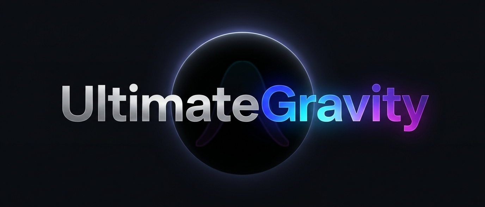
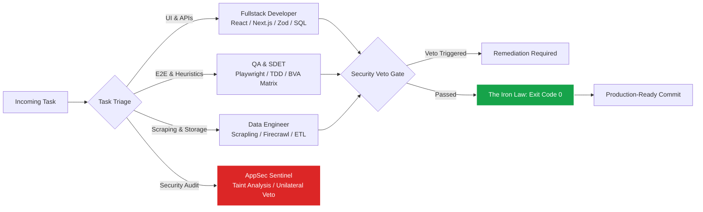

<div align="center">
  
  <br /><br />
  <h1>UltimateGravity</h1>
  <p><strong>The Production-Grade Autonomous Engineering Operating System for AI Coding Agents</strong></p>
  <p><em>Engineered by <a href="https://github.com/MasterPandaa">MasterPandaa</a> for high-craft, zero-hallucination software engineering.</em></p>

  [](LICENSE)
  [](https://deepmind.google)
  [](GEMINI.md)
  [](CHANGELOG.md)
  [-success?style=flat-square)](benchmarks/)
  [](install.ps1)
</div>

---

## 💡 What is UltimateGravity?

Most AI coding assistants start impressively, then quickly fall apart: they run into **context rot**, hallucinate non-working code, generate generic UI boilerplate, loop endlessly on failing edits, or freeze your laptop by loading dozens of uncoordinated tools.

**UltimateGravity** turns your AI assistant into an autonomous, disciplined software engineering powerhouse. Built directly on top of the latest frontier agent research and battle-tested in real-world codebases, it provides the missing operational runtime—the **Harness**—that forces models to plan surgically, write clean code, and prove every change with verified execution tests before declaring completion.

> **$\text{Agent} = \text{Model} + \text{Harness}$**  
> Raw model intelligence is a commodity. The harness surrounding it determines whether you get production software or broken toys.

---

## 🎯 Who is This For?

| Role / Experience Level | Why You Will Love UltimateGravity |
|---|---|
| 🐣 **Beginners & Solo Developers** | **1-Click Setup**: Run one PowerShell script and turn your coding assistant into a patient senior mentor that writes tests, catches mistakes, and explains complex concepts in plain language. |
| ⚡ **Fullstack & Frontend Engineers** | **Zero UI Slop**: Produces humanized, production-ready interfaces (4 UI states: Loading/Empty/Error/Success, Zod validation, optimistic rollbacks, zero layout shift) instead of cookie-cutter AI templates. |
| 🧪 **QA Engineers & SDETs** | **Automated Verification**: End-to-end Playwright browser suites, Boundary Value Analysis (BVA), deterministic reproduction loops, and visual SSIM regression testing out of the box. |
| 🛡️ **Security & DevOps Leads** | **AppSec Sentinel with Veto Power**: Built-in security auditor that flags SQLi, command injection, secret leaks, and CVEs with unilateral veto power over dangerous pull requests. |
| 🚀 **AI & Agent Researchers** | **Frontier Research DNA**: Absorbed directly from 15+ peer-reviewed papers (Google DeepMind, PwC Labs, NVIDIA, Sylph.AI) running 100% locally on Windows with zero RAM waste. |

---

## ⚡ The 5 Pains We Solve

```
┌───────────────────────────────────────┬───────────────────────────────────────┐
│ WITHOUT ULTIMATE GRAVITY              │ WITH ULTIMATE GRAVITY v6.3.0          │
├───────────────────────────────────────┼───────────────────────────────────────┤
│ ❌ Hallucinated "Fixes"                │ ✅ The Iron Law of Verification       │
│ AI says "Done!" without running tests.│ Completion strictly requires exit     │
│ Code breaks as soon as you execute it.│ code 0 and verified machine logs.     │
├───────────────────────────────────────┼───────────────────────────────────────┤
│ ❌ Context Rot & Token Drain          │ ✅ MaxIM Compaction & Context Packets │
│ Long chats get dumb, forget rules, and│ Dual-gate memory compaction bounds    │
│ burn expensive API context budgets.   │ token active size, saving up to 80%.  │
├───────────────────────────────────────┼───────────────────────────────────────┤
│ ❌ Generic AI Slop & Robotic Copy     │ ✅ Anti-AI Slop Craft & Archetypes    │
│ Purple gradients, centered cards, and │ 10-pass UI humanizer, distinct design │
│ buzzwords ("blazing fast", "delve").  │ archetypes, and authentic typography. │
├───────────────────────────────────────┼───────────────────────────────────────┤
│ ❌ Heavy Vector RAG False Alarms      │ ✅ Lexical-First Grep Hierarchy       │
│ Embeddings match "false friends" and  │ Exact regex search beats vector RAG   │
│ waste 2 GB RAM on local vector DBs.   │ with 100% precision & zero RAM waste. │
├───────────────────────────────────────┼───────────────────────────────────────┤
│ ❌ Tool Bloat & Laptop Freezes        │ ✅ Dynamic MCP Profiling              │
│ 50+ background daemons exhaust memory │ Keeps active tools <= 150 on standard │
│ and crash 8GB RAM Windows machines.   │ Windows machines with zero daemons.   │
└───────────────────────────────────────┴───────────────────────────────────────┘
```

---

## 🚀 Quickstart (1-Click Windows Installation)

Install the full canonical system into `~/.gemini` in seconds:

```powershell
# 1. Clone the repository
git clone https://github.com/MasterPandaa/UltimateGravity.git
cd UltimateGravity

# 2. Run the 1-click Windows installer
powershell -ExecutionPolicy Bypass -File .\install.ps1

# 3. Verify your system benchmarks
node ~/.gemini/scripts/bench-runner.js run
# => 26 / 26 Test Cases Passed (100.0%)! System ready.
```

*Restart your Google Antigravity IDE or terminal after installation to load the updated PATH and active rules.*

---

## 👥 The Quad-Role Autonomous Specialist System

UltimateGravity organizes autonomous work across **4 Specialist Roles**, each with isolated file boundaries and strict responsibilities:



1. **Fullstack Developer (`fullstack-developer`)**: Modern Web, Next.js hydration safety, 4 UI states, Zod schema validation, optimistic rollbacks, and composite index profiling (`EXPLAIN ANALYZE`).
2. **Quality Assurance & SDET (`qa-engineer`)**: Automated Playwright browser testing, Boundary Value Analysis, 4-step bug root cause loop, and strict Go/No-Go release gating. Weakening tests to pass is forbidden.
3. **Data Engineer (`data-engineer`)**: Multi-tier web scraping (Scrapling & Firecrawl), relational schema design, ETL automation, and database normalization.
4. **AppSec Sentinel (`security-engineer`)**: Memory, token, and secret leak defense, AST taint analysis (SQLi, RCE, command injection), and adversarial audits with **unilateral veto power** over vulnerable PRs.

---

## 📊 Automated Verification & Benchmarks

UltimateGravity includes a built-in, zero-dependency benchmark engine ([`bench-runner.js`](scripts/bench-runner.js)) validating 26 deterministic regression test cases across 4 suites:

```text
=== RUNNING AGENT BENCHMARK SUITES (k=1) ===
📁 Suite: browser-resilience.jsonl (4 cases)   ✔ 4/4 PASS (SSIM >= 0.98, CRUD modals)
📁 Suite: code-sequential.jsonl (3 cases)      ✔ 3/3 PASS (State accumulation N -> N+1)
📁 Suite: core-rules.jsonl (15 cases)          ✔ 15/15 PASS (Governance & invariants)
📁 Suite: skill-activation.jsonl (4 cases)     ✔ 4/4 PASS (Trigger sensitivity & Step 0)
======================================================
📊 SCORECARD: 26 / 26 Passed (100.0%) | 0 Regressions
```

---

## 🛠️ 26 Global CLI Tools & Utilities Included

Included out-of-the-box in `bin/` and accessible from any PowerShell prompt after installation:

| Command | Category | What it Does |
|---|---|---|
| `bench-runner` | QA & Benchmark | Runs the automated 26-test regression benchmark suite |
| `file-rewind` | Safety Net | Instant shadow-copy file rollback before bad edits |
| `step-checkpoint` | Snapshot Engine | Atomic milestone snapshots and differential diffs |
| `task-dag` | Execution Plane | Dependency DAG state machine with zero-bleed context packets |
| `ast-outline` | Code Navigator | Extracts structural syntax skeletons for large files (>300 lines) |
| `compact-log` | Context Diet | Trims JSONL transcripts and session logs |
| `mcp-profile` | Tool Manager | Dynamic MCP switcher keeping active tools $\le 150$ |
| `browser-sentinel`| Frontend Sentinel | Headless Edge probe detecting React hydration & runtime crashes |
| `harness-distiller`| Distiller | Converts session friction logs into lean $L_0 \le 60$ line skills |
| `clean-file` | Privacy | Strips C2PA, EXIF, and AI steganographic watermarks for data hygiene |
| `fd` | Fast Search | High-performance native Rust filesystem search engine |
| `agent-activate` | Orchestration | Interactive terminal picker to load specialist agent profiles |
| `agent-archive` | Context Diet | Safely compresses and archives dormant subagent definitions |
| `agy-exec` | Execution Engine | Persistent Windows PowerShell execution with session state retention |
| `antigravity-conversation-fix` | Resilience | Heuristic recovery utility for damaged IDE conversation transcripts |
| `file-history` | Audit & Safety | Pre-tool-use file mutation snapshot logger |
| `harness2` | Meta-Harness | Autonomous harness bootstrap and operational invariant verifier |
| `raven-dispatch` | Dispatcher | Context-bleed barrier and DAG task dispatcher for subagents |
| `repo-wiki` | Documentation | Local markdown wiki builder and structural indexer |
| `rrsi-eval` | Evaluation | 5-gate regularizer and cross-model failure critic |
| `skill-activate` | Skill Engine | Dynamic skill loader and prompt injector |
| `skill-archive` | Storage Diet | Compresses and stores inactive skills to preserve token budget |
| `skill-usage` | Telemetry | Real-time skill invocation frequency tracker and telemetry reporter |
| `tier-manager` | Tier Engine | Agent capability tier and model fallback manager |
| `win-memory-profile` | Profiler | Sysinternals VMMap memory profiler for Windows host |
| `workspace-index` | Indexer | AST and dependency topology scanner for workspace roots |

---

## 🔬 Grounded in Frontier Research

UltimateGravity synthesizes and operationalizes principles from leading AI laboratories:

- **PwC Labs (arXiv:2605.15184)**: *Lexical-First Grep Hierarchy* proving regex search outperforms vector embeddings in coding harnesses with 0 RAM waste.
- **Google Research & DeepMind MaxIM (arXiv:2611.12825)**: *Capacity-Constrained Memory Compaction* enforcing Predictive Sufficiency and Recursive Consistency.
- **Harness Engineering 11-System Study (arXiv:2609.00006)**: Empirical validation of the 7 Canonical Subsystems of production coding agents.
- **Google Research (arXiv:2606.03979)**: *Offline Sleep & Rehearsal Paradigm* preventing catastrophic forgetting of system invariants.
- **Sylph.AI (arXiv:2604.21003)**: *Two-Level Automated Harness Evolution Framework*.
- **Google Cloud AI Research PaperOrchestra (arXiv:2604.05018)**: Parser-bound documentation verification.

---

## 📋 System Requirements

- **Operating System**: Windows 10 / Windows 11 (64-bit)
- **Runtimes**: [Node.js](https://nodejs.org) v18+ (LTS) & [Python](https://python.org) 3.10+
- **Shell**: PowerShell 5.1 (Built-in) or PowerShell 7+
- **Memory Footprint**: Optimized to run smoothly on standard 8GB RAM machines

---

## 👤 Author & Craft Philosophy

UltimateGravity was conceived, designed, and actively engineered by **[MasterPandaa](https://github.com/MasterPandaa)**.

The philosophy is straightforward: **software engineering standards should not be discarded just because an AI is generating code**. If human engineers require compile checks, test coverage, clean architecture, and security reviews, an AI coding agent must be held to the exact same standard.

Distributed under the [MIT License](LICENSE). Contributions, issues, and star badges are warmly welcome!
