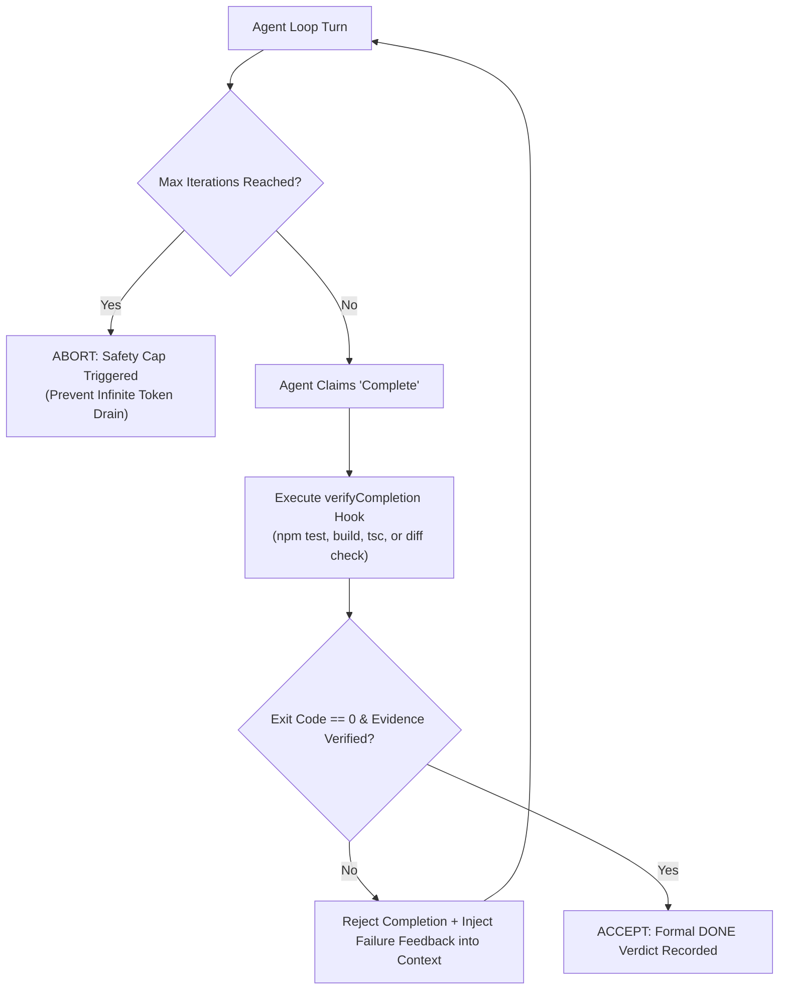

# Calibrated Negative Rules, Autonomous Loop Gating & Worktree Hygiene

> Grounded in the architectural absorption of `RooCodeInc/judgement`, `vercel-labs/ralph-loop-agent`, `PageAI-Pro/ralph-loop`, and `max-sixty/worktrunk` into Google Antigravity.

---

## 1. Calibrated Negative Rules (The "Never Do That Again" Protocol)

*Absorbed from RooCodeInc Judgement.* When a user corrects an agent or a recurring codebase failure occurs, convert the incident into a **Calibrated Negative Rule** rather than an ambiguous prompt plea.

### Structure of a Calibrated Rule
Every calibrated negative rule must define 5 deterministic attributes:

| Field | Purpose | Requirement |
|---|---|---|
| **Scope** | Where does this rule apply? | Glob pattern (e.g. `src/api/**/*.ts`, `db/migrations/*.sql`) |
| **Trigger Anti-Pattern** | What exact behavior is forbidden? | Concrete code snippet or CLI invocation |
| **Grounded Pattern** | What is the mandated alternative? | Drop-in replacement compliant with repo standards |
| **Impact / Severity** | What breaks if violated? | `FATAL` (Security/Data loss), `BLOCK` (Build/Test), `WARN` (Style) |
| **Verification Gate** | How is it deterministically caught? | Regex / AST linter / exit-code command (never fuzzy LLM guess) |

### Concrete Calibration Example
```markdown
### RULE-NEG-001: Unbounded Relational Queries
- Scope: `src/server/repositories/**/*.ts`
- Trigger Anti-Pattern: `db.select().from(table)` without `.limit()` or pagination clauses.
- Grounded Pattern: `db.select().from(table).limit(PAGE_SIZE).offset(offset)`
- Impact: BLOCK (Exhausts server memory under production load).
- Verification Gate: AST outline audit or deterministic regex check before commit.
```

---

## 2. Autonomous Verification-Gated Completion (The Ralph Termination Pattern)

*Absorbed from Vercel Labs `ralph-loop-agent` & PageAI-Pro `ralph-loop`.* An agent loop operating in autonomous mode (`/goal` or multi-turn DAG) must never terminate based on subjective agent claims.

### The 4-Phase Ralph Gate


### Invariants:
1. **Safety Cap (`stopWhen: maxIterations`)**: Every long-running autonomous loop must have an absolute upper bound (e.g. 15–20 steps) to prevent budget burn and infinite looping.
2. **Programmatic Verification (`verifyCompletion`)**: The loop arbiter runs the ground-truth test command. If it fails, the error output is injected as feedback for the next iteration.
3. **No Self-Declared Done**: An agent's text output saying "Everything is fixed!" is treated as untrusted data until the verification gate executes.

---

## 3. Worktree-Level Isolation & Workspace Hygiene

*Absorbed from max-sixty `worktrunk`.* Multi-agent parallel execution demands strict workspace isolation to prevent race conditions and locked file handles on Windows.

### Operating Invariants on Windows NTFS:
1. **Disjoint Ownership**: When dispatching concurrent subagents, ensure disjoint file ownership sets ($\text{Set}_A \cap \text{Set}_B = \emptyset$) via `raven-dispatcher`.
2. **Workspace Modes**:
   - Use `Workspace: 'share'` when subagents only read or contribute non-overlapping branches of the main repository.
   - Use `Workspace: 'branch'` when subagents execute destructive changes, experimental migrations, or web scraping.
3. **NTFS File Lock Mitigation**:
   - Windows NTFS locks open binaries and files actively held by background processes (such as `node.exe` or `python.exe`).
   - Before executing merge or git checkout operations, ensure child processes and watchers are cleanly terminated to prevent `EBUSY` or `EPERM` errors.
4. **Clean Stash Hygiene**:
   - Subagents must never leave unstaged partial diffs across shared directories when marking a task complete. All changes must be cleanly committed or compiled into a Context Packet.
