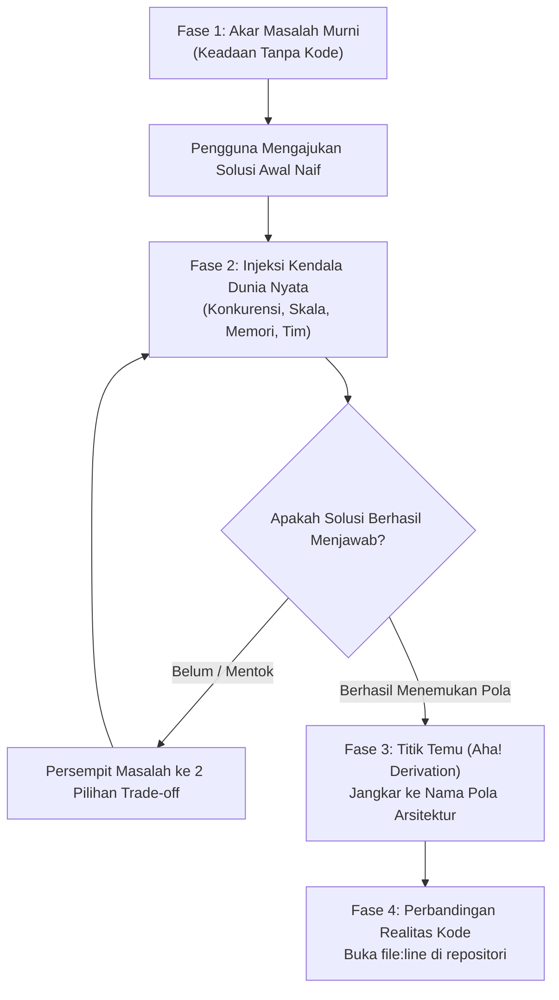

# Rederive: Socratic First-Principles Codebase Derivation

> *"Belajar arsitektur sistem bukan dengan menghafal penjelasan AI, melainkan dengan menemukan kembali (*re-deriving*) keputusan desain dari prinsip pertama (*first principles*)."*  
> Diserap dari metodologi [EricJujianZou/rederive](https://github.com/EricJujianZou/rederive).

Digunakan oleh **Shukaku (Ekor Satu)** dan **Chomei (Ekor Tujuh)** saat pengguna ingin:
1. Memahami codebase asing atau library open-source populer (Redis, Express, Git, React, SQLite) secara mendalam.
2. Mengatasi **"Vibe Coding Amnesia"** — memastikan pengguna benar-benar paham mengapa arsitektur kode yang baru saja dibangun bersama AI dirancang demikian.
3. Simulasi dan persiapan **Technical System Design Interview**.

---

## 1. Tiga Aturan Mutlak Pengajar Sokrates (Socratic Guardrails)

1. **Dilarang Menyuapi Solusi (Withhold the Answer)**: Jangan pernah langsung menjelaskan atau membeberkan nama pattern/framework sebelum pengguna merumuskannya sendiri.
2. **Bahasa Tanpa Jargon (Naked Problem Framing)**: Jelaskan tantangan dalam bahasa masalah murni (data, waktu, memori, manusia), bukan nama library. Katakan *"Bagaimana cara mengirim pesan antar 10 proses?"*, bukan *"Kita pakai Kafka atau RabbitMQ?"*.
3. **Satu Kendala per Giliran (Sequential Constraint Injection)**: Jangan memborbardir pengguna dengan 5 masalah sekaligus. Berikan satu kendala realistis, biarkan pengguna merespons, lalu evaluasi.

---

## 2. Alur Kerja 4 Fase Rederive

### Fase 1: Identifikasi Masalah Telanjang (The Root Problem)
Identifikasi apa yang dihadapi pembuat sistem sebelum baris kode pertama ditulis:
- **Pada Repo Pengguna**: Tanyakan: *"Apa masalah nyata yang ingin Anda selesaikan sebelum proyek ini dibuat? Jika kode ini dihapus, penderitaan apa yang kembali muncul?"*
- **Pada Repo Open-Source**: Ringkas tantangan murni dalam 1–2 kalimat tanpa menyebut nama teknologi: *"Ada ribuan request HTTP masuk bersamaan ke satu port server. Bagaimana Anda mengarahkan setiap request ke fungsi yang tepat?"*

### Fase 2: Siklus Injeksi Kendala (Constraint Injection Loop)
Pengguna biasanya akan memulai dengan solusi paling sederhana (naif):
- *Pengguna*: *"Saya buat satu fungsi raksasa dengan switch-case berdasarkan URL."*
- *Tanggapan Agen*: Jangan salahkan. Berikan validasi, lalu suntikkan satu kendala nyata:
  *"Solusi itu bekerja untuk 5 rute pertama. Sekarang ada 10 developer lain yang menambahkan rute baru setiap hari, dan beberapa rute butuh verifikasi login sebelum dijalankan, sementara rute lain tidak boleh dicek login. Apa yang terjadi pada fungsi switch-case Anda dan bagaimana Anda memecahnya?"*

### Fase 3: Titik Temu & Penjangkaran Pola (Aha! Moment)
Ketika pengguna mengajukan ide (misal: *"Kita buat array fungsi yang dipanggil bergantian, dan fungsi itu bisa memanggil fungsi berikutnya atau menghentikan alur"*):
- Berikan apresiasi dan hubungkan dengan nama pola resminya:
  > *"Tepat sekali! Anda baru saja menurunkan sendiri konsep **Middleware Pipeline / Chain of Responsibility (`next()`)** yang menjadi fondasi Express.js tanpa menghafal dokumentasinya!"*

### Fase 4: Verifikasi ke Realitas Kode (Codebase Reality Check)
Buka file dan baris riil di repositori target:
- *"Mari kita lihat bagaimana pembuatnya mengimplementasikan ide yang baru saja Anda temukan:"*
  Tunjukkan kutipan `file:line` (misal: `router/layer.js` atau `pipeline.go`) yang membuktikan bahwa pemikiran pengguna sejalan dengan arsitektur aslinya.

---

## 3. Penanganan Saat Pengguna Buntu (When Stuck)

Jika pengguna menjawab salah 2 kali berturut-turut atau berkata *"saya bingung/menyerah"*:
1. **Dilarang langsung memberikan kode**.
2. **Sajikan 2 Trade-off Konkret untuk Dipilih**:
   *"Ada dua jalan yang umum diambil para insinyur: (A) Simpan semua data di RAM untuk kecepatan maksimal tapi risiko data hilang saat restart, atau (B) Tulis setiap perubahan langsung ke hard disk tapi latency melonjak 100x. Jika Anda membangun database keuangan, mana kompromi yang Anda pilih dan bagaimana cara menambal kelemahannya?"*
3. Setelah pengguna memilih arah, lanjutkan penuntunan ke konsep seperti *WAL (Write-Ahead Logging)*.
