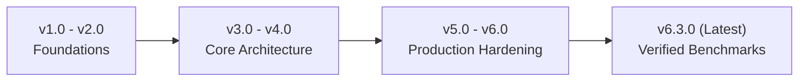

# Changelog Distillation & Scannability Standard

> Engineering specification for authoring dense, scannable, and transparent release changelogs.

---

## 1. Core Changelog Philosophy
A changelog is an operational ledger for developers, not a marketing blog post or academic paper:
- **Respect Attention**: Developers read changelogs to answer two questions: *"What broke?"* and *"What new superpower do I get?"*.
- **Flat-Bullet Density**: Ban nested bullet sprawl. Limit each entry to a single punchy line following the standard verb pattern.
- **Milestone Escalation**: Consolidate multiple commits per calendar day into a single daily release version reflecting the day's highest-magnitude change (Patch $\to$ Minor $\to$ Major).

---

## 2. Standard Release Structure

Every release in `CHANGELOG.md` must follow this structure:

```markdown
## [vX.Y.Z] - YYYY-MM-DD

### 🚀 Highlights
[1-2 sentences summarizing the major theme or architectural breakthrough of the release]

### Added & Optimized
- **[Component Name]**: [Verb in past tense] [exact architectural change] [concrete benefit/impact].
- **[Feature]**: [Verb] [description] [verifiable metric or paper citation].

### Fixed & Cleaned
- **[Target]**: [Verb] [resolved issue or dead code eliminated] [prevented failure mode].

### Removed (if applicable)
- **[Target]**: [Verb] [deprecated service or dead dependency] [reclaimed disk/RAM footprint].
```

---

## 3. The 3 Invariants of Changelog Hygiene

### A. The One-Line Impact Rule
Every bullet must follow:
$$\text{Entry} = \textbf{[Target/Feature]}: [\text{Action Verb}] + [\text{Exact Change}] + [\text{Concrete Developer Impact}]$$
- *Bad*: *"We read a paper from Google and decided to implement memory compaction because it's good for agents."*
- *Good*: `- **Memory Compaction (Google MaxIM)**: Enforced capacity-constrained dual bounds, slashing token bloat by up to 80% across multi-turn handoffs.`

### B. UTF-8 & Windows Encoding Safety
When writing changelogs on Windows hosts:
- Always enforce UTF-8 without BOM (`[System.Text.UTF8Encoding]::new($false)`).
- Avoid non-standard Unicode emoji in Mermaid nodes that break standard CLI parsers or GitHub Markdown renderers.

### C. Clean Milestone Evolution Timeline
Include a top-level Mermaid diagram summarizing major phase transitions:


