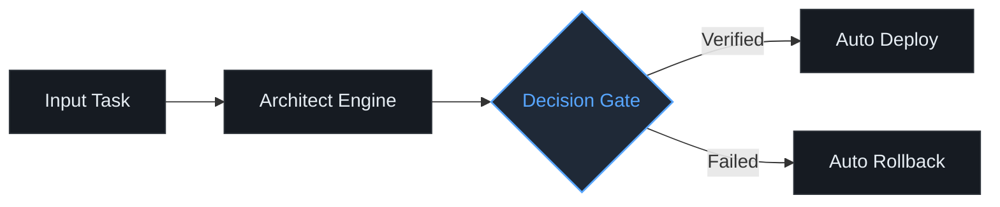

# Visuals, Badges & Social Preview Specification

> Guidelines for designing repository banners, Shields.io badges, dynamic CI indicators, and social preview cards that project high engineering craft.

---

## 1. Repository Banner Architecture

A repository banner is the visual anchor of the repository. It sets the emotional tone and establishes premium craft within the first 3 seconds of a visit.

### A. Dimensions & Aspect Ratio
- **Aspect Ratio**: **21:9 Ultra-Wide** (recommended: `1280x548` px, `1376x590` px, or `1920x820` px). Avoid tall 16:9 banners that push README content below the fold.
- **File Format**: Web-optimized PNG (`< 500 KB`) or JPG (`< 200 KB`).
- **Positioning**: Top of `README.md`, directly below the root `<div align="center">`.

### B. Contrast & Dark-Mode Palette
GitHub users overwhelmingly use dark theme. Ensure the banner renders seamlessly against GitHub dark backgrounds (`#0d1117` / `#161b22`):
- **Background**: Deep obsidian or muted slate (`#090d16`, `#0b0f19`).
- **Primary Text**: Pure white (`#ffffff`) or high-contrast silver (`#f0f6fc`).
- **Accent Glow**: Muted cyan, electric blue, or emerald green subtle gradients (`opacity: 0.15 - 0.25`).
- **Grid / Technical Accents**: Faint architectural grid lines (`1px`, `#30363d` with low opacity) to communicate precision engineering.

---

## 2. GitHub Social Preview (OpenGraph 1280×640)

> [!IMPORTANT]
> The top README banner does **NOT** automatically become the GitHub Social Preview card for link sharing. Without manual configuration, GitHub displays a generic auto-generated gradient card.
>
> **The Standard**: Export a **1280×640 px (2:1 aspect ratio)** card incorporating the logo, title, and 1-sentence value hook, and upload it via:  
> `GitHub Repository -> Settings -> General -> Social preview -> Edit -> Upload an image`.  
> This ensures high click-through rates (CTR) when the repository URL is shared on Twitter/X, Reddit, WhatsApp, and LinkedIn.

---

## 3. Shields.io Badge Architecture

Badges communicate health, maturity, and compatibility at a glance. Broken or cluttered badges destroy credibility instantly.

### A. Universal Badge Standard
Always use `style=flat-square` for consistency, sharp borders, and modern aesthetic.

```markdown
<!-- Badges Standard Set -->
[](https://github.com/<owner>/<repo>/actions/workflows/bench.yml)
[](LICENSE)
[](#system-requirements)
[](CHANGELOG.md)
[-success?style=flat-square)](benchmarks/)
[](install.ps1)
```

### B. The Dynamic CI Badge Invariant
- If you claim automated tests, machine verification, or "The Iron Law", you **MUST** include a live dynamic CI status badge linked to the GitHub Actions workflow.
- Static badges claiming 100% passing without an active CI workflow are flagged as unverified by external auditors.

### C. Badge Count & Anti-Patterns
- **Cap Total Badges**: Keep between 5 to 7 essential badges.
- **No Dead Links**: Every badge image wrapped in a link must resolve to a valid heading, file, or workflow.
- **Consistent Styles**: Never mix `flat`, `flat-square`, and `for-the-badge` in the same repository.

---

## 4. Markdown Diagrams (Mermaid)

Technical buyers trust flowcharts and state diagrams over prose.

### Allowed Mermaid Diagrams
- `flowchart TD` or `flowchart LR` for architectural topology and task flows.
- `sequenceDiagram` for multi-actor protocols and subagent interactions.
- `stateDiagram-v2` for lifecycle states.


- Wrap node labels in quotes `["Label"]` to prevent markdown rendering crashes on special characters.
- Keep flowcharts concise: 4–8 nodes maximum. Multi-page architectures belong in dedicated docs.
