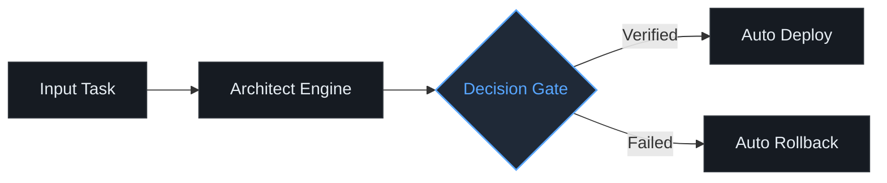

# Visuals & Badges Specification

Guidelines for designing repository banners, Shields.io badges, and markdown diagrams that project high engineering craft.

---

## 1. Repository Banner Architecture

A repository banner is the visual anchor of the repository. It sets the emotional tone and establishes premium craft within the first 3 seconds of a visit.

### A. Dimensions & Aspect Ratio
- **Aspect Ratio**: **21:9 Ultra-Wide** (recommended: `1280x548` px or `1920x820` px). Avoid tall 16:9 banners that push README content below the fold.
- **File Format**: Web-optimized PNG (`< 500 KB`) or SVG with embedded fonts.
- **Positioning**: Top of `README.md`, directly below the main title or above the primary badges.

### B. Contrast & Dark-Mode Palette
GitHub users overwhelmingly use dark theme. Ensure the banner renders seamlessly against GitHub dark backgrounds (`#0d1117` / `#161b22`):
- **Background**: Deep obsidian or muted slate (`#090d16`, `#0b0f19`).
- **Primary Text**: Pure white (`#ffffff`) or high-contrast silver (`#f0f6fc`).
- **Accent Glow**: Muted cyan, electric blue, or emerald green subtle gradients (`opacity: 0.15 - 0.25`).
- **Grid / Technical Accents**: Faint architectural grid lines (`1px`, `#30363d` with low opacity) to communicate precision engineering.

### C. Typography & Copy Rules
- **Headline**: Repository name in bold, geometric sans-serif (Inter, Geist, SF Pro).
- **Sub-headline**: 1-sentence value proposition (max 8–12 words).
- **Zero Clutter**: Do not include logos of 15 different libraries, full code snippets, or lengthy paragraphs inside the banner image.

---

## 2. Shields.io Badge Architecture

Badges communicate health, maturity, and compatibility at a glance. Broken or cluttered badges destroy credibility instantly.

### A. Universal Badge Standard
Always use `style=flat-square` for consistency, sharp borders, and modern aesthetic.

```markdown
<!-- Badges Template -->
[](https://github.com/<owner>/<repo>/releases)
[](LICENSE)
[](#grounded-benchmarks)
[](https://nodejs.org)
[](#system-requirements)
```

### B. The 5 Essential Badge Roles
Organize badges into a single line or two tightly grouped lines:
1. **Version / Release**: Links to `/releases`. Green (`238636`) for stable release.
2. **License**: Links to `LICENSE`. Standard open-source license badge.
3. **Quality / Benchmark Gate**: Proves machine verification (e.g. `100% Verified`, `25/25 Passing`).
4. **Runtime / Engine Compatibility**: Primary language or runtime requirement.
5. **Operating System / Target Environment**: Avoids user confusion regarding platform compatibility.

### C. Anti-Patterns
- **No Badge Farm**: Cap total badges at 5–7. Avoid 20+ badges covering obscure linters or redundant services.
- **No Dead Links**: Every badge image wrapped in a link `[](URL)` must resolve to a valid heading or external page.
- **Consistent Styles**: Never mix `flat`, `flat-square`, and `for-the-badge` in the same repository.

---

## 3. Markdown Diagrams (Mermaid)

Technical buyers trust flowcharts and state diagrams over prose.

### A. Allowed Mermaid Diagrams
- `flowchart TD` or `flowchart LR` for architectural topology and task flows.
- `sequenceDiagram` for multi-actor protocols and subagent interactions.
- `stateDiagram-v2` for lifecycle states.

### B. Styling Standards for GitHub Dark Theme
Use native text-based Mermaid with clean class definitions:

- Wrap node labels in quotes `["Label"]` to prevent markdown rendering crashes on special characters.
- Keep flowcharts concise: 4–8 nodes maximum. Multi-page architectures belong in dedicated docs.
