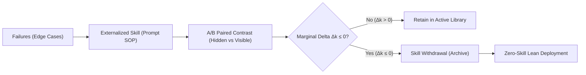

# R²Orch: Skill-Internalization & Withdrawal Protocol

> Theoretical foundation: **arXiv:2610.22740** (*R²Orch: Recursive Self-Improvement for Agent Orchestration via Self-Play within a Skill-Internalization Loop*).

---

## 1. Core Principles

Agent prompt libraries easily succumb to **prompt bloat** and **spurious skill retention** when evaluated purely on raw task success rates. $R^2Orch$ provides a mathematically rigorous framework for retiring skills once their capabilities are either internalized or obsolete.

---

## 2. Neyman-Rubin Randomized Paired Contrasts

To decouple a skill's true marginal efficacy from task difficulty or curriculum confounding, evaluations are structured as randomized block experiments:

1. **Partitioned Rollouts**:
   For any rollout group $G$, split tasks into:
   - **Hidden Part ($\mathcal{H}$)**: Rollouts reading context *without* the candidate skill ($K \setminus k$).
   - **Visible Part ($\mathcal{V}$)**: Rollouts reading context *with* the candidate skill ($K$).

2. **Unbiased Benefit Estimator**:
   $$\Delta_k = \bar{y}_{\mathcal{V}} - \bar{y}_{\mathcal{H}}$$
   - $\Delta_k > 0$: The skill provides measurable lift.
   - $\Delta_k \le 0$: The skill is inert or counter-productive (*noise eating context*).

3. **Bayesian Decision Criterion**:
   Accumulate contrasts into a Bayesian-Bootstrap posterior $\Pi_k$. Withdraw skill $k$ when:
   $$\Pi_k(\Delta \le 0) \ge 1 - \alpha$$
   where $\alpha$ is the acceptable false-positive risk.

---

## 3. Recursive Learnability ($\ell_{\text{rec}}$)

To avoid **advantage collapse** during skill withdrawal:
$$\ell(p) = 4p(1-p)$$
- Evaluated on $K \setminus k$ (the context without the candidate skill).
- Peaks at $p = 0.5$ (maximum informative entropy and gradient variance).
- Vanishes at $p \in \{0, 1\}$ (all-pass or all-fail collapse).

Tasks chosen for evaluation must maintain high $\ell(p)$ under skill withdrawal to guarantee that agent progress survives scaffold pruning.

---

## 4. Operational Intake & Pruning Checklist

Before approving or retaining any skill in `skills/`:
- [ ] **Empirical Failure Evidence**: Did the agent fail without this skill in $\ge 2$ sessions?
- [ ] **Marginal Lift ($\Delta_k > 0$)**: Does the skill measurably improve success over base prompts?
- [ ] **Withdrawal Readiness**: Can the SOP be offloaded to deterministic hooks or condensed into general system invariants?
- [ ] **Zero-Skill Trajectory**: Is the skill designed to be temporary scaffolding rather than permanent prompt weight?
