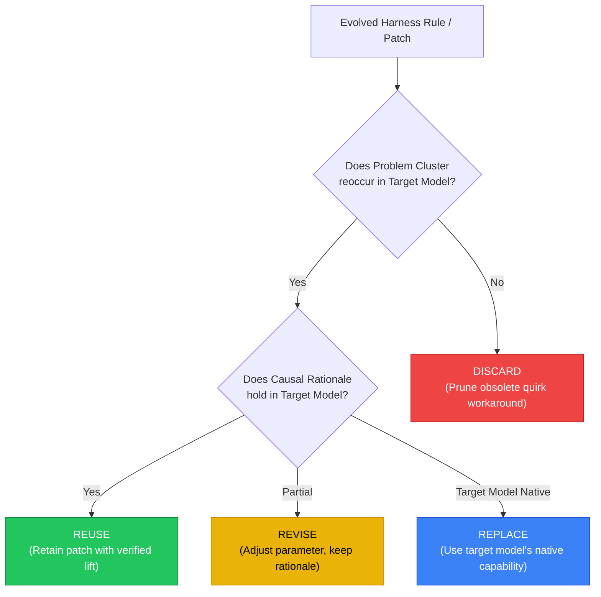

# Self-Improvement Memory (SIM) & Continual Recursive Self-Improvement

> **Pattern Origin**: Absorbed from Google Cloud AI, Google DeepMind, and Penn State (`arXiv:2611.18856`, Xin Yu et al., §8 External Proposal Protocol).

This reference details the Self-Improvement Memory (SIM) architecture and Continual Recursive Self-Improvement (CRSI) decision protocol for agent harnesses, eliminating negative transfer and regression when transferring evolved rules and skills across heterogeneous foundation models and changing benchmarks.

---

## 1. The Negative Transfer Failure Mode

When optimizing an agent harness ($\mathcal{H}$) through recursive self-improvement:
1. Optimizations tuned exclusively to a specific model (e.g. Claude 3.5 Sonnet) overfit to that model's peculiar failure modes and token biases.
2. When the underlying model is upgraded or swapped (e.g. to Gemini 3.8 Flash), propagating only the final evolved code results in **Negative Transfer**:
   - The new model inherits unnecessary prompt workarounds designed for the old model's blind spots.
   - The optimizer lacks causal memory of *why* specific rules were added, which failure signatures they mitigated, and what trade-offs were accepted.

---

## 2. Self-Improvement Memory (SIM) Schema

Instead of retaining only raw code diffs, maintain an attributed **Self-Improvement Memory** tuple for every harness evolution:

$$\text{SIM}_j = \langle \text{ProblemCluster}_j, \text{Rationale}_j, \text{SurgicalPatch}_j, \Delta_{\text{pred}}, \Delta_{\text{obs}}, \text{Context}_j \rangle$$

### Schema Attributes:
| Field | Type | Description |
|---|---|---|
| `ProblemCluster` | `string` | Normalized failure signature (e.g., `git_diff_overflow`, `auth_header_leakage`, `premature_task_stop`). |
| `Rationale` | `string` | Causal explanation detailing why the mutation resolves the root cause rather than treating symptoms. |
| `SurgicalPatch` | `diff` | Minimal verifiable modification ($\le 20$ lines for rules, $\le 60$ lines for skills). |
| `PredictedDelta` | `float` | Anticipated performance lift ($\Delta S_{\text{pred}}$) and token cost budget ($\Delta C$). |
| `ObservedDelta` | `float` | Empirical benchmark score delta ($\Delta S_{\text{obs}}$) verified by `bench-runner.js`. |
| `ModelContext` | `object` | Source model family, reasoning effort level, context window bounds, and tokenizer class. |

---

## 3. Continual RSI (CRSI) Decision Protocol

When evaluating or porting existing harness rules and skills to a new foundation model or environment, run the 4-way CRSI triage:

### The 4 Action Operations:
1. **REUSE**: The target model exhibits the identical failure mode, and the causal patch yields $\Delta S \ge \delta$. Promote rule unchanged.
2. **REVISE**: The failure mode exists but differs in scale (e.g. context limit or token budget). Adjust numerical bounds while preserving the structural invariant.
3. **REPLACE**: The target model natively resolves the issue (e.g., built-in tool call schema validation). Remove verbose prompt scaffolding in favor of a lean zero-overhead instruction.
4. **DISCARD**: The failure signature was an artifact of the prior model's quirks. Prune immediately to preserve Turn-0 token budget.
