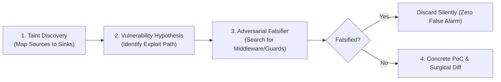

# Multi-Tier Leak Defense & Security Sentinel Playbook

This playbook provides operational procedures and concrete verification standards for the **`security-engineer`** across three defensive tiers: **Windows Host OS**, **Antigravity Agent Runtime**, and **Target Application Codebase**.

---

## 1. Tier 1: Windows Host OS & Daemon Memory Defense

### A. Process Memory & Handle Leak Diagnostics
Run the native diagnostic profiler to inspect Private Bytes, Working Set, and GDI/USER Handles:
```powershell
# Snapshot top 15 memory consumers
powershell -ExecutionPolicy Bypass -File C:\Users\Luthfi\.gemini\scripts\win-memory-profile.ps1 -Top 15

# Audit runaway/orphaned background dev daemons (node, python, chrome, playwright)
powershell -ExecutionPolicy Bypass -File C:\Users\Luthfi\.gemini\scripts\win-memory-profile.ps1 -DetectOrphans

# Measure continuous memory leak delta over 6 seconds
powershell -ExecutionPolicy Bypass -File C:\Users\Luthfi\.gemini\scripts\win-memory-profile.ps1 -FilterName node -SampleCount 3 -IntervalSeconds 2
```

### B. Leak Interpretation Thresholds
- **Handle Leak**: Any process with $> 2,000$ handles or positive handle delta $> 50$ per minute without GC stabilization indicates unclosed Win32 handles or event subscriptions.
- **Private Bytes Bloat**: If Private Memory increases monotonically under sustained load without returning to baseline, inspect unclosed streams, lingering closures, or global cache maps.
- **Orphan Daemon Cleanup**: Lingering child processes from cancelled tasks or tests should be terminated:
  ```powershell
  # Terminate specific orphaned PID safely
  Stop-Process -Id <PID> -ErrorAction SilentlyContinue
  ```

---

## 2. Tier 2: Agent Runtime & Token Leak Prevention (Dual-Scope)

### A. Secret & Credential Leak Interception (Gitleaks-Standard Defense)
Never allow sensitive tokens, private keys, or credentials to enter source code, git history, or terminal logs.

#### 1. High-Entropy & Key Pattern Signatures:
- **OpenAI / Anthropic**: `sk-[a-zA-Z0-9_-]{20,}` / `sk-ant-[a-zA-Z0-9_-]{20,}`
- **GitHub PAT / OAuth**: `ghp_[a-zA-Z0-9]{36}` / `github_pat_[a-zA-Z0-9_]{82}` / `gho_[a-zA-Z0-9]{36}`
- **Stripe Secret / Webhook**: `sk_live_[0-9a-zA-Z]{24}` / `whsec_[0-9a-zA-Z]{32}`
- **AWS Access Key / Secret**: `AKIA[0-9A-Z]{16}` / Shannon entropy > 4.5 in 40-char string
- **Google Cloud / API Key**: `AIza[0-9A-Za-z-_]{35}`
- **Slack Tokens**: `xox[baprs]-[0-9]{10,13}-[0-9]{10,13}[a-zA-Z0-9-]*`
- **Supabase / JWT Secret**: `eyJ[a-zA-Z0-9_-]{10,}\.eyJ[a-zA-Z0-9_-]{10,}\.[a-zA-Z0-9_-]{10,}`
- **Generic Private Keys**: `-----BEGIN (RSA |EC |OPENSSH |DSA )?PRIVATE KEY-----`
- **Frontend Variable Exposure**: Verify that `service_role_key`, database passwords, or private signing secrets are **NEVER** prefixed with `NEXT_PUBLIC_` or `VITE_`.

#### 2. Offline Secret Scanning Protocol (Gitleaks Recipe):
For comprehensive local audits without remote network exposure (strictly offline):
```powershell
# Scan working tree files for secrets (ignoring git history)
gitleaks detect --source . --no-git -v

# Scan commit history for leaked credentials before push
gitleaks detect --source . -v
```

> [!IMPORTANT]
> **Strict Offline Boundary**: Never perform active network verification (probing discovered tokens against live vendor APIs like TruffleHog does). Active probing leaks secret provenance and risks third-party revocation alarms.

### B. LLM Context Bloat & Runaway Billing Guard
- **Token Budget ROI**: Audit tool invocations producing $> 200$ lines. Write raw data to scratch files (`scratch/`) and summarize critical findings in context.
- **Infinite Loop Circuit Breaker**: If an agent makes $> 3$ consecutive repeated tool calls with identical arguments without forward state progression, trigger the circuit breaker and request human intervention.
- **Context Starvation Prevention**: Enforce memory pruning via `memory-trimmer` and turn-0 optimization via `token-optimizer`.

---

## 3. Tier 3: Target Application & Injection Defense

### A. Code & Command Injection (AST Taint Analysis)
Always trace untrusted input from **Sources** to sensitive **Sinks**:

| Vulnerability | Dangerous Sinks | Safe Remediation Pattern |
|---|---|---|
| **SQL Injection** | `db.query("SELECT ... " + id)` | Parameterized queries: `db.query("SELECT ... WHERE id = $1", [id])` |
| **Command Injection (Node)** | `exec(`git checkout ${branch}`)` | Argument array: `execFile('git', ['checkout', branch])` |
| **Command Injection (Python)** | `os.system("ping " + host)` | List arguments: `subprocess.run(["ping", host], check=True)` |
| **PowerShell Injection** | `& "$cmd $args"` | Array calling: `& $cmd @args` with safe escaping |
| **Path Traversal** | `path.join(uploadDir, filename)` | Normalize & verify containment: `path.resolve(dir, filename).startsWith(dir)` |
| **XSS** | `dangerouslySetInnerHTML={{ __html: userInput }}` | Sanitize with DOMPurify or use native JSX text children |

### B. Runtime Syntax & AST Integrity Verification
- **Automated Watchdog**: `diagnostic-watchdog-hook.js` executes on every `write_file`/`edit_file`.
- **Pre-Commit Verification**:
  - JavaScript/TypeScript: `node --check` / `tsc --noEmit`
  - Python: `python -m py_compile <file>`
  - PowerShell: `[System.Management.Automation.Language.Parser]::ParseInput(...)`
- **Zero-Tolerance Invariant**: Files with unbalanced brackets, unclosed string quotes, or fatal linter errors must never be marked complete.

---

## 4. DeepSec Two-Pass Adversarial Audit Workflow



1. **Pass 1 (Discovery)**: Map untrusted inputs and hypothesize blast radius.
2. **Pass 2 (Falsifier Critic)**:
   - Check if upstream middleware (e.g. Zod validation, helmet, CORS guard) neutralizes the input.
   - Check if framework auto-escaping (React JSX, Prisma parameterized queries) prevents execution.
   - If proven valid, assign Threat ID and generate deterministic minimal fix.
