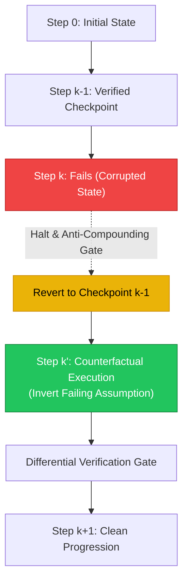

# Counterfactual Replay & Branch Repair Heuristics

> **Pattern Origin**: Absorbed from `shepherd-agents/shepherd` (§8 External Proposal Protocol).

This reference details the counterfactual branching and trajectory repair protocols used when an agent or multi-step execution encounters unexpected failures, avoiding compounded context degradation and cascading regressions.

---

## 1. The Compounding Error Failure Mode

In multi-step autonomous execution, a fatal anti-pattern is **Error Compounding**:
1. Step $k$ fails due to an incorrect assumption or failing assertion.
2. The agent attempts a hasty patch on top of the corrupted workspace at Step $k+1$.
3. The patch creates unintended side-effects, breaking adjacent modules.
4. The agent spends subsequent turns fighting cascading errors, saturating context tokens and corrupting git history.

---

## 2. The Counterfactual Replay Protocol

Instead of forward-patching on corrupted state, execute a **Counterfactual Branch Repair**:



### The 4-Step Replay Loop

1. **Halt & Capture Trace**:
   - Immediately stop execution when a command exits non-zero (`exitCode !== 0`) or an assertion fails.
   - Do NOT run speculative blind edits on the broken workspace.

2. **Revert Workspace to State $k-1$**:
   - Restore the last verified checkpoint:
     ```powershell
     node C:\Users\Luthfi\.gemini\scripts\step-checkpoint.js revert <checkpoint_k-1>
     ```
   - Verifies that git status and working tree return to clean green baseline.

3. **Invert the Tacit Counterfactual Assumption**:
   - Formulate the counterfactual hypothesis: *"If we had assumed $X'$ instead of $X$ at step $k$, would the contract hold?"*
   - Examples:
     - Assumption $X$: Route uses dynamic param `[id]`. Counterfactual $X'$: Route requires query string `?id=`.
     - Assumption $X$: Port `3000` is free. Counterfactual $X'$: Port is occupied, bind explicitly to alternate port.
     - Assumption $X$: Database schema enforces CASCADE. Counterfactual $X'$: Foreign key requires SET NULL.

4. **Re-Execute from Clean $k-1$ State**:
   - Apply the surgical mutation grounded in $X'$.
   - Run verification commands fresh.
   - On green pass, commit a new clean checkpoint ($k'$). The failed trajectory diff is discarded without context pollution.
