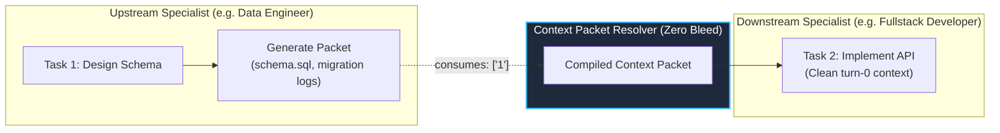

# Context Packet Architecture & Spec-Driven Development

> Grounded in the architectural absorption of `gsd-build/context-packet` and `gsd-build/get-shit-done` into Google Antigravity.

---

## 1. Context Packet Architecture (Zero Context Bleed)

A critical failure mode in multi-agent orchestration is **Context Bleed**—when downstream subagents inherit verbose transcripts, trial-and-error shell outputs, and debugging traces from upstream agents. This inflates token costs, saturates attention, and triggers context rot.

### Dual-Edge Topology: Execution vs Data Edges
Antigravity decomposes agent DAG edges into two orthogonal concepts:
1. **Execution Order Edge (`blockedBy` / `depends_on`)**: Defines temporal precedence. Task $B$ cannot enter `ready` state until Task $A$ is `completed`.
2. **Data Edge (`consumes`)**: Defines information flow. Task $B$ declares that it requires the *Context Packet* of Task $A$. Downstream Task $B$ receives only the verified deliverables and file paths, never Task $A$'s raw execution history.



### Context Packet File Structure
Packets are stored on disk under `C:\Users\Luthfi\.gemini\antigravity\tasks\<conversationId>\packets\<id>.json`:
```json
{
  "taskId": "1",
  "subject": "Design DB Schema",
  "assignedAgent": "data-engineer",
  "completedAt": "2026-11-11T06:24:14.974Z",
  "result": "Postgres tables created with composite indexes",
  "files": [
    "db/schema.sql",
    "db/migrations/001_init.sql"
  ]
}
```

---

## 2. Spec-Driven Lifecycle & Context Budget Discipline

Absorbed from `get-shit-done` (GSD v1), Antigravity enforces strict context budgeting during multi-turn projects:

### A. The 5-Step Lifecycle Loop
1. **Discuss**: Define scope, boundaries, non-goals, and architectural decisions before writing code.
2. **Plan**: Decompose the milestone into atomic, dependency-mapped DAG tasks (`task-dag create`).
3. **Execute**: Dispatch isolated subagents in waves. Each subagent operates on a compiled context packet in the **0–30% context sweet spot**.
4. **Verify**: Apply the *Iron Law of Verification* (`verification-before-completion`). Prohibit assumed fixes.
5. **Ship**: Consolidate diffs, run regression gates, and record state transitions.

### B. Context Budget Rule (0–30% Sweet Spot)
- Never allow an agent turn to accumulate >50% context before executing critical mutations.
- When an upstream task finishes, summarize its deliverables into a packet, terminate or reset the subagent, and start downstream work fresh.

---

## 3. Quad-Role Subagent Injection SOP

When orchestrating across Antigravity roles (`fullstack-developer`, `qa-engineer`, `data-engineer`, `security-engineer`):

1. **Register DAG with Data Edges**:
   ```bash
   task-dag create --subject "DB Schema" --agent "data-engineer"
   task-dag create --subject "API Endpoints" --blockedBy "1" --consumes "1" --agent "fullstack-developer"
   ```
2. **Produce Packet on Completion**:
   ```bash
   task-dag complete 1 --result "Schema defined with Zod contracts" --files "src/types/schema.ts"
   ```
3. **Inject Resolved Packet into Subagent Step 1**:
   ```bash
   task-dag packet 2 --out "temp/packet-2.md"
   # Subagent Step 1 receives temp/packet-2.md with zero upstream clutter
   ```
