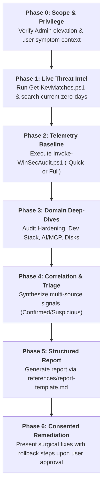

# Windows Security Audit

A methodical, evidence-first, read-only Windows security auditing system. Collects host telemetry, verifies OS hardening baselines, checks local developer and AI agent attack surfaces (MCP, LiteLLM), correlates software against live CVEs via CISA KEV, and outputs structured audit artifacts (`audit.json` and `findings.csv`).

## Core Principles

1. **Read-Only by Default**: Telemetry collection is strictly read-only and non-destructive. Remediation actions require explicit user approval per command (Phase 6).
2. **Behavior Over Static Names**: Malware mutates signatures continuously. Hunting focuses on behavioral mechanisms (persistence, unquoted service paths, IFEO hijacking, socket listeners, and user-writable execution paths) rather than static names (`references/threat-matrix.md`).
3. **Multi-Tiered Evidence**: Single anomalies rarely prove an infection. Findings are categorized into **Confirmed**, **Suspicious**, or **Informational**.
4. **Live Threat Intelligence**: Static CVE lists age rapidly. Always execute live correlation against CISA KEV and current-month Patch Tuesday zero-days (`references/threat-intel-sources.md`).
5. **AI Agent & MCP Surface Defense**: Audit local AI agent configurations (`claude_desktop_config.json`, `.cursor/mcp.json`, LiteLLM port 4000, Ollama port 11434) for unpinned packages, cleartext secrets, and broad network bindings (`references/dev-stack-and-ai.md`).

---

## Operating Modes

- **Mode A (Direct Shell Access)**: Execute PowerShell collectors directly via `run_command`.
- **Mode B (Assisted Offline Mode)**: Provide the PowerShell audit script command for the user to run elevated, then ingest the exported `findings.csv` and `audit.json` for analysis and reporting.

---

## Standard 6-Phase Audit Workflow



### Phase 0: Scope & Privilege Assessment
- Check elevation: Running as Administrator is required to inspect BitLocker volumes, Defender exclusions, SMB configuration, and Security EventLogs.
- Document user context: Are there active symptoms (high CPU, fan noise, suspicious pop-ups, leaked tokens)? Active symptoms prioritize Phase 4 triage.

### Phase 1: Live Threat Intelligence & KEV Refresh
- Run `scripts/Get-KevMatches.ps1` to correlate locally installed software against the official CISA KEV feed:
  ```powershell
  powershell -ExecutionPolicy Bypass -File scripts\Get-KevMatches.ps1
  ```
- Cross-reference with current-month Patch Tuesday zero-days and Chromium V8 advisories (`references/threat-intel-sources.md`).

### Phase 2: Telemetry Baseline Collection
Execute the read-only PowerShell collector:
```powershell
# Full deep audit (includes Authenticode signature verification & 5s CPU sampling)
powershell -ExecutionPolicy Bypass -File scripts\Invoke-WinSecAudit.ps1 -OutDir "C:\path\to\output"

# Fast audit (<10 seconds, skips slow signature loops)
powershell -ExecutionPolicy Bypass -File scripts\Invoke-WinSecAudit.ps1 -Quick -OutDir "C:\path\to\output"

# Audit with web project scanning for webshells and exposed .env files
powershell -ExecutionPolicy Bypass -File scripts\Invoke-WinSecAudit.ps1 -Quick -WebRoot "C:\xampp\htdocs","D:\projects"
```
The script writes two machine-readable artifacts:
- `audit.json`: Complete raw configuration and process telemetry.
- `findings.csv`: Categorized findings with severity, area, evidence, and remediation advice.

### Phase 3: Domain Deep-Dive References
Consult dedicated references based on audit scope:
- **OS Hardening & Protection**: `references/windows-hardening.md` (HVCI, LSA Protection, CFA, 10 Core ASR rules).
- **Behavioral Threat Hunting**: `references/threat-matrix.md` (IoCs for Trojans, RATs, Cryptojackers, LOLBins).
- **Developer Stack & AI / MCP Security**: `references/dev-stack-and-ai.md` (PHP, Node, Next.js, Cursor/Claude MCP, Ollama/LiteLLM ports).
- **Disk, Boot & Partitions**: `references/windows-hardening.md` (GPT/UEFI, SMART counters, WinRE, BitLocker).

### Phase 4: Correlation & Triage
- Correlate signals across domains (e.g. Unsigned binary in `%TEMP%` + persistent Run key + outbound connection to foreign IP).
- Identify common development false positives (Docker, Node, Laragon opening local dev ports).

### Phase 5: Structured Report Delivery
- Format findings adhering strictly to `references/report-template.md`.
- Group by severity: **Critical**, **High**, **Medium**, **Low**, and **Info**.
- Always mask plaintext secrets and credentials.

### Phase 6: Consented Remediation
- Present exact PowerShell remediation commands alongside reversible rollback procedures.
- **Never modify configurations or delete files without explicit confirmation per action.**
